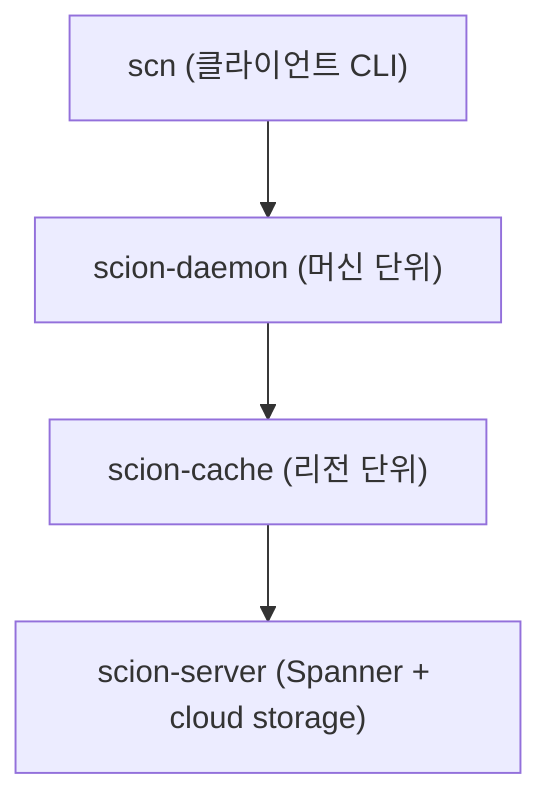

title: Anthropic이 Git을 Scion으로 바꾼 이유: 에이전트 규모에서 다시 쓴 버전 제어
slug: anthropic-scion-source-control
category: 리서치
summary: Anthropic 엔지니어링 블로그 원문을 토대로 하루 머지 3만 건을 넘기며 Git을 떠난 배경, Scion의 데이터 모델과 계층 캐시, 성과 수치를 정리하고 일반 팀에 남는 교훈을 짚는다.
tags: scion,git,source-control,monorepo,anthropic,agent-scale,version-control,research
toc: true
publishedAt: 2026-10-14T03:00:00Z
updatedAt: 2026-10-22T03:00:00Z
syncHash: 6efbb9227485fdc592af574494975e6c2db59476c98b9706b220032923df690e

---

> 이 글은 2026년 10월 14일 기준으로 Anthropic 엔지니어링 블로그 원문을 바탕으로 정리했다. 원문에 나온 수치는 전부 Anthropic의 자체 보고이며, 독립적으로 검증한 수치가 아니다.

에이전트에 git worktree와 pull request를 어떻게 쓰는지 정리하는 글을 쓰면서, 나는 늘 같은 전제를 깔고 있었다. Git의 모델은 맞고, 고쳐야 할 것은 Git 위를 쓰는 방법뿐이라는 전제. 에이전트가 병렬로 작업하고, 컨플릭트나 PR 리뷰가 병목이 되는 것은 Git 사용법의 문제이지 Git 자체의 결함은 아니라는 식으로.

2026년 10월 13일, 그 전제를 가장 정면으로 건드리는 글이 나왔다. Anthropic 엔지니어링 블로그가 내부 버전 제어 시스템 Scion을 공개한 것이다. Git을 "더 잘 쓰는" 법이 아니라, 회사 전체의 단일 저장소를 Git에서 Scion으로 옮긴 이야기. 5개월, 7명의 엔지니어, 그리고 하루 머지가 2,500건에서 30,000건 넘게로 뛴 배경.

이 글은 원문을 토대로 Scion이 무엇을, 왜, 어떻게 만들었는지 정리한다. 그리고 마지막에, 이 글이 일반 팀에 남기는 것이 무엇인지 따로 짚는다.

## 5개월, 7명, 그리고 단일 저장소 전체의 Git 교체

발표에서 확인되는 사실을 먼저 나열한다.

- 2026년 5월부터 5개월 동안, Anthropic의 단일 저장소(monorepo) 전체를 Git에서 Scion으로 마이그레이션했다.
- 7명의 엔지니어가 이 작업을 이끌었다.
- 같은 기간 만든 시스템은 Scion 하나에 그치지 않는다. 코드 리뷰 시스템 Antique를 함께 만들었고, 그 밖에 코드 검색과 소스 제어 IAM을 포함한 관련 시스템이 여섯 개 남짓이다.

여기서 주목할 점은 단일 툴 하나가 아니라 스택 전체를 다시 썼다는 사실이다. 버전 제어, 리뷰, 검색, 권한까지 한 세트로 교체했다. Git이 제공하던 것을 기능 단위로 하나씩 흉내 낸 것이 아니라, "에이전트가 사는 환경"을 전제로 스택 전체를 다시 설계했다는 것이다.

그리고 발표에서 가장 중요한 한 문장이 있다. Scion은 일반적인 Git 대안으로 나온 것이 아니라는 명시적 고지. 이 문장은 결론 부분에서 다시 나온다.

## 하루 머지가 30,000건을 넘으면서 Git의 전제가 무너졌다

Scion 개발의 출발점은 도구 선정이 아니라 수치였다.

| 지점 | 수치 (Anthropic 자체 보고) |
|---|---|
| 하루 머지 건수 (2026년 5월) | 약 2,500건 |
| 하루 머지 건수 (2026년 9월) | 30,000건 이상 |
| 단일 저장소 main 분기 역사 | 약 100GB |
| 압축된 워킹 트리 | 25GB 이상 |
| 하루 체크아웃 횟수 | 약 2,500만 회 |
| 모든 체크아웃이 신선한 clone이라면 필요한 네트워크 트래픽 | 하루 600PB 이상 |

4개월 만에 10배가 넘는 머지 증가의 주체는 사람보다 에이전트다. Claude Code 같은 에이전트가 병렬로 작업하고 머지를 요청하면서, 머지 처리량이 사람 중심 설계의 한계를 넘은 것이다.

여기서 결정적인 수치는 마지막이다. 저장소가 커질수록 새 clone의 비용이 크고, 에이전트마다 독립적인 워킹 트리를 요구하면, Git이 기본적으로 전제하는 "clone을 받아서 로컬에서 일한다"는 모델의 네트워크 비용이 하루 600PB를 넘는다는 계산. 이 수치는 실현 가능하지 않다.

즉 병목은 로컬 git 명령의 속도가 아니다. clone과 체크아웃 트래픽, 그리고 그 트래픽을 감당하는 인프라다. Git의 로컬 명령은 여전히 빠르지만, 그 "로컬"을 채우는 것 자체가 불가능해졌다. Scion의 모든 설계는 이 지점부터 시작한다.

## Git이 숨기고 있던 전제 6가지를 드러내 놓고 뒤집었다

원문은 Scion의 설계 원칙 6가지를 명시한다. Git의 기본 동작과 나란히 놓으면, Git이 "상식"으로 숨기고 있던 전제들이 드러난다.

| 설계 원칙 | Git의 기본 동작 | Scion (원문 기준) |
|---|---|---|
| 클라이언트 연결 | 오프라인에서 작업하고 준비되면 push | 클라이언트는 항상 온라인이고, 모든 조작은 즉시 서버 호출 |
| 작업 분배 | 클라이언트가 완전한 clone을 갖고 대부분의 처리를 로컬에서 완료 | 클라이언트는 얇은 shell에 제한된 캐시만 갖고, 서버가 무겁게 |
| 서비스 범위 | log, diff, merge 등 로컬 커맨드가 프로세스 안에서 실행 | 포괄적인 소스 제어 서비스로 만들어, 쿼리 API 위에 여러 응용을 올린다 |
| 확장성 | 클론 하나가 확장 단위 | 서버·캐시·데몬이 모두 수평으로 확장 |
| 커밋 | 로컬에 append하고, 충돌은 pull-rebase로 해결 | 저렴하고 증분적이며 lock-free. changeset은 write-ahead log의 항목이다 |
| 워킹 트리 | 완전한 트리 체크아웃이 시작점 | 워킹 트리는 선택적이며 sparse, 에이전트는 전체 체크아웃 없이 동작 |

(Git 열은 원문이 아니라 내 요약이고, Scion 열은 원문 기술이다.)

여섯 개를 따로따로 보면 각각 합리적인 설계 결정이다. 그러나 합치면 하나의 일관된 스탠스가 된다. 개발 머신도, 에이전트도 항상 연결된 얇은 클라이언트이고, 지능과 상태는 서버에 둔다는 것. Git은 "클라이언트가 스마트하고 서버는 바보"인 반면, Scion은 그 비대칭을 정반대로 뒤집는다.

## 트리 스냅샷 대신 변경 파일 목록을 저장한다

두 번째 결정은 데이터 모델이다.

Git의 커밋은 포인터 3개(트리, 부모, 메타데이터)로 구성되고, 그 트리는 저장소의 모든 파일의 스냅샷이다. 저장소가 100GB면, 새 커밋 하나당 그 전체 구조의 포인터를 적는다. 커밋 비용이 저장소 크기에 비례하는 모델이다.

Scion의 기본 단위인 changeset은 다르다.

```text
changeset (개념도, 원문 서술에 따른 정리)
  first parent   → 이전 changeset
  changed files  → 이번 커밋에서 바뀐 파일 목록
  blobs          → 바뀐 파일들의 content-addressed 포인터
```

커밋 비용이 저장소 크기가 아니라 변경량에 비례한다. 트리와 diff, 히스토리는 전부 파생 데이터로, 서버가 필요할 때 유도한다.

이 아이디어 자체가 새 것은 아니다. Google의 Piper, Meta의 Sapling/Mononoke(Bonsai)가 같은 계열의 diff-centric changeset을 이미 쓰거나 써 왔다. 원문도 이 계보를 인정한다. 흥미로운 것은 Anthropic이 존재하는 것을 채택하지 않고 in-house로 다시 만들었다는 점이다. 공개된 개체를 쓰되, 자기 에이전트 워크로드에 맞춰 캐싱·서버·API 계층을 통째로 재설계한 것이다.

## 체크아웃을 계층 캐시로 설계했다

하루 600PB 문제를 푸는 방법은 캐싱이다. 다만 단순한 1단계 캐시가 아니라, 클라이언트 아래에 같은 요청에 응답하는 계층 세 개를 둔 구조다.



클라이언트는 어떤 계층이 응답하는지 모른다. 같은 요청을 보내면 가장 가까운 계층에서 응답되고, 없으면 다음 계층으로 내려간다. Git에서 "clone"은 원본 저장소에서 트리를 전부 받는 동작이지만, Scion에서 체크아웃은 "내가 필요한 파일 blob을 캐시 계층에서 끌어오는" 동작으로 바뀐다.

원문이 보고하는 성과는 다음과 같다. 전부 Anthropic의 자체 보고다.

| 지표 | Git (이전) | Scion (이후) |
|---|---|---|
| 체크아웃 소요 | 분 단위 | 초 단위 (두 자릿수 배, 약 100배 단축) |
| 서빙 인프라 (CPU/메모리) | 기존 git 미러링 인프라 | 약 200분의 1 |
| 캐시 hit rate | — | 계층마다 99% 이상 |
| CI CPU 용량 | baseline | 약 25% 절감 |

체크아웃이 100배 이상 빨라졌다는 것은, 에이전트가 "저장소를 기다리는" 시간이 사실상 사라졌다는 뜻이다. CI 절감 25%도 같은 원인(체크아웃 비용)에서 온다. 이 수치들은 독립 검증할 수 없으나, 방향성(클라이언트 얇게·서버 무겁게·캐시 계층화)과 일관된다.

## 7명이 5개월로 6개 시스템을 만든 데에는 이유가 있다

7명이 5개월에 버전 제어·리뷰·검색·IAM까지 6개 시스템을 만들고 단일 저장소 전체를 마이그레이션한 속도는, 원문에 따르면 Claude의 기여를 빼고 설명하기 어렵다.

- Claude Mythos Preview가 ingest 파이프라인을 다시 작성했고, 메모리는 20분의 1로 줄고 속도는 4배 빨라졌다.
- 팀은 Slack 채널로 일을 받는 Claude들을 "superfan"이라고 부르며, 각 컴포넌트를 지켜보게 한다. 팀이 Claude Tag를 많이 쓴다는 언급도 있다.
- 엔지니어의 리뷰 대상이 라인 단위가 아니라 의도 수준으로 이동했다.

원문은 Claude를 throughput의 공헌자로 서술한다. 다만 이 글에서 짚어둘 것은, 이 수치(20분의 1, 4배)도 Anthropic 자체 보고라는 점이다. Claude의 기여와 Scion 설계 자체의 기여를 분리한 분석은 원문에 없다. "7명 5개월"을 읽을 때, 그 속도가 모델 성능에 얼마나 의존하는지는 여전히 안개 속이다.

## 에이전트 규모에서 "머지 전에 검증"의 전제가 흔들린다

세 번째로 흔들리는 전제는 CI/머지 큐다.

Git 워크플로우의 기본은 "머지 전에 검증"이다. PR이 열리면 CI가 통과해야 하고, 머지 큐는 순차적으로 머지를 검증한다. 이 모델은 하루 수십에서 수백 건의 머지에서는 성립한다. 30,000건에서는 성립하지 않는다. 저장소 전체에 락을 걸고 순차 검증하는 구조는 에이전트 규모에서 병목 그 자체가 된다.

원문이 밝힌 대응은 두 가지다.

1. 커밋을 저렴하고 증분적이며 lock-free로 만든다. changeset은 write-ahead log에 쌓이는 항목이라, 저장소 전체를 잠그지 않고 들어온다.
2. 전역 머지 큐의 락을 그대로 재현할 수 없었으므로, 검증 투자를 머지 후·배포 전 자동 테스트로 옮겼다.

여기에 Claude가 컨플릭트를 사람이 인식하는 것보다 빨리 찾아서 해결한다는 관찰이 더해진다. 병목이 "컨플릭트를 푸는 속도"에서 "머지된 상태가 맞는지를 검증하는 속도"로 이동하는 것이다.

이 섹션은 Scion을 쓰지 않는 우리에게도 그대로 적용된다. 에이전트가 머지를 늘리는 레포에서, "머지 전에 무엇을 검증할 것인가"보다 "머지 후 어떤 검증을 배포 직전까지 미룰 수 있는가"가 더 중요한 질문이 됐다.

## Scion은 Git 대안으로 나온 것이 아니다

원문은 명확하다. Scion은 일반적인 Git 대안이 "절대 아니다"(by no means a suitable replacement for git).

Scion이 전제하는 조건을 나열하면, 이 말이 왜 필요한지 보인다.

- 거대한 단일 저장소 (약 100GB 역사, 25GB 워킹 트리)
- 항상 온라인인 개발 머신과 에이전트 스웜
- 전용 인프라 팀 (Spanner, object storage, 리전 단위 캐시 운영)

이 3가지가 하나라도 빠지면 Scion은 성립하지 않는다. 오프라인 작업이 필요한 팀, 분산된 여러 저장소를 쓰는 팀, 전용 서버 인프라를 둘 수 없는 팀에는 Scion의 전제가 맞지 않는다.

그러나 일반 팀이 이 발표에서 가져갈 수 있는 것은 4가지가 있다.

1. 체크아웃을 캐싱 문제로 바라본다. Git을 그대로 쓰더라도 partial clone, mirror, 리전 캐시는 같은 방향의 완화책이다.
2. 검증을 클라이언트에서 서버로 옮긴다. 로컬에서 완벽하게 확인하던 것을, 서버 쪽에서 증분적으로 확인하도록 워크플로우를 바꾼다.
3. 커밋 비용을 변경량에 비례하도록 만든다. 저장소가 커질수록 커밋·diff가 느려지는 레포는, Scion의 changeset이 답인 것은 아니어도, 최소한 그 원인(트리 스냅샷)을 의식해야 한다.
4. 에이전트 규모에서 머지 큐와 CI 용량을 재설계한다. 순차 검증의 전제가 깨지는 시점이 가까워지면, "머지 후 검증"으로 무게중심을 옮기는 것이 해다.

대부분 팀에게 맞는 해는 Git을 대체하는 것이 아니라, Git의 서버 쪽을 재설계하는 것이다. Scion은 그 선의 최단점이다.

## 정리

Scion의 의의는 "Git을 이겼다"가 아니라, Git의 전제에 상한이 있다는 것을 숫자로 보여줬다는 점이다. clone이 상식이고, 로컬이 스마트하고, 머지 전에 검증한다는 세 전제는 모두 특정 규모 이하에서만 성립한다. 에이전트 규모에서 그 상한이 왔고, Anthropic은 시스템의 무게중심을 서버로 옮겨 다시 세웠다.

이 글에서 확인하지 못한 것을 분명히 한다.

- 성과 수치 전부(100배 단축, 1/200, 99%, 25%)는 Anthropic 자체 보고이고, 독립 검증하지 못했다.
- Scion은 비공개 내부 도구라, 직접 동작을 확인한 것이 아니다.
- 원문은 설계 논의 중심으로 쓰고, 운영 실패 사례나 용량 운영의 상세는 다루지 않는다.
- 일반 팀에 대한 4가지 교훈은 내 추론이며, 원문의 주장은 아니다.

원문: [Redesigning source control at Anthropic](https://www.anthropic.com/engineering/redesigning-source-control) (Anthropic Engineering, Nick G.와 소스 제어 팀, 2026년 10월 13일 게시)

## 10월 22일 수정: 원문 갱신과 출처 논쟁

- **원문이 10월 15일에 갱신됐다.** Scion의 기법을 먼저 시도한 프로젝트들에 대한 설명이 보강됐다. 발표 직후 "Mononoke의 derived data 같은 선행 작업을 충분히 밝히지 않았다"는 비판이 나왔고([braindetox의 비판 정리](https://braindetox.kr/en/posts/anthropic_scion_mononoke_derived_data_critique_2026.html)), 갱신은 그 뒤에 이뤄졌다. 지금 원문은 Google Piper와 Meta Sapling을 명시하고, Mononoke가 Sapling의 서버 구성 요소라고 적는다.
- **이 글의 수치를 원문과 다시 대조했다.** 캐시 구조를 "클라이언트 아래 세 계층"으로, 머지 설명을 "커밋은 lock-free, 검증은 머지 후·배포 전으로 이동"으로 바로잡았다. 원문에는 "머지 자체가 lock-free WAL append"라는 표현이 없다.

### 비슷한 시스템과 나란히 놓으면

Scion이 처음 나온 형태는 아니다. 대형 단일 저장소를 가진 회사들은 이미 서버 중심 구조로 갔다. 아래 비교는 [HackerNoon의 10월 14일 분석](https://hackernoon.com/ai-agents-are-killing-the-git-client-not-git-what-anthropics-scion-and-cursors-origin-show)을 옮긴 것이다.

| | Git | Piper (Google) | Sapling (Meta) | Scion (Anthropic) | Origin (Cursor) |
|---|---|---|---|---|---|
| 구조 | 분산, 전체 복제 | 중앙 서버 + 가상 파일 시스템 | 중앙 Rust 서버(Mononoke) + EdenFS | 서버의 changeset 로그 + 3계층 캐시 | Git 호환 호스팅 + 에이전트·머지 기능 |
| 클라이언트 | 사람, 오프라인 가능 | 가상 체크아웃 | Git 호환 클라이언트 | 항상 온라인, 일은 서버가 한다 | 표준 Git + 클라우드 에이전트 |
| 공개 여부 | 오픈소스 | 내부 전용 | 클라이언트만 오픈소스 | 설계만 공개 | 초기 베타 |

같은 글의 결론은 "에이전트가 죽이는 것은 Git이 아니라 Git 클라이언트"다. 형식은 Git 호환으로 남고, 계산은 서버로 옮겨 간다는 뜻이다.

### 커뮤니티 반응

- **오프라인을 버린 이유**: Hacker News에서 Scion 엔지니어가 "Scion의 가장 큰 사용자는 Claude이고, Claude는 원래 온라인이라 오프라인 지원은 중요하지 않았다"고 답했다는 보도가 있다([pasqualepillitteri.it](https://pasqualepillitteri.it/en/news/23527/anthropic-unveils-scion-source-control-replaces-git)). Subversion 같은 중앙형 시스템으로 돌아간 것이라는 평도 함께 나왔다. 원 댓글은 직접 확인하지 못했다.
- **대부분의 팀에는 필요 없다**: [Arize의 Laurie Voss](https://arize.com/blog/anthropic-scion-vs-git/)는 Scion이 "그만큼 큰 단일 저장소가 있을 때만 필요하다"고 정리했다. 리뷰가 병목인 팀은 리뷰부터 고치고, 푸시가 많은 팀은 Git 호스팅을 손보면 된다는 것이다. 이미 GitHub도 에이전트 규모의 푸시에 맞춰 Git 인프라를 다시 짓고 있다고 적었다.
- **제목이 과장됐다는 지적**: "AI가 코드를 너무 많이 써서 Git을 버렸다"는 식의 제목에 대해, 일반 팀의 Git은 여전히 잘 동작하고 Anthropic도 모든 저장소를 옮겼다고 하지 않았다는 반박이 나왔다.
