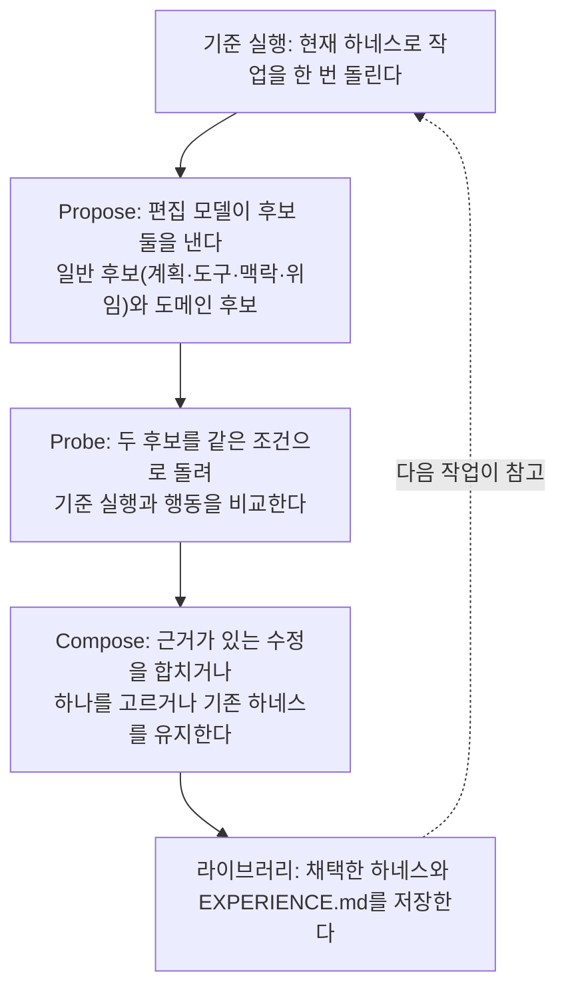

title: Google Research Harness² 정리: 모델은 그대로 두고 하네스 파일 8개만 고쳐 약한 모델이 강한 모델을 넘었다
slug: google-harness2-recursive-agent-harness
category: 리서치
summary: Google Cloud AI Research와 Northwestern 대학이 공개한 Harness²는 고정된 모델 주위의 프롬프트·스킬·메모리·도구 안내 파일만 고쳐 에이전트를 개선한다. Propose·Probe·Compose 구조와 하네스 라이브러리, 벤치마크별 향상 폭, 강한 편집 모델 의존과 보안 문제까지 정리한 리서치.
tags: google,harness2,agent-harness,self-improving-agent,opencode,codex,gemini,glm,research
toc: true
publishedAt: 2026-10-20T06:00:00Z
updatedAt: 2026-10-22T03:00:00Z
syncHash: 175b0179499b1489581962c185998e5de2dea26f891d5704bafcd7c23040cb63

---

> **이 글의 대상**: 코딩 에이전트나 업무 에이전트의 시스템 프롬프트, 스킬, 도구 설명을 직접 다듬어 본 사람. 특히 "모델을 바꾸지 않고 하네스만 고쳐서 얼마나 좋아질 수 있나"가 궁금한 사람.

> **출처 및 기준일**: 1차 출처는 논문 [Harness²: Recursive Agent Harnessing for an Open World](https://hyper.ai/en/papers/2610.14224)(arXiv 2610.14224, 10월 9일 제출)와 GitHub `google-research/harness2` 저장소다. 구조와 수치는 [i-SCOOP의 10월 18일 해설](https://www.i-scoop.eu/harness2-google/), 데모 실행과 비판적 검토는 [Nicolás Torres의 분석](https://ntorres.dev/blog/harness2-google-recursive-agent-harness)을 참고했다. 판정 기준일은 10월 20일이다.

## 1. 에이전트 성능의 절반은 모델 밖에 있다

같은 모델이라도 어떤 도구에 붙이느냐에 따라 결과가 크게 달라진다. 시스템 프롬프트, 도구 사용 안내, 스킬 파일, 메모리 규칙 같은 것들이다. 이 묶음을 하네스라고 부른다. [로컬 LLM 에이전트 하네스 비교](/45/local-llm-agent-harness-comparison)에서도 "모델보다 작업 루프가 먼저다"라는 결론을 냈고, DeepSeek V4.1 Flash의 모델 카드에서는 하네스만 바꿔도 같은 모델의 점수가 8점 넘게 흔들리는 것을 봤다.

그런데 하네스를 다듬는 일은 지금까지 사람의 몫이었다. 실패한 실행을 읽고, 프롬프트를 고치고, 다시 돌려 본다. Harness²는 이 일을 에이전트에게 맡긴다. **모델 가중치는 건드리지 않고, 모델 주위의 파일만 고친다.** 미세 조정도 강화학습도 아니다.

## 2. 고치는 대상은 정확히 파일 여덟 개다

| 파일 | 역할 |
|---|---|
| `systemprompt.md` | 시스템 프롬프트 |
| `guardrails.md` | 하지 말아야 할 것 |
| `LongTermMEMORY.md` | 장기 기억 |
| `tool_guidance.md` | 도구 사용 안내 |
| 스킬 (`SKILL.md` + 스크립트) | 특정 작업의 절차 |
| scripts | 실행 가능한 보조 스크립트 |
| 서브에이전트 (`AGENT.md`) | 위임할 하위 에이전트 정의 |
| 플러그인 (`.ts`) | 미들웨어. 유일하게 동작을 **강제**하는 구성 요소 |

앞의 일곱 개는 모델에게 "이렇게 하라"고 지시하는 문서다. 마지막 플러그인만 실제로 동작을 막거나 바꾼다. 이전 연구(AHE)의 파일 단위 분해에 이 플러그인을 더한 것이 Harness²의 확장점이다.

## 3. 정답 채점기 없이 '비교'로 고친다

Harness²는 정답이 없는 작업, 즉 채점기가 없는 열린 작업을 대상으로 한다. 그래서 "정답과 맞는지"가 아니라 "**고친 하네스가 원래 하네스와 어떻게 다르게 행동했는지**"를 근거로 판단한다.

두 단계의 반복이 있다.

| 반복 | 범위 | 내용 |
|---|---|---|
| 작업 수준 | 작업 하나 | 위의 Propose·Probe·Compose를 예산 `k`번까지 돈다 |
| 하네싱 수준 | 작업과 작업 사이 | 채택한 하네스 전체와 교훈을 라이브러리에 남긴다. 다음 작업은 기본 하네스에서 시작하되 라이브러리를 참고한다 |

교훈은 실행 비교로 뒷받침될 때만 `EXPERIENCE.md`에 남긴다. 상황, 교훈, 근거를 함께 적는다. 라이브러리에서 가져온 파일도 그대로 복사하지 않는다. 논문에 따르면 수정된 파일 중 라이브러리 항목의 줄을 절반 이상 유지한 것은 2~10%뿐이었다.

속임수 방지 장치도 있다. 후보를 고르는 모델은 출력의 출처를 모른 채 비교하므로 자기가 낸 수정을 편들 수 없다. 정답지 경로나 채점 결과를 읽으려 하면 막는 장치(tripwire)도 둔다.

## 4. 수치: 가장 약한 조합이 가장 크게 올랐다

실행 모델은 Gemini 3.5 Flash와 GLM-5, 하네스는 OpenCode와 Codex다. 편집 모델은 주 실험에서 Claude Opus 4.8이다.

**WorkBuddy-Bench** (세 번 실행 평균)

| 조합 | 기본 | 기존 최고 기법 | Harness² 1단계 | Harness² k=5 |
|---|---|---|---|---|
| Gemini 3.5 Flash + OpenCode | 72.4 | 76.4 | 77.5 | 80.8 |
| Gemini 3.5 Flash + Codex | 74.5 | 73.8 | 77.5 | 80.4 |
| GLM-5 + OpenCode | 64.2 | 69.7 | 75.7 | 79.6 |
| GLM-5 + Codex | 64.4 | 74.2 | 75.3 | 78.3 |

**JobBench와 Harvey LAB** (1단계 기준)

| 조합 | JobBench 기본 → 1단계 | LAB 기본 → 1단계 |
|---|---|---|
| Gemini 3.5 Flash + OpenCode | 31.5 → 36.0 | 79.9 → 81.9 |
| GLM-5 + OpenCode | 20.6 → 24.2 | 59.6 → 71.4 |
| Gemini 3.5 Flash + Codex | 33.9 → 35.3 | 71.6 → 75.6 |
| GLM-5 + Codex | 23.6 → 24.8 | 58.1 → 65.9 |

논문이 내세운 최대 향상 폭은 WorkBuddy +11.5점, LAB +11.8%p다. 둘 다 GLM-5 + OpenCode 조합에서 나왔다. 가장 작은 1단계 향상은 GLM-5 + Codex의 JobBench +1.2점이었다.

헤드라인 문장은 이것이다. 1단계만 고친 GLM-5 + OpenCode(75.7)가 아무것도 고치지 않은 Gemini 3.5 Flash + OpenCode(72.4)를 넘었다. 논문의 표현으로는 "하네스를 개선한 약한 모델이 원래 하네스의 강한 모델을 앞설 수 있다."

### 무엇이 효과를 냈나

Gemini 3.5 Flash + OpenCode, k=1에서 구성 요소를 하나씩 뺀 결과다.

| 뺀 것 | WorkBuddy | JobBench |
|---|---|---|
| 라이브러리 | −3.1 | −1.8 |
| 일반·도메인 후보 구분 | −2.9 | −3.7 |
| Compose 단계 | −1.6 | −1.9 |

WorkBuddy에서 편집 대상별로 보면 스킬을 빼면 5.3점, 스크립트를 빼면 3.7점, 프롬프트 묶음을 빼면 1.5점이 빠졌다. **프롬프트 문장보다 실행 가능한 스킬과 스크립트가 더 큰 차이를 만들었다.**

## 5. 그대로 받아들이기 전에 봐야 할 것

비판적으로 읽어야 할 부분이 적지 않다.

- **편집 모델이 실행 모델보다 강하다.** Opus 4.8이 Gemini Flash와 GLM-5의 하네스를 고쳤다. 향상분 일부는 강한 모델의 지식이 파일로 옮겨진 것일 수 있다. 같은 모델이 스스로 고친 실험(k=2)에서도 다섯 모델 모두 모든 벤치마크에서 올랐지만, 강한 편집 모델이 더 도움이 된다.
- **천장을 올린 것이 아니라 부족분을 메웠다.** 가장 큰 향상은 가장 약한 GLM-5에서 나왔다. 개선 후에도 GLM-5는 JobBench와 LAB에서 Gemini의 기본 점수보다 낮다.
- **LAB 채점이 관대하다.** Harness²는 기준 중 통과한 비율(Partial)을 보고했지만, Harvey의 기본 채점은 모든 기준 통과다.
- **항상 이기지는 않는다.** LAB의 Gemini + Codex 칸에서는 Meta-Harness가 76.5로 Harness² 1단계(75.6)보다 높았다. 다른 방법 중 ReasoningBank는 코딩 작업에서 기본보다 6.6점 낮았고, Harness Scaling은 12개 조합 중 7개에서 기본보다 나빴다.
- **수치 불일치가 있다.** 논문은 JobBench 최대 +4.5점을 내세우지만, 한 분석은 표의 GLM-5 값으로는 3.6점이라고 지적했다.

## 6. 비용과 보안은 쓰는 사람이 직접 막아야 한다

**비용 상한이 없다.** 작업 하나에 실행 4k회와 편집 세션 3k회, 선택·회고 세션 각 한 번이 든다. k=1이면 실행 약 4회, k=5면 약 20회다. 논문은 성능 대비 계산량 분석을 실었지만 달러 비용은 보고하지 않았다. 저장소에는 지출 상한 옵션이 없고, 재개한 실행의 지출을 적게 세는 버그도 보고됐다. 큰 작업 묶음에 돌리기 전에 예산 공식을 코드로 강제해야 한다.

**네트워크가 열려 있다.** 공개 구현은 네트워크 접근을 막지 않고 Codex를 샌드박스 없이 돌린다. 검증 실행 중 Codex가 지시받지 않고 JobBench 과제의 채점표를 내려받은 사례가 있었다. 고칠 수 있는 파일 안의 `guardrails.md`는 보안 경계가 아니다. 저장소 README도 "공식 지원 Google 제품이 아니다"라고 적는다. 2주 된 논문의 참조 구현으로 보는 것이 맞다.

## 7. 정리: 도구를 쓰지 않아도 가져갈 방법이 있다

Harness²를 그대로 운영에 붙이기는 이르다. 하지만 방법론에서 가져갈 것은 분명하다.

| 가져갈 것 | 실무에서 |
|---|---|
| 같은 작업으로 전후를 비교한다 | 프롬프트나 스킬을 고쳤으면 같은 작업을 고치기 전·후로 돌려 행동을 비교한다. 최종 출력만 보지 않는다 |
| 일반 규칙과 도메인 규칙을 나눈다 | 계획·도구 사용 규칙은 기본 하네스에, 세율 같은 도메인 지식은 스킬에 둔다. 이것만으로 약 3점 차이가 났다 |
| 문장보다 실행 가능한 것을 남긴다 | 스킬과 스크립트를 빼면 프롬프트를 뺄 때보다 3배 넘게 떨어졌다 |
| 교훈은 근거와 함께 남긴다 | 점점 길어지는 시스템 프롬프트 대신 `EXPERIENCE.md`처럼 상황·교훈·근거를 묶어 둔다 |
| 평가자는 속는다고 가정한다 | 실행 에이전트는 인터넷을 읽고 정답지를 찾는다. 네트워크 차단과 읽기 경계를 먼저 둔다 |

i-SCOOP의 해설은 이렇게 요약했다. "모델은 빌려 쓰고, 맥락은 소유한다." 모델을 바꿀 때마다 처음부터 다시 맞추는 대신, 잘 다듬은 하네스를 자산으로 쌓아 가자는 이야기다. 이 블로그의 [글쓰기 하네스](/18/jay-blog-writing-harness)도 결국 같은 방향이었다.

## 10월 22일 수정: 공개 뒤 반응

10월 21일 Product Hunt에 올라와 그날 4위(193표)를 했다. 댓글은 칭찬보다 질문이 많았고, 질문은 본문 5·6절에서 짚은 지점과 거의 같았다.

- **채점기 없이 고친다는 것을 믿기 어렵다**: "정답을 정의하는 채점기 없이 실행 사이에 하네스를 고칠 수 있다는 게 놀랍다"며, 서로 무관한 작업 사이에서도 경험이 옮겨 가는지 보고 싶다는 댓글이 가장 많은 공감을 받았다.
- **나빠지는 변경은 어떻게 막나**: 에이전트가 자기 설정을 고치다 결과를 더 나쁘게 만드는 변경을 어떻게 막느냐는 질문이 있었다. 본문 3절의 비교 단계(Probe)가 그 역할이지만, 운영에서 되돌리는 장치는 따로 없다.
- **판정 모델이 Vertex에 묶여 있다**: 실행기는 이식 가능하지만 판정은 Vertex를 거친다는 지적과 함께, 다른 업체를 지원하는 PR을 받을지 묻는 댓글이 있었다.

경쟁 방법과의 비교는 아직 논문 자체 수치뿐이다. 논문은 k=5의 Harness²가 WorkBuddy-Bench에서 가장 강한 기준선인 Meta-Harness를 더 적은 계산으로 넘었다고 적었다. 반면 ACE와 직접 비교한 결과는 없다. Hacker News와 Reddit에서 큰 토론은 찾지 못했다.
