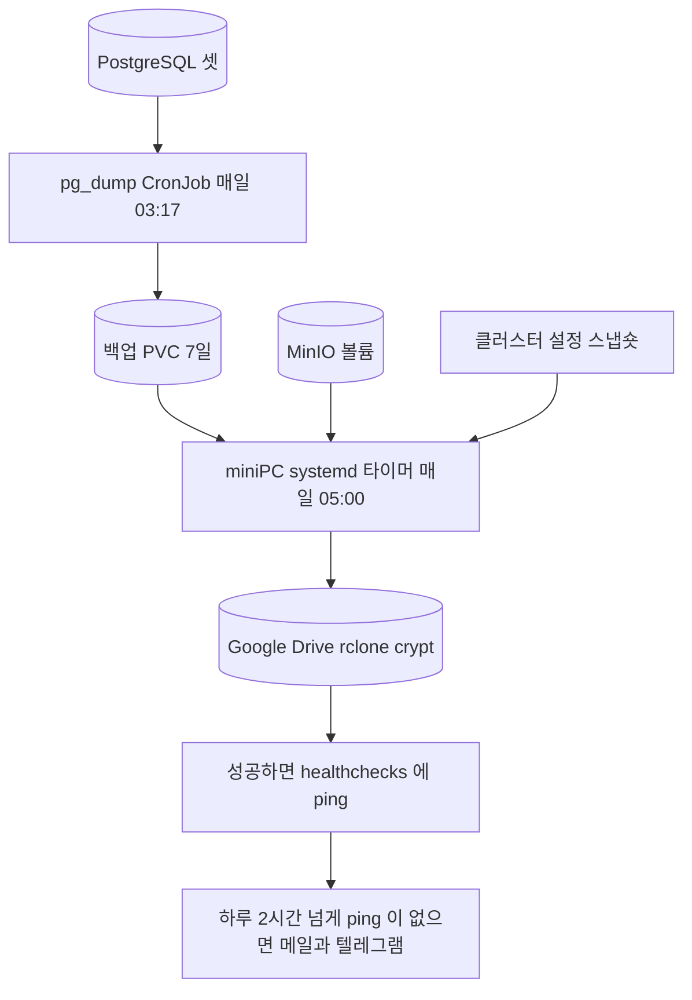

title: 매일 돈다고 믿은 백업이 41일 동안 한 번도 돌지 않았다
slug: jaywiki-backup-silent-41-days
category: 개발 노트
tags: backup,launchd,macos,tcc,rclone,google-drive,healthchecks,dead-mans-switch,operations,devlog
summary: 9월에 맥북에 등록한 매일 백업이 macOS 권한에 막혀 41번 연속 시작도 못 했고, 실패 알림도 그 스크립트 안에 있어 함께 죽어 있었다. 백업을 miniPC가 직접 Google Drive로 보내고 성공 신호를 바깥에서 세는 구조로 옮긴 과정과, 같은 일을 막으려고 바꾼 습관을 정리한다.
toc: true
syncHash: 81209b7bfe6151032ff1dc531c6a6e2eff850823602652d4225d9dd78c24877d
publishedAt: 2026-10-21T10:23:57.659748Z

---

다른 서버의 백업을 정리하던 날, 맥북에서 `launchctl list` 를 쳤다가 낯선 숫자를 봤다. jay-wiki 백업 작업 옆에 `126` 이 찍혀 있었다. 0 이어야 할 자리다.

9월 10일에 이 작업을 등록하면서 [보안 점검 후속 글](/67/jaywiki-security-followup-maintenance-2026-09)에 이렇게 적었다. "매일 04:30 맥북에 암호화 사본을 만드는 일정도 등록하고 첫 실행을 확인했다." 바로 다음 문장은 이랬다. "마지막 성공 시각을 보지 않고 매일 백업된다고 가정하지 않는다."

그 뒤로 마지막 성공 시각을 본 적은 없다. 그리고 그 백업은 9월 11일부터 10월 21일까지 41번 모두 시작도 못 했다. 이 글은 왜 41일 동안 아무도 몰랐는지, 무엇으로 바꿨는지, 같은 일을 막으려고 무엇을 바꿨는지에 대한 기록이다.

## 9월에 만든 백업은 손으로 돌렸을 때 네 번 모두 성공했다

구성은 단순했다. 맥북의 launchd 가 매일 04:30 에 `run-offsite-backup.sh` 를 부른다. 스크립트는 SSH 로 miniPC 에 붙어 PostgreSQL 세 개를 덤프하고, MinIO 객체와 설정, 클러스터 설정을 끌어와 age 로 암호화한 뒤 `~/Library/Application Support/JayWiki Backups` 에 쌓는다.

실패에도 대비했다고 생각했다. 스크립트가 실패하면 macOS 알림을 띄우고, `last-attempt.json` 에 실패를 적는다. 성공하면 `last-success.json` 을 갱신한다.

설정하던 9월 10일에는 터미널에서 손으로 네 번 돌렸고 네 번 모두 성공했다. 마지막 사본은 약 22MB 였다. 복원도 해 봤다. "첫 실행을 확인했다"는 문장은 이 네 번을 가리킨다.

## 자동 실행은 41번 모두 스크립트를 열지도 못했다

오류 로그에는 같은 줄이 날마다 쌓여 있었다.

```text
/bin/bash: .../scripts/run-offsite-backup.sh: Operation not permitted
```

원인은 macOS 의 개인정보 보호 장치(TCC)였다. 저장소가 `~/Documents` 아래에 있는데, launchd 가 띄운 `/bin/bash` 에는 그 폴더를 읽을 권한이 없다. 그래서 스크립트 파일을 여는 단계에서 막혔다. 종료 코드 126 은 "실행할 수 없다"는 뜻이다.

손으로는 왜 됐을까. 손으로 돌릴 때 bash 를 띄운 것은 터미널 앱이고, 터미널에는 `~/Documents` 접근 권한이 있다. **같은 스크립트, 같은 bash 라도 누가 부르느냐에 따라 권한이 달랐다.** 9월 10일에 확인한 것은 "스크립트가 돈다"였지 "launchd 가 부르면 돈다"가 아니었다.

## 실패 알림은 실패한 스크립트 안에 있었다

41일 동안 아무 알림도 없었던 이유가 이 사고의 핵심이다.

| 믿은 것 | 실제 |
|---|---|
| 실패하면 macOS 알림이 뜬다 | 알림을 띄우는 코드가 스크립트 안에 있다. 스크립트가 열리지 않으니 알림도 없다 |
| 실패하면 `last-attempt.json` 에 남는다 | 기록하는 코드도 스크립트 안에 있다. 40일 동안 9월 10일의 success 를 가리켰다 |
| 마지막 성공 시각을 확인한다 | 확인하는 장치가 없었다. 사람이 열어 봐야 하는 파일이었다 |

실패 처리는 "스크립트가 시작은 했는데 중간에 실패한 경우"만 다루고 있었다. "시작조차 못 한 경우"는 아무도 다루지 않았다. 실패를 알리는 쪽이 실패하는 쪽 안에 있으면, 둘은 같이 죽는다.

같은 모양의 사고를 이 프로젝트에서 이미 한 번 겪었다. Prometheus 를 다시 올리다가 Alertmanager 의 수신처가 빈 값으로 돌아가, 규칙은 정상으로 울리는데 알림만 35일 동안 아무 데도 가지 않았다. 그때 만든 답이 [클러스터 밖의 판정자](https://portfolio.leneu.cloud/wiki/watchdog-outside-the-cluster)였다. 알림 경로에는 그 답을 적용해 놓고, 백업에는 적용하지 않았다.

## 권한을 주는 대신 백업이 도는 위치를 옮겼다

고치는 방법은 몇 가지가 있었다.

| 방법 | 판단 |
|---|---|
| `/bin/bash` 에 전체 디스크 접근 권한 주기 | 기각. 앞으로 launchd 가 부르는 모든 bash 스크립트가 디스크 전체를 읽는다. 그리고 맥이 꺼져 있거나 덮여 있으면 여전히 안 돈다 |
| 스크립트를 작은 앱으로 감싸 권한 주기 | 기각. 권한 문제는 풀리지만 "맥이 켜져 있어야 돈다"는 문제는 그대로다 |
| 저장소를 `~/Documents` 밖으로 옮기기 | 기각. 같은 이유다 |
| **miniPC 가 직접 밖으로 올리기** | 채택. 원본이 있는 기계가 늘 켜져 있으니, 그 기계가 보내면 된다 |

권한 문제는 표면이었다. 진짜 문제는 **노트북에 백업을 맡겼다는 것**이다. 노트북은 들고 다니고, 덮여 있고, 꺼져 있는 날이 있다. 노트북이 켜져 있어야 도는 백업은 백업이 아니다.

여기서 원칙을 두 개 정했다.

1. 백업은 원본이 있는 서버에서 돈다
2. 실패를 알리는 대신 성공을 보고하고, 보고가 끊기면 바깥이 알린다

두 번째가 데드맨 스위치다. 실패 알림은 실패하는 쪽이 살아 있어야 보낼 수 있다. 성공 보고가 끊긴 것은 바깥에서 셀 수 있다. 서버가 통째로 죽어도, 권한에 막혀 시작도 못 해도, 바깥에서는 똑같이 "오늘 보고가 없다"로 보인다.

## miniPC 가 Drive 에 올리고, 성공했을 때만 바깥에 보고한다

새 구성은 이렇다.



miniPC 의 systemd 타이머가 매일 05:00 에 스크립트를 부른다. 스크립트는 03:17 에 CronJob 이 만든 덤프 셋을 찾아 체크섬을 대조하고, MinIO 볼륨과 클러스터 설정을 함께 묶어 Google Drive 에 올린다. 내용은 rclone crypt 로 암호화하고, 매일 사본은 3일, 매달 1일 사본은 계속 둔다.

핵심은 마지막 몇 줄이다. 읽기 쉽게 줄만 나눠 옮겼다.

```bash
rclone copyto "$file" "backup:jaywiki/daily/$name" &&
  { [[ ${day:6:2} != 01 ]] ||
      rclone copyto "$file" "backup:jaywiki/monthly/jaywiki-${day:0:6}.tar.gz"; } &&
  rclone delete "backup:jaywiki/daily" --min-age 3d &&
  printf 'url = "https://hc-ping.com/%s/jay-wiki-backup"\n' \
      "$(cat /etc/leneu-backup/hc-ping-key)" |
    curl -fsS -m 10 --retry 3 -o /dev/null -K - &&
  echo "jaywiki: uploaded $name"
```

모든 단계가 `&&` 로 이어져 있다. 업로드가 실패하면 ping 이 나가지 않는다. 덤프가 26시간보다 오래됐거나, 셋 중 하나라도 빠졌거나, 체크섬이 맞지 않으면 그 전에 끝난다. **스크립트가 실패를 알릴 필요가 없다.** 성공만 보고하면, 보고가 없는 날이 곧 실패한 날이다.

오래된 사본을 지우는 단계도 업로드가 성공한 뒤에만 돈다. 그래서 며칠 동안 실패해도 마지막 사본은 지워지지 않는다.

바깥의 판정자는 healthchecks.io 다. check 하나에 "하루에 한 번, 여유 2시간"을 걸어 두면, 마지막 ping 뒤로 26시간 동안 소식이 없을 때 메일과 텔레그램으로 알린다. 무료 플랜으로 충분하다.

## 첫날에 세 번 막혔다

옮기는 날도 매끄럽지 않았다. 셋 다 설정을 잘못 짚은 것이라 기록해 둔다.

**ping 이 404 로 돌아왔다.** 업로드는 됐는데 마지막 ping 에서 실패했다. healthchecks 의 ping 주소는 "프로젝트 키 + check 이름"이고, 키는 프로젝트마다 다르다. 다른 서버의 백업 설정을 그대로 복사해 오면서 키도 그쪽 프로젝트 것을 가져왔는데, check 는 jay-wiki 프로젝트에 만들었다. jay-wiki 프로젝트의 키로 바꾸자 됐다.

**두 번째 실행은 30분 제한에 걸려 죽었다.** 로그에는 `403 rateLimitExceeded` 가 찍혀 있었다. 하루 몇 번 올리지도 않는데 한도 초과라니 이상했다. 원인은 rclone 의 기본 클라이언트 ID 였다. 따로 만들지 않으면 전 세계 rclone 사용자가 같은 ID 를 쓰고, 분당 한도도 그 전체가 나눠 쓴다. 붐비는 순간에는 내 요청 몇 개도 거절된다. rclone 이 22분 동안 다시 시도하다가 systemd 의 30분 제한에 걸렸다. 7분 뒤 다시 돌린 세 번째 실행은 27초 만에 끝났다.

**텔레그램 알림이 다른 프로젝트에 붙었다.** healthchecks 의 텔레그램 연동은 그룹에 봇을 넣고 링크를 열어 프로젝트를 고르는 방식이다. 테스트 메시지는 왔는데, 메시지 아래에 "다음 check 도 down 이다: quantinue-runtime-8020" 이 붙어 있었다. jay-wiki 프로젝트에는 그런 check 가 없다. 링크를 열 때 기본값으로 다른 프로젝트가 골라져 있었다. **테스트가 왔다는 것과 맞는 곳에 붙었다는 것은 다른 확인이었다.**

## 사본에서 다시 되살아나는지까지 대조했다

업로드가 됐다는 것만으로 끝내지 않았다. Drive 에서 다시 받아 풀고 확인했다.

| 확인 | 결과 |
|---|---|
| 덤프 셋의 sha256 | CronJob 이 남긴 원본 해시와 셋 다 일치 |
| MinIO 볼륨 | 파일 205개 |
| 클러스터 설정 | 리소스 497개 |
| 다음 날 자동 실행 | 05:09 에 타이머가 스스로 돌아 37MB 업로드, ping 도착 |

마지막 줄이 이번에 가장 중요하게 본 확인이다. 9월에 놓친 것이 바로 이것이었다. 손으로 돌린 실행이 아니라 **스케줄러가 스스로 부른 첫 실행**을 보고 나서야 맥북의 launchd 작업을 내렸다.

## 같은 일을 막으려고 바꾼 습관

이번 일에서 남긴 습관은 기술보다 확인하는 방식에 가깝다.

**하나, 예약 작업은 스케줄러가 부른 첫 실행을 본다.** 손으로 돌려서 성공한 것은 "스크립트가 돈다"까지만 증명한다. launchd, cron, systemd 는 사용자 셸과 다른 환경에서 부른다. 권한, PATH, 작업 디렉터리, 환경 변수가 다 다를 수 있다. 등록한 다음 날 실제 로그를 보거나, `systemctl start` 처럼 스케줄러를 통해 한 번 부른다.

**둘, 실패 알림을 실패할 수 있는 쪽 안에 두지 않는다.** 실패를 알리는 코드는 그 코드가 살아 있을 때만 동작한다. 시작도 못 한 경우, 기계가 꺼진 경우, 권한이 막힌 경우에는 아무 말도 하지 않는다. 대신 성공 신호를 보내고, 신호가 끊긴 것을 바깥에서 센다.

**셋, 사람이 열어 봐야 하는 상태 파일은 없는 것과 같다.** `last-success.json` 은 정확한 값을 들고 있었다. 다만 아무도 열지 않았다. "마지막 성공 시각을 확인한다"를 문서에 적는 것과, 그 시각이 오래되면 기계가 알려 주는 것은 다른 일이다.

**넷, 백업은 늘 켜져 있는 곳에서 돌린다.** 원본이 있는 서버가 직접 보내는 쪽이 가장 단순하다. 노트북은 받는 쪽으로도 믿기 어렵다.

**다섯, 알림 채널도 실제 도착과 연결 위치를 함께 본다.** 테스트 버튼으로 메시지가 오는지 보고, 그 메시지가 어느 프로젝트의 것인지도 본다.

## 남은 한계

이 구성도 완전하지 않다. 알고 있는 것을 적어 둔다.

- rclone 공용 클라이언트의 한도 문제는 그대로다. 자주 막히면 Google Cloud 에 자기 OAuth 클라이언트를 만들어 바꾼다. 이때 동의 화면을 "테스트" 상태로 두면 토큰이 7일 만에 만료되니 프로덕션으로 바꿔야 한다
- Drive 토큰과 암호화 비밀번호를 다른 서버의 백업과 함께 쓴다. 한쪽 서버의 root 를 잃으면 다른 쪽 사본도 지울 수 있다
- MinIO 볼륨은 쓰는 도중에 그대로 묶는다. 스냅샷이 아니라서, 운영과 같은 MinIO 이미지로만 되살릴 수 있다
- RPO 는 하루다. 03:17 에 뜬 덤프를 05:00 에 올린다
- 마지막 판정자는 healthchecks.io 무료 플랜 하나다. 그 서비스가 멈추면 이 구조도 말이 없다

그래도 9월과 지금의 차이는 분명하다. 그때는 백업이 멈춰도 아무도 몰랐다. 지금은 하루 두 시간이 지나면 바깥에서 먼저 알려 준다.
