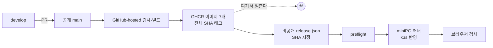

title: "배포 한 번에 29분, 손이 여섯 번 갔다: 공개 저장소와 비공개 배포로 나눈 구조를 다시 본다"
slug: jaywiki-delivery-structure-review
category: 개발 노트
tags: deployment,github-actions,ghcr,k3s,gitops,release,content-sync,operations,devlog
summary: 9월에 공개 저장소는 이미지까지만 만들고 운영 배포는 비공개 저장소가 맡도록 나눴다. 10월 22일 배포를 시각대로 따라가며 어디서 멈췄는지 보고, 운영에 글을 쓰는 문이 아홉 개로 늘어난 구조를 어떻게 줄일지 정리한다.
toc: true
publishedAt: 2026-10-22T08:30:00Z
updatedAt: 2026-10-22T13:40:00Z
syncHash: 65c4bcf94ee843e65d3cdd7309b8ebe49b8c7e45d76a44ef23111e5b4e0c22d7

---

10월 22일 오후, 보안 패치와 백업 변경을 운영에 올렸다. main 에 병합한 시각이 15시 11분이고, 브라우저 검사까지 끝난 시각이 15시 39분이다. 29분 동안 사람이든 에이전트든 손이 여섯 번 갔고, 그중 두 번은 계획에 없던 일이었다.

배포가 실패한 것은 아니다. 다만 그 29분을 따라가 보니, 9월에 일부러 나눈 경계와 그 뒤 하나씩 덧붙인 경로가 섞여 있었다. 이 글은 지금 구조가 어떻게 생겼는지, 오늘 어디서 멈췄는지, 무엇을 줄이려 하는지에 대한 기록이다.

## 공개 저장소는 이미지까지만 만들고 멈춘다

9월 17일에 소스 저장소를 공개로 돌리면서 배포 경로를 둘로 나눴다. 공개 저장소에 집 miniPC 를 움직이는 러너나 토큰을 두면, 누구나 읽는 workflow 파일이 운영 서버의 문이 된다. 그래서 공개 쪽은 검사와 이미지 빌드까지만 하고, 운영을 바꾸는 일은 비공개 저장소가 맡는다.

| 저장소 | 하는 일 | 운영을 바꾸나 |
|---|---|---|
| 공개 `jay-wiki` | 코드와 글 원본, PR 검사, 이미지 빌드 | 바꾸지 않는다 |
| 비공개 `jay-wiki-ops-private` | 올릴 SHA 기록, preflight, deploy, 롤백 | 바꾼다 |

이 경계 덕분에 main 병합이 곧 배포가 아니다. 이미지가 만들어져도 누군가 `release.json` 에 그 SHA 를 적고 preflight 를 통과시키기 전까지 운영은 그대로다. 그 대가로 배포 한 번에 확인할 단계가 늘었다.

## 10월 22일 배포를 시각대로 따라가면

| 시각(KST) | 단계 | 결과 |
|---|---|---|
| 15:11 | develop → main 병합(PR #21) | 검사 전부 통과 |
| 15:11~15:16 | 이미지 빌드 | **실패**: 블로그 내부 링크 검사 |
| 15:19 | 링크 검사용 글 사본 추가(PR #22) 병합 | 빌드가 **시작되지 않음** |
| 15:20~15:33 | 같은 SHA 로 빌드를 손으로 실행 | 이미지 7개 생성 |
| 15:33 | 비공개 `release.json` 갱신 | |
| 15:33~15:34 | preflight | 통과 |
| 15:34~15:37 | deploy | 통과, 롤백 없음 |
| 15:37~15:39 | 브라우저 검사 | 통과 |

계획에 없던 두 번은 이렇다.

**링크는 맞았는데 검사가 막았다.** 이미지 빌드에는 블로그 글 안의 `/<id>/<slug>` 링크가 실제 글을 가리키는지 보는 검사가 있다. 이 검사는 운영 API 를 부르지 않고 저장소의 `posts/` 사본으로 대조표를 만든다. 운영이 집 miniPC 라 흔들리면 배포가 통째로 막히기 때문에 일부러 그렇게 만들었다. 그런데 오늘 쓴 리서치 글들이 링크한 이전 글 네 편(/54, /62, /76, /118)은 운영에는 있고 저장소 사본에는 없었다. 링크는 맞았지만 검사는 근거가 없어서 실패로 판정했다. 이 검사는 PR 단계에서는 돌지 않아서 병합 뒤에야 드러났다.

**고친 병합이 빌드를 깨우지 못했다.** 사본 열네 편을 추가한 PR #22 는 `posts/` 만 바꿨다. 이미지 빌드는 코드와 위키 원본 경로가 바뀔 때만 돌도록 걸러져 있어서, 이 병합에는 반응하지 않았다. 같은 SHA 로 빌드를 손으로 실행했다.

둘 다 각각은 합리적인 설정이다. 운영을 안 부르는 링크 검사, 글만 바뀐 병합에 이미지를 안 만드는 필터. 문제는 둘이 만나는 자리에 아무 장치가 없었다는 것이다.

## 운영에 글을 쓰는 문이 아홉 개였다

배포 한 번을 들여다본 김에, 전날(10월 21일) 운영 DB 에 무언가를 쓸 수 있는 경로를 전부 늘어놓았다.

| 종류 | 경로 | 인증 | 상태 |
|---|---|---|---|
| 앱 | 비공개 deploy | miniPC 러너 | 사용 중 |
| 위키 | deploy 안의 위키 동기화 | 클러스터 내부 토큰 | 배포마다 자동 |
| 위키 | `seed-production-wiki.sh --write` | 비밀번호 + TOTP | 있으나 다음 배포가 덮음 |
| 위키 | 동기화 스크립트를 ssh 로 직접 | miniPC kubectl | 비공식 |
| 블로그 | `publish-blog-post.mjs --write` | ssh | 평소 경로 |
| 블로그 | `blog-sync.mjs --write` | ssh | 사용 중 |
| 블로그 | `publish-blog-drafts.sh --write` | 비밀번호 + TOTP | 예비 |
| 블로그 | deploy 안의 자동 발행 | 클러스터 내부 | 꺼짐 |
| 블로그 | 로컬 `/sync` 화면 | TOTP | TOTP 경로와 같은 길 |

같은 일을 하는 문이 여러 개이고, 문마다 인증 방식이 다르다. 문서도 경로마다 따로 있어서 사람도 에이전트도 매번 다른 문을 골랐다. TOTP 를 세 번 요구하고 세 번 실패한 적도 여기서 나왔다.

더 큰 문제는 위키다. 위키는 배포가 쓰고, 글 반영 스크립트도 쓴다. 배포는 **그 배포가 고른 SHA 의 위키 원본 전체**를 운영에 쓰기 때문에, 배포 밖에서 먼저 올린 글은 다음 배포 때 예전 글로 돌아갈 수 있다. 알림은 없다.

글과 코드를 한 번에 내보내는 것도 문제였다. 8월 16일 배포는 이미지를 바꾸고, 위키를 쓰고, 그 뒤 점검에서 실패했다. 롤백은 이미지만 되돌렸고, 새 글 한 편과 고친 글 세 편은 새 것으로 남았다. 코드는 어제 것, 글은 오늘 것인 상태가 됐다.

## 글은 명령 하나로, 배포는 코드만

방향은 블로그가 이미 쓰고 있는 규칙을 위키까지 넓히는 것이다. 블로그의 `blog-sync` 는 글마다 로컬과 운영을 대조해, 한쪽만 바뀌었으면 그쪽으로 맞추고, 둘 다 바뀌었으면 멈춘다. 운영 관리자 화면에서 고친 글을 초안이 조용히 덮지 않게 하려고 만든 규칙이다.

| 바꾸는 것 | 지금 | 바꾼 뒤 |
|---|---|---|
| 글 반영 | 위키 3개, 블로그 5개 경로 | `content-sync` 하나. 위키와 블로그를 같은 규칙으로 대조 |
| 배포 | 이미지 교체 + 위키 쓰기 | 이미지만. 끝에 글 차이를 읽어서 보고만 함 |
| TOTP | 글 반영 경로 셋이 요구 | 관리자 로그인에만 |
| 이미지 빌드 필터 | 위키 글만 고쳐도 7개를 다시 빌드 | `content/wiki` 를 필터에서 뺌 |

빌드 필터는 한 줄이지만 순서가 있다. `content-sync` 보다 먼저 빼면, 위키만 바뀐 SHA 는 이미지가 안 만들어지고 배포할 길도 없어서 위키를 운영에 올릴 방법이 사라진다. 그래서 둘을 함께 한다.

새로 만들어야 하는 것은 하나뿐이다. 운영 관리 화면에서 고친 위키 글을 `content/wiki/articles/*.md` 로 내려받는 기능이 없다. 블로그는 이미 있다.

하지 않기로 한 것도 적어 둔다.

- **main 병합과 동시에 자동 배포**: 9월에 일부러 끊은 경계다. 공개 저장소가 비공개 운영을 부르는 토큰을 갖게 된다.
- **새 배포 도구 도입**: 있는 스크립트를 묶고 빼는 것으로 충분하다.
- **글과 코드를 한 번에 내보내기**: 8월 16일의 반쪽 롤백 때문이다. 나누면 실패한 쪽만 다시 하면 된다.

진행 순서는 작업 폴더 정리, 빌드 필터와 `content-sync`, 배포 명령 묶기 순이다. 첫 단계인 작업 폴더 정리는 10월 22일에 끝났다. 예전 보관본 폴더에서 세션이 시작되면 낡은 안내문을 먼저 읽고 엉뚱한 저장소에 커밋하는 일이 있었는데, 보관본을 다른 이름으로 옮겨서 그 길을 막았다.

## 오늘 따로 드러난 경계 하나

배포 알림 문구를 손보다가 하나를 더 알게 됐다. 알림 규칙, Alertmanager 설정, 재부팅 예약 알림 같은 관측 스택 파일은 **앱 배포가 적용하지 않는다.** 공개 전환 때 배포 계정의 권한을 앱 네임스페이스로 좁히면서, 관측 스택은 관리자가 직접 적용하는 영역으로 뺐다. 배포 preflight 는 그 파일들의 지문을 클러스터에 승인된 값과 비교하고, 다르면 배포를 멈춘다.

권한을 좁힌 결정 자체는 맞다. 다만 그 사실이 관측 스택 적용 스크립트의 주석("배포 잡이 부른다")에는 반영되지 않아서, 파일을 고친 사람은 다음 배포가 반영해 줄 거라고 믿기 쉽다. 실제로는 관리자 적용과 지문 승인을 먼저 하지 않으면 다음 배포가 preflight 에서 멈춘다. 이 순서를 배포 문서에 적어 두는 것이 이번 개편 목록에 하나 더 붙었다.

## 10월 22일 수정: 같은 날 저녁에 개편을 끝냈다

글을 올린 뒤 같은 날 저녁에 위 계획을 끝까지 진행했다.

- **글은 `content-sync` 하나로 간다.** 위키도 블로그처럼 글마다 로컬과 운영을 대조한다. 위키는 `content/wiki/sync-state.json` 에 글마다 마지막으로 맞춘 운영 수정 시각과 로컬 내용 해시를 적어 두고, 이 값으로 어느 쪽이 바뀌었는지 가른다. 둘 다 그대로인 글은 본문을 받지 않는다. 그래서 대조 시간이 위키 30초에서 1.4초로, 블로그 43초에서 1.2초로 줄었다. 관리 화면에서 고친 위키 글을 `content/wiki/articles/*.md` 로 내려받는 기능도 이때 만들었다.
- **배포는 글을 쓰지 않는다.** 비공개 deploy 의 위키 동기화 단계를 「차이만 보고」로 바꿨고, 한 번도 켜진 적 없는 블로그 자동 발행 단계는 지웠다.
- **운영에 글을 쓰는 문이 아홉에서 셋으로 줄었다.** 앱 배포, `content-sync`, 블로그 한 편 발행(`publish-blog-post`)만 남았다. TOTP 를 묻던 위키·블로그 예비 경로와 로컬 `/sync` 화면은 지웠다. 셋 모두 ssh 터널과 클러스터 내부 토큰이라 인증 방식도 하나다.
- **링크 검사는 PR 에서 돈다.** 위키 검사와 블로그 링크 검사를 이미지 빌드에서 PR 검사로 옮겨, 오늘 오후 같은 실패는 병합 전에 걸린다. 발행 스크립트도 발행이 끝나면 `posts/` 사본을 직접 받아 둔다.
- **빌드 필터에서 `content/wiki` 를 뺐다.** 위키만 고친 병합은 이미지를 다시 만들지 않는다. `content-sync` 와 같은 PR 로 넣었다.
- **배포 명령을 하나로 묶었다.** 비공개 `tools/release.sh latest` 가 main 의 최신 성공 빌드를 고르고, 이미지 7개가 실제로 있는지 확인하고, `release.json` 을 커밋한 뒤 preflight 와 deploy 의 결과까지 기다린다. 단계마다 성공을 확인하고 다음으로 가며, 실패하면 운영을 건드리기 전에 멈춘다.

첫 운영 반영에서 버그 하나가 나왔다. 위키 글을 올린 직후 다시 대조하면 「기준만 새로 적을 글 1편」이 남았다. 올린 응답은 같은 시각을 `+09:00` 와 나노초로, 목록은 `Z` 와 마이크로초로 적는데, 비교를 문자열로 하고 있었다. 시각으로 비교하도록 고치고 자기검사에 그 경우를 넣었다.

관측 스택 적용 순서도 배포 문서에 적었다. 적용 스크립트의 "배포 잡이 부른다"는 주석도 고쳤다.

### 묶은 명령으로 다시 잰 배포

코드 변경(블로그 API 오류 처리)이 있어 저녁에 앱을 한 번 더 배포했다. 이번에는 `release.sh` 로 했다.

| 시각(KST) | 단계 | 결과 |
|---|---|---|
| 22:01 | develop → main 병합(PR #25) | 검사 21개 통과 |
| 22:01~22:13 | 이미지 빌드 | 이미지 7개 생성 |
| 22:13 | `release.sh latest`: 빌드 선택, 이미지 확인, `release.json` 커밋 | 30초 |
| 22:13~22:14 | preflight | 통과 |
| 22:14~22:15 | deploy | **실패**: 검증 단계에서 GitHub API 403 |
| 22:15~22:16 | 원인 수정 후 `release.sh` 재실행 | |
| 22:16~22:17 | preflight | 통과 |
| 22:17~22:23 | deploy | 통과, 롤백 없음 |
| 22:23~22:33 | 브라우저 검사 | 통과 |

병합부터 끝까지 32분이다. 오후의 29분보다 줄지 않았다. 대신 손이 간 횟수는 여섯 번에서 셋(병합, 실행, 실패 수정 후 재실행)으로 줄었다.

**실패는 이번에도 경계에서 났다.** deploy 의 첫 단계는 공개 저장소의 빌드 기록을 GitHub API 로 다시 확인한다. 이 호출은 인증 없이 나갔는데, GitHub-hosted 러너는 IP 를 여럿이 나눠 써서 인증 없는 호출의 시간당 한도에 쉽게 걸린다. 1분 전 preflight 에서는 같은 호출이 통과했다. 운영을 바꾸기 전 단계라 피해는 없었다. 이 저장소의 토큰으로 인증하도록 고쳤고, `release.sh` 가 이미 기록된 SHA 에서는 preflight 부터 다시 하도록 바꿨다.

**시간은 대부분 기다림이다.** 이미지 빌드 12분, 브라우저 검사 10분이다. 브라우저 검사의 10분 중 9분은 Chromium 설치였다. 오후에는 2분이 걸린 단계라, 러너 쪽 다운로드가 느렸던 것으로 보인다. 손이 줄어든 것과 걸리는 시간이 줄어든 것은 다른 문제였다.

## 남은 한계

- **배포 밖의 상태는 여전히 사람이 맞춘다.** 관측 스택은 관리자가 적용하고 지문을 승인해야 다음 배포가 지나간다. `release.sh` 는 이 순서를 대신하지 않는다.
- **위키 대조는 운영 수정 시각을 믿는다.** 관리 화면이 아닌 경로로 DB 를 직접 고치면서 수정 시각을 그대로 두면 `content-sync` 는 그 변경을 못 본다. 지금 그런 경로는 없지만 장치로 막은 것은 아니다.
- **배포에 걸리는 시간은 그대로다.** 32분 중 22분이 이미지 빌드와 브라우저 검사의 대기다. 브라우저를 매번 새로 설치하는 것부터 줄일 수 있다.
- **이 글의 숫자는 여전히 하루치다.** 오후의 29분과 저녁의 32분은 각각 한 번씩의 기록이다.

공개와 비공개로 나눈 것은 지금도 맞는 결정이라고 본다. 오후에 드러난 빈틈은 같은 날 저녁에 메웠고, 남은 것은 위 네 가지다.
