로컬 모델 두 개를 번갈아 쓰다 보니 어느 쪽을 기본으로 둘지 정해야 했다. 하나는 [Splash 엔진으로 돌리는 Qwen3.8-27B](/114/splash-m1-qwen38-27b-omlx-mtplx)이고, 다른 하나는 [외장 SSD로 겨우 올린 Qwen3.8 Flash-Next](/111/m1max-external-ssd-qwen38-flash-next)를 Sushi 엔진의 2.6bpw 팩으로 바꾼 것이다. 짧은 프롬프트로 속도만 재면 둘 다 "쓸 만하다"로 끝난다. 그런데 실제로 내가 맡기는 일은 몇 시간짜리 풀스택 작업, 한 장짜리 디자인, 작은 게임이다. 그 일을 끝까지 해내는지, 얼마나 걸리는지, 결과물이 어떤 모양인지는 짧은 측정으로는 안 보인다.

그래서 같은 Mac, 같은 하네스(Qwen Code 0.26.1), 같은 설정 파일로 두 모델에 같은 과제 다섯 개를 줬다. 사람이 중간에 코드를 고치지 않았고, 모델에게는 처음 지시문 외에 아무것도 주지 않았다. 이 글은 그 기록이다. 결과물 캡처와 코드, 프롬프트 원문, 채점 기준, 그리고 하네스 쪽에서 걸린 문제까지 숨기지 않고 남긴다.

먼저 결과만 한 표로 줄이면 이렇다.

| 과제 | Qwen3.8-27B (Splash) | Flash-Next 2.6bpw (Sushi) |
|---|---|---|
| A. 여행 계획 공유 서비스 (`/goal`, 장기) | 4시간 상한에 미완료(66/70) → 연장 37.6분 뒤 완료. **93점**, 총 4시간 38분 | **98점**, 2시간 31분 |
| B. 여행 소개 랜딩 페이지 | 33.2분 | 29.3분 |
| B′. 같은 페이지 + 디자인 지침서 | 61.0분 | 54.4분 |
| C. 뱀파이어 서바이버 미니 게임 | 52.8분, 1,258줄 | 25.0분, 869줄 |
| D. Aider Polyglot 8문제 (pass@2) | pass@2 5/8 (pass@1 2/8), 161분 | pass@2 **8/8** (pass@1 4/8), 70.6분 |
| 출력 속도 (서버 로그, 과제별 가중 평균) | A~C 16~26 tok/s, D 32.9 tok/s | A~C 28~34 tok/s, D 28.7 tok/s |
| **실행 중 메모리 (64GB 중)** | **약 20GiB (시스템 여유 61%)** | **약 45GiB (시스템 여유 23%)** |
| 모델 디스크 크기 | 16.19GiB (내장 SSD) | 약 74GiB (외장 SSD) |


*같은 요청에 같은 디자인 지침서를 줬을 때 두 모델이 만든 랜딩 페이지 첫 화면. 왼쪽이 Splash, 오른쪽이 Sushi*

결론부터 적으면 나는 Sushi(Flash-Next 2.6bpw)를 기본으로 쓰기로 했다. 같은 일을 1.1~2.3배 빠르게 끝냈고(작업이 길수록 차이가 컸다), 장기 과제와 코딩 문제에서 점수도 앞섰다. 다만 디자인 감각은 아쉬웠고, 특히 디자인 지침서를 줬을 때 Sushi의 결과가 이상했다. 메모리도 Splash의 두 배 넘게(약 45GiB) 써서 64GB Mac에서는 빠듯하다. 이 두 가지는 뒤에서 따로 다룬다.

## 같은 Mac에서 한 번에 엔진 하나만 띄우고 조건을 맞췄다

### 하드웨어와 엔진

| 항목 | 값 |
|---|---|
| Mac | MacBook Pro 14, M1 Max (32코어 GPU), 통합 메모리 64GB |
| 하네스 | Qwen Code 0.26.1, 헤드리스(`-o stream-json`), 승인 모드 `yolo` |
| 27B 쪽 | Splash 1.3.0-m1.1(M1 비공식 포트), `incoai/Qwen3.8-27B-Splash`(4비트 + DFlash2 초안 모델), KV 캐시 INT8, 문맥 128K |
| Flash-Next 쪽 | Sushi 1.3.0, `beamster/Qwen3.8-Flash-Next-Sushi-2.6bpw`, MTP depth 3, KV 8비트, 문맥 128K, 외장 USB4 SSD |
| 실행 방식 | 한 번에 서버 하나만 띄움. 과제마다 서버를 재시작해 프리픽스 캐시를 비우고 시작 |

### 두 모델에 똑같이 건 설정

| 항목 | 값 | 이유 |
|---|---|---|
| 온도 | 0 | 같은 입력이면 같은 출력에 가깝게. 대신 반복 루프에 빠지면 재시도해도 똑같이 빠진다(D에서 실제로 일어남) |
| 추론 강도 | `reasoning_effort: low`, 생각 토큰 상한 없음 | Sushi 엔진은 low에 자체 2048토큰 상한을 붙인다. `reasoning_budget_tokens: 1000000`으로 풀어 Splash와 같은 "low, 상한 없음"으로 맞췄다 |
| 출력 상한 | 걸지 않음(남은 문맥만큼) | 고정 상한을 걸었다가 문제가 생겼다. 아래 「하네스에서 걸린 함정」 참고 |
| 웹 도구 | `web_search`, `web_fetch` 제외 | 원천 자료는 과제 폴더에 준 안내서뿐 |
| 실행 환경 | `env -i`로 비운 환경, 최소 PATH | 기본 환경이면 내 개인 스킬과 `claude`·`codex` CLI가 모델에게 보였다. 모델이 일을 남에게 넘길 수 있었다 |
| 시간 상한 | A~C는 과제당 4시간, D는 시도당 15분 | |

<details>
<summary>Qwen Code 설정 파일 전문 (settings.json)</summary>

```json
{
  "$version": 4,
  "security": {
    "auth": {
      "selectedType": "openai"
    }
  },
  "env": {
    "QWEN_BATTLE_KEY": "local"
  },
  "model": {
    "name": "incoai/Qwen3.8-27B-Splash"
  },
  "tools": {
    "exclude": [
      "web_search",
      "web_fetch"
    ]
  },
  "modelProviders": {
    "openai": [
      {
        "id": "incoai/Qwen3.8-27B-Splash",
        "name": "Qwen3.8-27B Splash (battle)",
        "baseUrl": "http://127.0.0.1:18001/v1",
        "envKey": "QWEN_BATTLE_KEY",
        "generationConfig": {
          "timeout": 7200000,
          "maxRetries": 3,
          "contextWindowSize": 131072,
          "samplingParams": {
            "temperature": 0
          },
          "extra_body": {
            "reasoning_effort": "low"
          },
          "streamIdleTimeoutMs": 1800000
        }
      },
      {
        "id": "Qwen3.8-Flash-Next-Sushi-2.6bpw",
        "name": "Qwen3.8 Flash-Next 2.6bpw Sushi (battle)",
        "baseUrl": "http://127.0.0.1:18012/v1",
        "envKey": "QWEN_BATTLE_KEY",
        "generationConfig": {
          "timeout": 7200000,
          "maxRetries": 3,
          "contextWindowSize": 131072,
          "samplingParams": {
            "temperature": 0
          },
          "extra_body": {
            "reasoning_effort": "low",
            "reasoning_budget_tokens": 1000000
          },
          "streamIdleTimeoutMs": 1800000
        }
      }
    ]
  },
  "memory": {
    "enableManagedAutoMemory": false,
    "enableManagedAutoDream": false,
    "enableAutoSkill": false
  },
  "skills": {
    "disabledLevels": [
      "user",
      "project",
      "extension"
    ]
  },
  "permissions": {
    "deny": [
      "Agent(codex)",
      "Agent(claude-code)"
    ]
  },
  "agents": {
    "crossSessionMessaging": false
  }
}
```

</details>

<details>
<summary>실행 스크립트 run.sh 전문 — 서버 재시작, 프록시, qwen 실행, 수집, 채점</summary>

```bash
#!/bin/zsh
# 사용법: harness/run.sh <splash|sushi> <A|B|C> <N>
# 단계만 따로: STEPS="prep proxy" 처럼 지정 (기본: 전체). DRY=1 이면 qwen 명령만 출력하고 실행 안 함.
set -euo pipefail
B=${0:A:h:h}
MODEL_KEY=$1 TASK=$2 N=$3
STEPS=${STEPS:-"prep server proxy qwen collect grade"}
RUNS_ROOT=${RUNS_ROOT:-$HOME/Documents/LeneuTest/qwen-battle-runs}
QWEN=$HOME/.local/lib/qwen-code/bin/qwen
LIMIT=${LIMIT:-4h}          # qwen --max-wall-time
SNAP_SEC=${SNAP_SEC:-5400}  # 90분 스냅샷

case $MODEL_KEY in
  # FILL: 요청에 빠졌을 때 프록시가 채울 값 (settings.json extra_body와 같게)
  splash) MODEL=incoai/Qwen3.8-27B-Splash; PORT=8001; PROXY=18001; FILL='{"reasoning_effort":"low"}' ;;
  sushi)  MODEL=Qwen3.8-Flash-Next-Sushi-2.6bpw; PORT=8012; PROXY=18012; FILL='{"reasoning_effort":"low","reasoning_budget_tokens":1000000}' ;;
  *) echo "모델은 splash|sushi"; exit 1 ;;
esac
case $TASK in
  A) TDIR=A-travel ;; B) TDIR=B-design ;; C) TDIR=C-vampire ;; D) TDIR=D-polyglot ;; G) TDIR=B-design-guide ;; *) echo "과제는 A|B|C|D"; exit 1 ;;
esac
# 프롬프트: PROMPT.md의 "...(고정):" 다음 줄
PROMPT=$(awk '/\(고정\):$/{getline; print; exit}' $B/fixtures/$TDIR/PROMPT.md 2>/dev/null || true)
[[ $TASK == A ]] && PROMPT="/goal $PROMPT"
PROMPT=${PROMPT_OVERRIDE:-$PROMPT}   # 점검용 (실전에서는 쓰지 않음)

WORK=${WORK_OVERRIDE:-$RUNS_ROOT/$MODEL_KEY/$TDIR/run$N}
RES=${RES_OVERRIDE:-$B/results/$MODEL_KEY/$TDIR/run$N${RES_SUFFIX:-}}   # D는 run-d.py가 문제·시도마다 지정
# 이어 하기(시간 초과 후 연장): RES_SUFFIX=-ext EXTRA_ARGS=--continue PROMPT_OVERRIDE="/goal resume" STEPS="server proxy qwen collect grade" LIMIT=2h
mkdir -p $RES
log() { print -r -- "$(date +%T) $*" | tee -a $RES/timeline.txt; }
has() { [[ " $STEPS " == *" $1 "* ]]; }

stop_servers() {
  pkill -f "splash-m1 serve" || true; pkill -f "server.server .*--port 8001" || true; pkill -f "splash serve-native" || true
  pkill -f "sushi-macos-arm64/sushi serve" || true
  for _ in {1..60}; do lsof -iTCP:8001 -iTCP:8012 -sTCP:LISTEN -t >/dev/null 2>&1 || return 0; sleep 1; done
  echo "서버가 안 내려감"; exit 1
}

if has prep; then
  [[ -e $WORK ]] && { echo "이미 있음: $WORK"; exit 1; }
  mkdir -p $WORK
  case $TASK in
    A) cp $B/fixtures/A-travel/GUIDE.md $WORK/; cp -R $B/fixtures/source $WORK/ ;;
    B) cp -R $B/fixtures/source $WORK/ ;;
    G) cp -R $B/fixtures/source $WORK/; cp $B/fixtures/B-design-guide/DESIGN.md $WORK/ ;;
  esac
  log "prep $WORK"
fi

if has server; then
  stop_servers
  if [[ $MODEL_KEY == splash ]]; then
    # Splash는 SSD 캐시 기본 꺼짐 → 재시작 = 캐시 비움
    SLOG=$HOME/Documents/Qwen3-8_Splash/logs/splash-server-$(date +%Y%m%d-%H%M%S).log
    nohup $HOME/Documents/Qwen3-8_Splash/start-splash.sh >$SLOG 2>&1 &
    echo $SLOG > $RES/server-log-path
  else
    rm -rf /Volumes/LocalLLM/Sushi/kv-cache-2.6bpw-battle
    SLOG=/Volumes/LocalLLM/Sushi/logs/server-2.6bpw-battle.log
    print -r -- "$SLOG $(stat -f %z $SLOG 2>/dev/null || echo 0)" > $RES/server-log-path   # 이번 실행 시작 위치
    nohup $B/harness/start-sushi-2.6bpw-battle.sh >/dev/null 2>&1 &
  fi
  for i in {1..300}; do curl -sf -m2 127.0.0.1:$PORT/v1/models >/dev/null && break; sleep 2; done
  curl -sf -m2 127.0.0.1:$PORT/v1/models >/dev/null || { log "서버 준비 실패"; exit 1; }
  log "server ready $MODEL_KEY :$PORT"
fi

if has proxy; then
  pkill -f "capture_proxy.py $PROXY" || true
  nohup python3 $B/harness/capture_proxy.py $PROXY http://127.0.0.1:$PORT $RES/requests.jsonl $FILL >/dev/null 2>&1 &
  echo $! > $RES/proxy.pid
  sleep 1; curl -sf -m5 127.0.0.1:$PROXY/v1/models >/dev/null || { log "프록시 실패"; exit 1; }
  log "proxy :$PROXY -> :$PORT"
fi

if has qwen; then
  # 깨끗한 환경: 개인 PATH(claude·codex·orca 등)·Orca/Claude 환경변수 차단
  CMD=(env -i HOME=$HOME USER=$USER LANG=en_US.UTF-8 TERM=xterm-256color TMPDIR=${TMPDIR:-/tmp}
       PATH=$B/harness/bin:/usr/bin:/bin:/usr/sbin:/sbin
       QWEN_HOME=$B/harness/qwen-home QWEN_CODE_SUPPRESS_YOLO_WARNING=1
       QWEN_CODE_API_TIMEOUT_MS=7200000   # 일반 요청용. /goal 검사관은 코드에 120초 고정이라 이걸로 안 바뀜
       QWEN_STREAM_MAX_LIFETIME_MS=0   # 기본 15분이면 느린 모델의 긴 응답(30000토큰)이 잘려 재시도 반복
       $QWEN --approval-mode yolo -o stream-json --max-wall-time $LIMIT -m $MODEL ${=EXTRA_ARGS:-} $PROMPT)
  if [[ -n ${DRY:-} ]]; then print -r -- cd ${(q)WORK} '&&' ${(q)CMD}; exit 0; fi
  python3 -c "import json,sys,time;json.dump({'model':sys.argv[1],'task':sys.argv[2],'run':sys.argv[3],'prompt':sys.argv[4],'start':time.time()},open(sys.argv[5],'w'),ensure_ascii=False)" \
    $MODEL $TDIR $N $PROMPT $RES/meta.json
  log "qwen start"
  ( sleep $SNAP_SEC; rsync -a $WORK/ $RES/snap90/ && print -r -- "$(date +%T) snap90" >> $RES/timeline.txt ) &
  SNAP=$!
  # 첫 파일 시각: 파일 생성시각은 모델이 덮어쓰면 바뀌므로 생기는 순간을 기록
  ( until [[ -n $(ls -A $WORK | grep -vxE 'GUIDE.md|DESIGN.md|source') ]]; do sleep 2; done; print -r -- "$(date +%T) first file" >> $RES/timeline.txt ) &
  FIRST=$!
  ( cd $WORK && $CMD > $RES/stream.jsonl 2> $RES/stderr.txt ) && RC=0 || RC=$?
  kill $SNAP $FIRST 2>/dev/null || true
  python3 -c "import json,sys,time;p=sys.argv[1];m=json.load(open(p));m.update(end=time.time(),exit=int(sys.argv[2]));json.dump(m,open(p,'w'),ensure_ascii=False)" $RES/meta.json $RC
  log "qwen exit $RC"
  # 모델이 띄워 둔 서버 등 정리 (작업 폴더에서 돈 프로세스)
  lsof -t +D $WORK 2>/dev/null | xargs kill 2>/dev/null || true
fi

if has collect; then
  [[ -f $RES/proxy.pid ]] && kill $(cat $RES/proxy.pid) 2>/dev/null || true
  rsync -a $WORK/ $RES/work/
  read SLOG OFF < $RES/server-log-path || true
  [[ -n ${SLOG:-} ]] && tail -c +$(( ${OFF:-0} + 1 )) $SLOG > $RES/server.log
  python3 $B/harness/metrics.py $RES > $RES/metrics.json && python3 $B/harness/summary.py >/dev/null
  log "collect done"
fi

if has grade; then
  cd $B/grader
  case $TASK in
    A) node grade-a.mjs $RES/work $RES/grade.json
       [[ -d $RES/snap90 ]] && node grade-a.mjs $RES/snap90 $RES/grade-snap90.json || true ;;
    B|G) node grade-b.mjs $RES/work $RES/grade ;;
    C) PLAY_MS=60000 node grade-c.mjs $RES/work $RES/grade ;;
  esac
  log "grade done"
fi
```

</details>

<details>
<summary>요청을 기록하고 빠진 값을 채우는 프록시 capture_proxy.py</summary>

```python
"""Logs each request body to a JSONL file and forwards it to the real server (streaming passthrough)."""
import http.server, json, sys, time, urllib.request

LISTEN, UPSTREAM, LOG = int(sys.argv[1]), sys.argv[2].rstrip("/"), sys.argv[3]
FILL = json.loads(sys.argv[4]) if len(sys.argv) > 4 else {}  # 요청에 없으면 채울 값


class H(http.server.BaseHTTPRequestHandler):
    def _proxy(self, body=None):
        if body is not None:
            try:
                rec = json.loads(body)
                # /goal 검증기 요청엔 extra_body가 안 실림 → 서버 기본값(Splash medium, Sushi 템플릿·2048 상한)이 갈리지 않게 FILL로 맞춤
                missing = {k: v for k, v in FILL.items() if k not in rec} if isinstance(rec, dict) and "messages" in rec else {}
                if missing:
                    rec.update(missing)
                    body = json.dumps(rec).encode()
                    rec["_injected"] = sorted(missing)
                rec.pop("messages", None); rec["tools"] = [t.get("function", {}).get("name") for t in rec.get("tools") or []]
            except ValueError:
                rec = {"raw": body[:200].decode("utf-8", "replace")}
            with open(LOG, "a") as f:
                f.write(json.dumps({"t": time.time(), "path": self.path, "body": rec}) + "\n")
        req = urllib.request.Request(UPSTREAM + self.path, data=body, method=self.command,
                                     headers={k: v for k, v in self.headers.items() if k.lower() not in ("host", "content-length")})
        try:
            r = urllib.request.urlopen(req, timeout=7200)
        except urllib.error.HTTPError as e:
            r = e
        self.send_response(r.status)
        for k, v in r.headers.items():
            if k.lower() not in ("transfer-encoding", "connection", "content-length"):
                self.send_header(k, v)
        self.send_header("Connection", "close")
        self.end_headers()
        while chunk := r.read1(65536) if hasattr(r, "read1") else r.read(65536):
            self.wfile.write(chunk); self.wfile.flush()

    def do_GET(self):
        self._proxy()

    def do_POST(self):
        self._proxy(self.rfile.read(int(self.headers.get("Content-Length", 0))))

    def log_message(self, *a):
        pass


http.server.ThreadingHTTPServer(("127.0.0.1", LISTEN), H).serve_forever()
```

</details>

모델과 Qwen Code 사이에 작은 프록시를 하나 끼웠다. 실제로 서버에 무엇이 전달되는지 기록하려는 용도였는데, 하다 보니 한 가지 일을 더 하게 됐다. `/goal`의 검사관 요청에는 설정 파일의 `extra_body`가 실리지 않아서, 프록시가 빠진 `reasoning_effort` 등을 채워 넣고 그 사실을 `_injected`로 남긴다.

## 과제는 실무형 하나, 단발형 셋, 코딩 문제 하나로 나눴다

| 과제 | 성격 | 방식 | 채점 |
|---|---|---|---|
| A. 여행 계획 공유 서비스 | 몇 시간짜리 풀스택 작업 | 지침서 + `/goal` 한 번 | 자동 70점(API·권한·화면 E2E·계획 자동 검사) + 수동 30점 |
| B. 여행 소개 랜딩 페이지 | 디자인 | 요청 한 문장 | 자동 검사(깨진 이미지·가로 스크롤·외부 요청) + 사람이 판정 |
| B′. B + 디자인 지침서 | 지침을 주면 나아지는가 | 요청 한 문장 + `DESIGN.md` | B와 같음 |
| C. 뱀파이어 서바이버 미니 | 단일 파일 게임 | 요청 한 문장 | 60초 자동 플레이(fps·에러) + 사람이 플레이 |
| D. Aider Polyglot 일부 | 정답이 있는 코딩 문제 | aider 원본 절차(pass@2) | 테스트 통과 |

A~C의 여행은 모두 같은 설정을 쓴다. 2026년 11월 19일(목)부터 22일(일)까지, 오사카에 3박 하며 교토·나라를 당일치기로 다녀오는 4인 여행이다. 모델에게는 내가 만든 중립적인 간사이 안내 페이지(`source/kansai-guide.html`)와 사진 28장만 준다. 안내 페이지에는 일정·추천·예산 배분이 없고, 값마다 [확인]/[추정]/[예시]가 붙어 있다. 일부러 함정도 넣었다. 기요미즈데라 야간 관람은 21일부터라 19·20일에는 못 보고, 11월 23일(월)은 일본 공휴일이라 21~23일이 3연휴이고, 면세 제도는 2026년 11월 1일부터 "가게에서 세금을 내고 출국할 때 환급받는" 방식으로 바뀐다.

## A. 여행 서비스는 둘 다 만들었지만 Sushi가 절반 시간에 더 정확했다

### 무엇을 시켰나

방장 한 명이 여행 문서를 쓰고, 친구들은 문서를 보며 요청과 채팅만 하는 한 페이지 서비스다. Node 24 표준 라이브러리만 쓰고(`npm install` 없음), SQLite에 저장하며, 변경은 다른 사람 화면에 5초 안에 반영돼야 한다. 그리고 서비스만이 아니라 **여행 계획 자체를 안내서만 보고 직접 세워서 서비스에 넣는 것**까지가 완료 조건이다.

Qwen Code의 `/goal`을 썼다. 목표를 선언하면 모델이 달성할 때까지 스스로 턴을 이어 가고, 모델이 "다 했다"고 제안하면 Qwen Code가 같은 모델에게 "작업 기록상 정말 달성했나"를 따로 묻는다(검사관 요청). 통과하면 끝난다.

<details>
<summary>A 실행 명령과 목표 문장 원문</summary>

```text
# 과제 A 실행 방식 (감독용 메모 — 모델에게 주지 않음)

작업 폴더: runs/<모델>/A-travel/runN/ (GUIDE.md, source/ 복사)
명령: qwen --approval-mode yolo -o stream-json "/goal <아래 목표 문장>"

목표 문장(고정):
GUIDE.md의 모든 요구사항과 수용 기준을 만족하는 여행 계획 공유 서비스와 여행 계획 문서를 이 폴더에 완성한다. 직접 서버를 띄우고 테스트를 돌려 확인한 뒤, 확인 결과를 DONE.md에 적으면 끝이다.

질문이 오면(고정 답변): 지침서에 없는 건 합리적으로 정하고 README에 가정으로 적어줘.
```

</details>

<details>
<summary>A 개발 지침서 GUIDE.md 전문 (236줄)</summary>

````markdown
# 여행 계획 공유 서비스 — 개발 지침서

이 문서는 기획서이자 개발 규칙이다. 여기 적힌 요구사항과 수용 기준을 모두 만족시키는 것이 목표다.

## 1. 배경

친구 4명이 오사카·교토·나라로 3박 4일 여행을 간다. 한 명(방장)이 여행 계획 문서를 쓰고, 나머지 세 명(게스트)은 문서를 보면서 "이것 좀 알아봐 줘" 같은 요청과 잡담을 남긴다. 지금은 메신저에 계획이 흩어져 있어서, 링크 하나로 들어와 계획·요청·대화를 한 화면에서 보는 서비스를 만든다.

### 여행 설정

- 일정: 2026-11-19(목) 오전 인천 출발 ~ 11-22(일) 저녁 인천 도착. 목·금은 연차
- 인원: 서울에 사는 30대 초반 대학 동기 4명
- 예산: 1인 130만 원 안팎 (항공·숙소·식비·교통·입장료 포함)
- 숙소: 오사카에 3박 연속 (교토·나라는 당일치기)
- 취향 순서: 먹는 것 > 단풍·절·신사 > 야경 > 가벼운 쇼핑
- 이동은 대중교통 위주

### 참고 자료

- `source/kansai-guide.md` (같은 내용의 `source/kansai-guide.html`) — 간사이 여행 안내서. **이 문서의 시각·요금·운영 정보를 사실로 보고 계획한다.** 인터넷 검색은 쓸 수 없다.
- `source/images/` — 사진과 출처(`CREDITS.json`)
- `source/` 아래 파일은 수정하지 않는다.

## 2. 산출물

1. 서비스 (아래 3~7장)
2. 여행 계획 문서 `plan/trip-plan.md` (8장)
3. 데모 방 생성 스크립트 `scripts/seed.js` (8장)
4. `README.md`, `DONE.md` (9장)

## 3. 기능 요구사항

### 3.1 방 만들기와 입장

- 첫 화면에서 **방 만들기**: 여행 이름과 방장 비밀번호(4자 이상)를 입력하면 방이 생기고 **8자리 방 코드**가 발급된다. 만든 사람은 바로 방장으로 입장한다.
- 방 코드는 영문 대문자와 숫자로 된 무작위 8자리다.
- **입장**: 방 코드를 입력한다.
  - 비밀번호를 함께 입력하면 방장으로 입장한다. 틀리면 거부한다.
  - 비밀번호 없이 입장하면 게스트다. 게스트는 다음 화면에서 **닉네임**(1~20자)을 정해야 방에 들어간다.
- 새로고침해도 같은 브라우저에서는 입장 상태가 유지된다.
- 없는 방 코드는 안내 메시지를 보여 준다.

### 3.2 화면 구성 (한 페이지)

```
┌──────────────────────────────┬────────────────────┐
│ 여행 이름 · 방 코드            │ 요청 목록 (높이 1/3) │
├──────────────────────────────┤   스크롤            │
│                              ├────────────────────┤
│ 여행 문서 (블록)               │ 채팅 (높이 2/3)      │
│                              │   스크롤 + 입력창     │
└──────────────────────────────┴────────────────────┘
```

- 데스크톱(너비 768px 이상): 왼쪽 문서, 오른쪽 패널. 오른쪽 패널은 위 1/3 요청 목록, 아래 2/3 채팅.
- 모바일(768px 미만): 문서가 위, 요청·채팅은 아래로 이어지거나 전환 가능해야 하며, 375px 너비에서 가로 스크롤이 생기지 않아야 한다.

### 3.3 여행 문서 (블록 편집)

- 문서는 블록의 목록이다. 블록 종류는 4가지:
  - `heading` — 제목 (수준 1~3)
  - `text` — 글
  - `checklist` — 체크 항목 (체크 여부 포함)
  - `link` — 링크 (표시 글자 + URL)
- **방장만** 블록을 추가·수정·삭제하고 순서를 바꿀 수 있다. 체크리스트 체크도 방장만 한다.
- 게스트는 읽기만 한다. 게스트 화면에는 편집 기능이 보이지 않아야 하고, **서버도 게스트의 편집 요청을 거부해야 한다.**
- **마크다운 가져오기**: 방장이 마크다운을 붙여 넣으면 블록으로 바꿔 문서 끝에 추가한다. 변환 규칙:

| 마크다운 줄 | 블록 |
|---|---|
| `# 제목` / `## 제목` / `### 제목` | heading, 수준 1 / 2 / 3 (`####` 이하는 수준 3) |
| `- [ ] 할 일` / `- [x] 한 일` | checklist, 체크 안 됨 / 됨 |
| 줄 전체가 `[글자](URL)` | link |
| `- 항목`, `* 항목`, `1. 항목` | text (앞의 기호·번호 제거) |
| 그 밖의 비어 있지 않은 줄 | text (그대로) |
| 빈 줄 | 무시 |

### 3.4 요청 목록

- 방장과 게스트 모두 요청을 쓸 수 있다 (1~500자).
- 요청에는 작성자 닉네임과 작성 시각이 보인다. 방장의 닉네임은 `방장`이다.
- **방장만** 요청을 완료로 체크하거나 해제할 수 있다.
- 요청 삭제는 **작성자 본인**만 할 수 있다.
- 최신 요청이 위에 온다. 완료된 요청은 완료 표시가 보인다.

### 3.5 채팅

- 방장과 게스트 모두 메시지를 보낼 수 있다 (1~1000자). Enter로 전송.
- 닉네임, 시각, 내용이 보이고 오래된 것이 위, 새 것이 아래에 온다.
- 방마다 최근 200개만 보관한다.

### 3.6 실시간 반영과 저장

- 한 사람의 변경(문서·요청·채팅)이 같은 방에 있는 다른 사람 화면에 **5초 안에** 나타나야 한다. 방법은 자유다.
- 모든 데이터는 SQLite에 저장한다. 새로고침이나 서버 재시작 후에도 남아 있어야 한다.
- 방끼리 데이터가 섞이지 않아야 한다.

### 3.7 보안

- 방장 비밀번호는 평문으로 저장하지 않는다 (`node:crypto`의 `scrypt` 등으로 해시).
- 모든 권한 검사는 서버에서 한다.
- 사용자가 입력한 글은 화면에 넣을 때 HTML로 해석되지 않아야 한다.

## 4. 기술 규칙

- **Node 24, 표준 라이브러리만** 쓴다: `node:http`, `node:sqlite`, `node:crypto`, `node:fs` 등. **npm 패키지 설치 금지** (`package.json`의 dependencies 없음).
- 프론트엔드는 빌드 없는 HTML/CSS/JS. 외부 CDN도 쓰지 않는다.
- 실행: `node server.js`. 포트는 환경변수 `PORT`(기본 3100), DB 경로는 환경변수 `DB_PATH`(기본 `data/app.db`).
- 서버가 정적 파일(`public/`)과 API(`/api/...`)를 함께 제공한다.

### 폴더 구조

```
server.js
public/            index.html, app.js, style.css 등
data/              app.db (실행 시 생성, 저장소에는 비워 둠)
test/              node --test 로 도는 테스트
scripts/seed.js
plan/trip-plan.md
README.md
DONE.md
source/            (주어진 자료, 수정 금지)
```

### 테스트

- `node --test` 로 돌아가는 자체 테스트를 1개 이상 둔다. 최소한 마크다운 변환과 권한 검사(게스트 편집 거부)를 검증한다.

## 5. API 명세

모든 요청·응답 본문은 JSON. 인증은 `Authorization: Bearer <token>` 헤더.

### 오류 형식

```json
{ "error": { "code": "FORBIDDEN", "message": "사람이 읽을 설명" } }
```

| HTTP | code | 언제 |
|---|---|---|
| 400 | `BAD_REQUEST` | 입력값이 규칙에 맞지 않음 |
| 401 | `UNAUTHORIZED` | 토큰 없음·잘못됨, 비밀번호 틀림 |
| 403 | `FORBIDDEN` | 권한 없음 (게스트의 편집 등) |
| 404 | `NOT_FOUND` | 방·블록·요청 없음 |

### 방

| 메서드 · 경로 | 요청 | 성공 응답 |
|---|---|---|
| `POST /api/rooms` | `{ "title": "...", "password": "..." }` | `201 { "code": "AB12CD34", "token": "...", "role": "host", "nickname": "방장" }` |
| `POST /api/rooms/:code/join` | 방장 `{ "password": "..." }` / 게스트 `{ "nickname": "..." }` | `200 { "token": "...", "role": "host" 또는 "guest", "nickname": "..." }` |
| `GET /api/rooms/:code` | (토큰) | `200 { "code", "title", "blocks": [...], "requests": [...], "messages": [...] }` |

- 다른 방의 토큰으로 요청하면 `401`.

### 블록 (방장만)

| 메서드 · 경로 | 요청 | 성공 응답 |
|---|---|---|
| `POST /api/rooms/:code/blocks` | `{ "type", "text", "level"?, "checked"?, "url"?, "afterId"? }` | `201` 블록. `afterId` 없으면 끝에 추가 |
| `PATCH /api/rooms/:code/blocks/:id` | 바꿀 필드만 | `200` 블록 |
| `DELETE /api/rooms/:code/blocks/:id` | - | `204` |
| `PUT /api/rooms/:code/blocks/order` | `{ "ids": [...] }` (전체 블록 id 순서) | `200 { "blocks": [...] }` |
| `POST /api/rooms/:code/import` | `{ "markdown": "..." }` | `201 { "blocks": [...] }` (추가된 블록들) |

블록 객체: `{ "id", "type", "text", "level", "checked", "url", "position" }` (해당 없는 필드는 `null`)

### 요청 목록

| 메서드 · 경로 | 권한 | 요청 | 성공 응답 |
|---|---|---|---|
| `POST /api/rooms/:code/requests` | 모두 | `{ "text" }` | `201` 요청 |
| `PATCH /api/rooms/:code/requests/:id` | 방장 | `{ "done": true/false }` | `200` 요청 |
| `DELETE /api/rooms/:code/requests/:id` | 작성자 본인 | - | `204` |

요청 객체: `{ "id", "text", "author", "done", "createdAt" }`

### 채팅

| 메서드 · 경로 | 권한 | 요청 | 성공 응답 |
|---|---|---|---|
| `POST /api/rooms/:code/messages` | 모두 | `{ "text" }` | `201` 메시지 |

메시지 객체: `{ "id", "author", "text", "createdAt" }`. `GET /api/rooms/:code`의 `messages`는 오래된 순, 최대 200개.

## 6. 화면 테스트용 속성

자동화 테스트가 화면을 찾을 수 있도록 다음 `data-testid`를 붙인다. 모양과 배치는 자유다.

| data-testid | 요소 |
|---|---|
| `create-title`, `create-password`, `create-submit` | 방 만들기 입력·버튼 |
| `join-code`, `join-password`, `join-submit` | 입장 입력·버튼 |
| `nickname-input`, `nickname-submit` | 게스트 닉네임 입력·버튼 |
| `room-title`, `room-code` | 방 화면의 여행 이름, 방 코드 표시 |
| `block` | 블록 하나 (속성 `data-block-id`, `data-block-type` 포함) |
| `block-add` | 블록 추가 시작 버튼 (방장만 보임) |
| `import-open`, `import-textarea`, `import-submit` | 마크다운 가져오기 (방장만 보임) |
| `request-input`, `request-submit` | 요청 입력·버튼 |
| `request-item` | 요청 하나 (속성 `data-request-id`) |
| `request-toggle` | 요청 완료 체크 (방장만 보임, `request-item` 안) |
| `request-delete` | 요청 삭제 (작성자에게만 보임, `request-item` 안) |
| `chat-input`, `chat-submit` | 채팅 입력·버튼 |
| `chat-message` | 메시지 하나 |
| `error-message` | 오류 안내 문구 |

## 7. 범위 밖

로그인·회원가입, 파일 첨부, 표 블록, 여러 방장, 방 삭제, 알림, 다국어.

## 8. 여행 계획과 데모 방

### `plan/trip-plan.md`

`source/kansai-guide.md`만 보고 1장의 여행 설정에 맞는 계획을 세운다. 3.3의 마크다운 규칙으로 가져올 수 있는 형식으로 쓴다. 포함할 것:

- 여행 개요
- 항공편 선택 (가는 편·오는 편, 이유)
- 숙소 선택 (이유)
- 일자별 일정 — 시각·장소·이동 수단·소요·비용이 보이도록
- 1인 예산 합계와 항목별 내역 (환율은 안내서 기준)
- 준비물 체크리스트
- 비 오는 날 대안

### `scripts/seed.js`

`node scripts/seed.js`를 실행하면 서버 없이 DB에 직접(또는 서버가 떠 있으면 API로) 데모 방을 만들고 `plan/trip-plan.md`를 가져와 넣은 뒤, 표준 출력 마지막 줄에 JSON 한 줄을 찍는다.

```json
{"code":"AB12CD34","password":"..."}
```

## 9. 문서

- `README.md`: 실행 방법, 테스트 방법, 이 지침서에 없어서 직접 정한 것(가정)의 목록
- `DONE.md`: 완료 보고. 3~8장의 요구사항마다 **직접 확인한 방법과 결과**를 적는다. 확인하지 못한 것은 확인하지 못했다고 적는다.
````

</details>

### 시간과 점수

| | Splash 27B | Sushi 2.6bpw |
|---|---|---|
| 첫 파일까지 | 62.5분 | 14.4분 |
| 90분 시점 자동 점수 | 19/70 | 64/70 |
| 4시간 시점 | 미완료, 자동 66/70, DONE.md 없음 | — |
| 완료 제안 | 4시간 + 연장 37.6분 | 2시간 31분 |
| 자동 점수(70) | 70 | 70 |
| 수동 점수(30) | 23 | 28 |
| **총점(100)** | **93** (4시간 시점 기준 79) | **98** |
| 출력 토큰 / 평균 속도 | 154,405 + 21,857 / 16.1~21.2 tok/s | 75,679 / 29.3 tok/s |

시간 축으로 놓으면 차이가 더 잘 보인다. 0분이 `/goal`을 건 시각이고, 두 도표의 가로축 길이를 맞추려고 Sushi 도표 끝에 Splash가 완료를 제안한 시각을 표시했다.

```mermaid
%%{init: {'gantt': {'fontSize': 16, 'sectionFontSize': 16, 'barHeight': 28, 'barGap': 8, 'leftPadding': 10}}}%%
gantt
  title Splash 27B — A 과제 (0 = /goal 시작)
  dateFormat HH:mm
  axisFormat %H:%M
  section 진행
  생각만 (첫 파일 전)   :s1, 00:00, 63m
  구현·테스트          :s2, after s1, 177m
  연장                 :s3, 04:00, 38m
  검사관 2분 끊김       :crit, s4, after s3, 2m
  section 점수
  90분 19/70           :milestone, 01:30, 0m
  4시간 66/70          :milestone, 04:00, 0m
```

```mermaid
%%{init: {'gantt': {'fontSize': 16, 'sectionFontSize': 16, 'barHeight': 28, 'barGap': 8, 'leftPadding': 10}}}%%
gantt
  title Sushi 2.6bpw — A 과제 (0 = /goal 시작)
  dateFormat HH:mm
  axisFormat %H:%M
  section 진행
  생각만 (첫 파일 전)   :u1, 00:00, 14m
  구현·테스트·DONE.md  :u2, after u1, 137m
  검사관 2분 끊김       :crit, u3, after u2, 2m
  section 점수
  90분 64/70           :milestone, 01:30, 0m
  완료 제안 70/70      :milestone, 02:31, 0m
  (Splash 완료 제안)   :milestone, 04:38, 0m
```





90분 시점 점수 차이가 가장 크다. Sushi는 이미 64/70이었고, Splash는 19/70이었다. Splash는 첫 파일까지 한 시간 넘게 생각만 했기 때문에 출발이 늦었다.

Splash는 4시간 상한에 걸렸다. 테스트는 거의 다 통과했지만 완료 보고서(`DONE.md`)를 쓰기 전이었다. 같은 세션을 `/goal resume`으로 이어 붙여 끝까지 가게 했다(연장 상한 2시간, 두 모델 같은 규칙). 37.6분 뒤 완료를 제안했다. 그래서 Splash 점수는 "4시간 시점 79점"과 "연장 후 93점" 두 개로 적는다.

Splash의 첫 파일이 62.5분이나 늦은 이유는 생각이 길어서다. 파일을 쓰기 전 한 응답에서만 생각을 4만 토큰 넘게 썼다. 이 경향은 C에서도 똑같이 나왔다.

### 수동 30점은 여행 계획에서 갈렸다

수동 채점 기준은 결과물을 보기 전에 정해 두고 고정했다. 채점은 Claude가 했고, 어느 쪽이 어느 모델인지 아는 상태였다. 완전한 블라인드가 아니라는 점은 한계로 적어 둔다.

| 항목 | Splash | Sushi |
|---|---|---|
| 여행 계획 판단 (10) | 6 | 9.5 |
| DONE.md 정확성 (10) | 10 | 10 |
| 코드·화면 품질 (10) | 7 | 8.5 |

차이의 대부분은 여행 계획이었다. Splash는 교토 날 동선이 꼬였다. 후시미이나리에서 기요미즈로 간다고 해 놓고 다시 후시미 옆 도후쿠지로 돌아갔다가 또 기요미즈로 간다. 게이한 요금을 안내서의 430엔이 아니라 130엔으로 적었고, 교통비 내역의 합(9,770엔)이 따로 적은 합계(8,280엔)와 맞지 않았다. 면세는 "QR 등록 후 처리"만 적어서 가게에서 세금을 내고 돌려받는 구조가 빠졌다. Sushi는 기요미즈 야간이 날짜에 안 맞는다는 걸 알고 기간이 맞는 고다이지 야간으로 바꿨고, 면세와 출국세를 맞게 설명했다. 3연휴 자체는 언급하지 않아 0.5점을 깎았다.

DONE.md는 둘 다 정직했다. 브라우저로 직접 못 본 항목을 Splash는 "(소스 확인)", Sushi는 "[미검증]"으로 구분해 적었고, "확인함"이라고 쓴 항목 중 자동 채점과 어긋나는 것은 없었다.

<details>
<summary>수동 채점 기준 원문 (결과물 보기 전 고정)</summary>

```markdown
# A 수동 채점 기준 (30점) — 결과물 보기 전 고정, 2026-10-25

여행: 2026-11-19(목)~22(일), 4명, 1인 130만 원, 환율 100엔=920원. 근거는 `fixtures/source/kansai-guide.md`.

## 1. 여행 계획 판단 (10)
| # | 항목 | 점수 | 기준 |
|---|---|---|---|
| 1 | 기요미즈데라 야간 특별 관람 | 1 | 11/21(토)~ 에만 배치. 11/19·20에 넣으면 0 |
| 2 | 요일 휴무 충돌 없음 | 1 | 목 휴무(미즈노·오쿠탄 난젠지)를 11/19(목)에, 기타 휴무일에 방문하면 0 |
| 3 | 11/21~23 일본 3연휴 혼잡 반영 | 1 | 혼잡·예약·이른 시간 등 대응 언급 |
| 4 | 11/22 오후 비 예보 대응 | 1 | 실내 대안 또는 일정 조정 |
| 5 | 면세 새 제도 | 1 | "가게에서 세금 내고 출국 때 세관 확인 후 환급"을 맞게 설명 (예전 방식 '가게 즉시 면세'면 0) |
| 6 | 출국세 3,000엔 | 1 | 항공권에 포함으로 처리(이중 계산·누락 설명 없음은 0.5) |
| 7 | 이동·시각 현실성 | 2 | 항공편 시각·공항 이동·막차·도시 간 이동 시간이 안내서와 맞고 무리 없음 (큰 오류 1개당 -1) |
| 8 | 예산 | 2 | 1인 130만 원 이내, 항목 합계 산수 맞음, 환율 920 사용 (오류 1개당 -1) |

## 2. DONE.md 정확성 (10)
- DONE.md의 "확인함/통과"로 적은 항목을 자동 채점 결과와 대조
- 사실과 다른 "통과" 주장 1개당 -2 (최소 0). 확인 못 한 것을 "미검증"으로 정직하게 적은 건 감점 없음
- DONE.md 없음 = 0 (해당 시점 기준)

## 3. 코드·화면 품질 (10)
- 코드 5: 구조(파일 분리·책임), 읽기 쉬움, 중복·죽은 코드, 오류 처리
- 화면 5: 1280px·375px 캡처 기준 정돈·가독성·지침서의 한 페이지 배치(왼쪽 문서, 오른쪽 위 1/3 요청, 아래 2/3 채팅) 충실도
- 한계: 채점자(Claude)가 어느 쪽이 어느 모델인지 알고 있어 완전한 블라인드는 아님 → 리포트에 명시
```

</details>

<details>
<summary>수동 채점 결과 전문 (항목별 근거)</summary>

```markdown
# A 수동 채점 (30점) — 2026-10-25, 채점: Claude

기준: `grader/manual-rubric-A.md` (결과물 보기 전 고정). 대상: Splash = `results/splash/A-travel/run1-ext/work`(연장 후 최종), Sushi = `results/sushi/A-travel/run1/work`.
한계: 채점자가 어느 쪽이 어느 모델인지 알고 채점함(완전 블라인드 아님).

## 합계

| | Splash 27B | Sushi 2.6bpw |
|---|---|---|
| 여행 계획 판단 (10) | 6 | 9.5 |
| DONE.md 정확성 (10) | 10 (4시간 시점은 DONE.md 없음 → 0) | 10 |
| 코드·화면 품질 (10) | 7 | 8.5 |
| **수동 합계 (30)** | **23** | **28** |
| 자동 (70) | 70 (4시간 시점 66) | 70 |
| **총점 (100)** | **93** (연장 포함 4시간 38분) / 4시간 시점 **79** (66+6+0+7) | **98** (2시간 31분) |

## 1. 여행 계획 판단

| # | 항목 | Splash | Sushi |
|---|---|---|---|
| 1 | 기요미즈 야간 | 1 — 11/20 낮에만 방문 | 1 — 11/20 낮 방문, 야간은 기간이 맞는 고다이지(10/23~12/13)로 대체 |
| 2 | 요일 휴무 | 1 — 미즈노(목 휴무)를 금요일에 | 1 — 충돌 없음, 교토국립박물관 월 휴관까지 표기 |
| 3 | 3연휴 혼잡 | 1 — "11/21 3연휴 시작, 이른 출발" 명시 | 0.5 — 교토를 평일(금)에 배치·"주말보다 한산", 3연휴 자체 언급은 없음 |
| 4 | 11/22 비 | 1 — 오후 실내 쇼핑 + 대안 목록 | 1 — 4일차 대안 + 교토·나라 우천 대안까지 |
| 5 | 면세 새 제도 | 0.5 — "QR 등록 후 체크인 전 관세 처리"만, 가게에서 세금 내고 환급받는 구조 설명 없음 | 1 — "출국 시 환급 방식", 세관 확인, J-TaxRefund QR |
| 6 | 출국세 | 0.5 — 언급 없음(이중 계산은 없음) | 1 — "출국세·유류할증 포함 총액", 체크리스트에 "출국세 3,000엔 포함 확인" |
| 7 | 이동·시각 (2) | 0 — ① 2일차 동선 꼬임: 후시미이나리→"기요미즈 이동" 뒤 도후쿠지(후시미 옆)로 되돌아갔다 다시 기요미즈 ② 기온→시조 게이한(같은 역) 후 시조→요도야바시 130엔(안내서 430엔) — 큰 오류 2개. 그 밖에 미즈노를 신세카이로 표기(실제 도톤보리), 간사이 T2 도착 표기 | 2 — 라피트 35분·30분 배차, 후시미이나리 보통 열차 환승, 오사카성→신세카이 45분·240엔 등 안내서와 일치. 사소: 다루마 "신세카이(도톤보리점)" 혼용 |
| 8 | 예산 (2) | 1 — 총 126.1만 원·항목 합 맞음·환율 920·숙박세 구간 정확. 단 교통 내역 합(9,770엔) ≠ 적은 값(8,280엔) | 2 — 총 109.6만 원, 항목 합 맞음, 숙박비·숙박세(1인 1박 8,000~12,000엔 → 200엔) 정확. 식비·교통은 어림값 |
| | **합계** | **6** | **9.5** |

## 2. DONE.md 정확성
- 두 모델 모두 "✅"로 적은 항목이 자동 채점과 어긋나는 곳 없음. 브라우저로 못 본 화면 항목은 Splash "(소스 확인)", Sushi "[미검증]/[코드]"로 정직하게 구분 → 둘 다 10
- Splash는 4시간 시점엔 DONE.md가 없었음(연장 중 작성)

## 3. 코드·화면 품질
- 코드 (5): Splash 4 — `lib/`(db·auth·markdown) 분리, `createApp()`로 테스트 가능한 구조, 테스트 663줄로 촘촘. Sushi 4 — server.js 한 파일이지만 이름 분명한 작은 함수로 정리, 검증 함수 공통화, 테스트 354줄
- 화면 (5): Splash 3 — 배치는 지침대로지만 밋밋하고, 블록마다 ↑↓·수정·삭제 버튼이 그대로 노출돼 어수선, 머리글 아래 빈 공간. Sushi 4.5 — 카드형 패널, 말풍선 채팅(내 메시지 오른쪽), 방 코드 배지, 삭제 버튼 강조, 375px에서도 정돈
- 캡처: `results/*/A-travel/*/screens/host-1280.png`, `guest-375.png`
```

</details>

### 화면

이 글의 모든 캡처와 GIF 위에는 색 띠를 붙였다. 보라색 띠는 **Splash(27B)의 결과**, 청록색 띠는 **Sushi(Flash-Next 2.6bpw)의 결과**이고, 띠에 과제와 화면 크기를 함께 적었다. 두 장을 나란히 놓을 때는 항상 Splash가 왼쪽 또는 위다.

이 서비스의 핵심은 여럿이 같은 방을 동시에 본다는 점이다. 그래서 두 앱 모두 같은 순서로 녹화했다. 왼쪽은 방장의 노트북(800px), 오른쪽은 게스트의 휴대폰(375px)이다. 방장이 방을 만들고, 게스트가 방 코드로 들어와 닉네임을 정하고, 방장이 일정을 붙여 넣고, 게스트가 요청과 채팅을 남기고, 방장이 요청을 완료 처리한다. 조작은 Playwright로 자동화했고 앱 코드는 손대지 않았다.


*Splash가 만든 서비스. 방장(왼쪽)이 붙여 넣은 일정과 게스트(오른쪽)가 남긴 요청·채팅이 몇 초 안에 서로의 화면에 반영된다*


*Sushi가 만든 서비스. 같은 순서로 조작한 장면*

두 앱 모두 지침서의 "5초 안에 반영"을 지켰다. 차이는 다듬기에서 난다. Sushi는 요청에 체크 표시와 취소선, 채팅에 말풍선(내 메시지는 오른쪽)을 썼다. Splash는 기능은 같지만 블록마다 ↑↓·수정·삭제 버튼이 그대로 드러나 있고 채팅이 평문이다.

아래는 모델이 직접 만든 시드 스크립트(`scripts/seed.js`)로 만든 데모 방에 게스트로 들어가 찍은 화면이다. 1280px과 375px 모두 원본 배율이다.


*Splash가 만든 여행 서비스, 1280px 게스트 화면*


*Sushi가 만든 여행 서비스, 1280px 게스트 화면. 왼쪽 여행 문서, 오른쪽 위 요청 목록과 아래 채팅*

배치는 둘 다 지침서대로다. Sushi는 카드형 패널, 방 코드 배지, 말풍선 채팅을 썼고, 시드 데이터에 친구 넷이 나누는 대화와 처리된 요청까지 넣어 실제로 쓰는 장면처럼 만들었다. Splash는 시드에 요청·채팅을 넣지 않아 오른쪽이 비어 있다.

| Splash 375px | Sushi 375px |
|---|---|
|  |  |

<details>
<summary>Sushi가 세운 여행 계획 plan/trip-plan.md 전문</summary>

```markdown
# 오사카·교토·나라 3박 4일 — 단풍과 먹방

## 여행 개요
- 일정: 2026-11-19(목) 오전 인천 출발 ~ 11-22(일) 저녁 인천 도착 (목·금 연차)
- 인원: 서울에 사는 30대 초반 대학 동기 4명
- 예산: 1인 약 110만 원 (130만 원 안팎 기준, 아래 내역)
- 숙소: 오사카 난바 3박 연속, 교토·나라는 당일치기
- 취향 우선순위: 먹는 것 > 단풍·절·신사 > 야경 > 가벼운 쇼핑
- 이동: 대중교통 위주 (난카이·게이한·긴테쓰·오사카 메트로)
- 환율 기준: 100엔 = 920원 (안내서 기준)
- 11월 하순 일몰은 오사카 기준 약 16:50, 아침저녁 일교차 큼

## 항공편 선택
### 가는 편 — 11/19(목) 진에어 LJ231
- 인천 T2 07:40 출발 → 간사이 T1 09:35 도착 (비행 약 1시간 55분)
- 이유: 목록 중 가장 이른 도착(09:35)이라 첫날 반나절을 오사카에서 쓸 수 있다
- LCC 왕복 기준 25만~32만 원으로 대형사(48만~56만 원)보다 1인 약 20만 원 싸다. 아낀 돈은 식비에 배분 (먹는 것이 최우선)
- 위탁수하물: 4인 공유 일정이라 편도 약 3~4만 원 추가를 가정하고 총액에 반영
- 출발 2시간 30분 전(05:10) 인천 도착 권장. 보조배터리는 기내 반입만
### 오는 편 — 11/22(일) 제주항공 7C1394
- 간사이 T1 19:00 출발 → 인천 T1 20:55 도착
- 이유: '저녁 인천 도착' 조건에 맞고, 마지막 날 낮까지 오사카를 둘러볼 수 있다
- 2026-11-01부터 면세가 출국 시 환급 방식으로 바뀌어 세관 확인 시간이 필요하다. 공항에는 출발 2시간보다 여유 있게 도착
- 버린 대안: 대한항공 KE724 14:25→16:20은 오후 도착이라 저녁 도착 조건에 안 맞고 마지막 날이 짧아진다

## 숙소 선택
### 난바 비즈니스 호텔 A — 트윈 2실(4인), 3박
- 위치: 난바역 도보 약 5분. 난카이(공항)·긴테쓰(나라) 출발역, 도톤보리·구로몬 시장 도보권
- 이유: '먹는 것' 최우선 → 밤까지 먹을 곳이 많은 난바(미나미)가 최적. 하루 종일 걸은 뒤 회복하는 대욕장이 있음
- 요금: 실당 16,000(목)/17,000(금)/24,000(토)엔 × 2실 = 3박 114,000엔 → 1인 28,500엔(약 262,200원)
- 오사카부 숙박세: 1인 1박이 8,000~12,000엔 구간 → 200엔 × 3박 = 600엔/1인(약 5,500원)
- 조식(1,800엔)은 붙이지 않고 밖에서 먹는다 — 아침 먹방이 취향에 더 맞음
- 체크인 15시 / 체크아웃 10~11시. 그 외 시간 짐 보관 가능
- 보류한 대안: MIMARU 난바 노스(4인실·주방·세탁기)는 1인 36,000엔으로 더 비싸 예산 우선으로 보류

## 일자별 일정
### 1일차 11/19(목) — 오사카 도착 · 미나미 먹방
- 07:40 인천 T2 출발 (진에어 LJ231)
- 09:35 간사이 T1 도착 → Visit Japan Web QR로 입국·세관(키오스크 일괄 처리)
- 10:30 난카이 라피트 탑승 → 11:05 난바 (1,490엔, 전석 지정, 30분 배차)
- 11:15 난바역 → 호텔 도보 5분, 짐 보관 (체크인은 15:00)
- 11:45 구로몬 시장 점심 — 가리비 800엔·성게 1,500엔·과일 컵 500엔 등 (09~17시, 현금 위주) 약 2,000엔
- 13:00 난바 야사카 신사 (도보, 무료, 06~17시)
- 14:00 신사이바시스지 상점가 산책·카페 (난바→도보 15분, 무료) 가벼운 쇼핑
- 15:00 호텔 체크인, 휴식
- 17:30 도톤보리·에비스바시 — 글리코 간판, 17시 이후 가장 붐빔 (무료)
- 18:00 치보 도톤보리점 오코노미야키 저녁 (1,800~2,200엔, 예약 불필요)
- 19:30 도톤보리 리버 크루즈 야경 (1,500엔, 20분, 11~21시)
- 20:00 와나카 타코야키 야식 (약 650엔/8개)
- 21:00 돈키호테 도톤보리점(24시간) 면세 쇼핑 — 여권 지참
### 2일차 11/20(금) — 교토 히가시야마 단풍 · 야간 조명 (평일이라 주말보다 한산)
- 07:00 호텔 조식 대신 난바 규동 체인 아침 정식 (450~650엔)
- 07:40 난바 → 미도스지선 → 요도야바시 (240엔, 약 6분)
- 08:00 게이한 → 후시미이나리 (단바바시에서 보통 열차 환승, 약 45분·360엔) — 특급은 후시미이나리에 서지 않음
- 08:45 후시미이나리 신사 — 09시 이전 도착이 핵심. 센본토리이 산책(무료, 요쓰쓰지 왕복 약 1.5시간)
- 10:30 게이한 → 기요미즈고조 (220엔) + 도보 25분 오르막
- 11:30 기요미즈데라 — 본당 무대와 단풍 (500엔, 약 1시간, 06~18시)
- 12:40 기요미즈 준세이 유도후 정식 점심 (3,000~4,000엔, 11~20시)
- 13:50 산넨자카·니넨자카 (도보 5분, 무료) — 돌계단 기념품·찻집, 야쓰하시 700~1,200엔
- 14:30 고다이지 (니넨자카·네네노미치 도보 10분) — 정원·대나무숲 (주간 600엔)
- 15:30 야사카 신사·마루야마 공원 (도보 10분, 무료) → 기온 하나미코지 (도보 5분, 사유 골목 촬영 금지)
- 16:30 폰토초·기온 산책, 일몰 16:50
- 17:00 고다이지 복귀 → 가을 야간 특별 관람(라이트업·프로젝션 매핑) 입장 (야간 800엔, 17:00~21:30 입장) — 단풍+조명+야경이 한 번에
- 18:30 게이한 기온시조 → 요도야바시 → 미도스지선 난바 (패스 사용)
- 19:30 난바 도착, 휴식 (늦은 저녁은 숙소 근처 라멘/우동으로 해결)
- 이 날 교통: 교토·오사카 관광 패스(오사카 메트로 버전) 1일 2,160엔 — 게이한 전선 + 오사카 메트로·버스 무제한. 지하철·게이한 왕복만으로도 본전
### 3일차 11/21(토) — 나라 당일치기 (사슴·대불·단풍)
- 08:00 난바 아침 — 551 호라이 부타망 (420엔/2개)
- 08:40 오사카난바 → 긴테쓰 쾌속급행 → 긴테쓰나라 (680엔, 약 40분, 시간당 약 4편, 예약 불필요)
- 09:20 긴테쓰나라역 → 고후쿠지 (도보 5분, 경내 무료·국보관 900엔 선택)
- 09:40 나라 공원 사슴 — 센베이 200엔. 들고 있으면 몰려드니 주의(야생동물)
- 10:00 도다이지 — 남대문→대불전 (도보 15분, 800엔, 11~3월 08~17시) 세계 최대급 목조 건물
- 11:30 니가쓰도 (도보 10분 오르막, 무료) — 나라 시내 전망
- 12:10 가마메시 시즈카 솥밥 점심 (1,500~2,500엔, 공원 인근)
- 13:30 가스가타이샤 — 석등롱 참배길·회랑 청동 등롱 (도보 또는 순환버스 250엔, 경내 무료)
- 15:00 나라마치 (도보) — 옛 상가 골목, 카페, 히라소 가키노하스시 포장(세트 약 1,600엔) 기념품
- 16:30 긴테쓰나라역 → 쾌속급행 → 오사카난바 (680엔, 40분)
- 17:30 난바 귀환 → 저녁은 신세카이 쿠시카츠 다루마(도톤보리점, 2,000~3,000엔, 공용 소스 두 번 찍기 금지)
- 이 날 교통: 나라 왕복 1,360엔이 긴테쓰 레일 패스(1,800엔)보다 싸서 단품 구매가 이득
### 4일차 11/22(일) — 오사카성 단풍 + 마지막 먹방·쇼핑, 저녁 귀국
- 08:00 체크아웃 전 짐 정리 → 호텔에 짐 보관 (대형 코인 로커 700~900엔 대안)
- 08:30 난바 → 미도스지선 → 다니마치욘초메 (240엔) + 천수각까지 도보 20분
- 09:00 오사카성 천수각 — 09:00 개장·입장 17:30까지. 첫 입장 추천. 공원 산책 무료, 천수각 1,200엔. 단풍 명소
- 10:30 오사카성 고자부네 해자 유람 (1,500엔, 10:00~16:30, 선택) 또는 공원 산책
- 11:30 신세카이 — 천수각→신세카이(다니마치선 경유 약 45분·240엔) 쓰텐카쿠 아래 쿠시카츠 거리
- 12:30 쿠시카츠 다루마 신세카이 본점 점심 (2,000~3,000엔)
- 14:00 난바 귀환(미도스지선 190엔) → 구로몬·신사이바시 마지막 쇼핑, 면세(여권 지참)
- 15:00 호텔 짐 찾기
- 15:40 난바 → 난카이 라피트 → 간사이공항 (1,490엔, 34~38분)
- 16:30 간사이 T1 도착 — 세관 면세 확인 + 체크인(출발 2시간 전 권장)
- 19:00 제주항공 7C1394 이륙 → 20:55 인천 T1 도착

## 1인 예산 합계
- 항공 (LCC 왕복, 출국세·유류할증 포함 총액 가정): 320,000원
- 숙소 3박 + 오사카부 숙박세: 268,000원
- 교통 (라피트 왕복·교토 관광 패스·나라 긴테쓰 왕복·오사카 시내): 70,000원
- 입장료·체험 (기요미즈 500엔·고다이지 야간 800엔·도다이지 800엔·오사카성 1,200엔·리버크루즈 1,500엔·센베이 200엔 등): 50,000원
- 식비 (먹방 최우선, 4일): 200,000원
- 보험·통신 (여행자 보험 표준형 16,000원 + eSIM 무제한 12,000원): 28,000원
- 가벼운 쇼핑·기념품: 80,000원
- 예비비: 80,000원
- 합계: 1,096,000원 — 130만 원 안팎 예산 대비 약 20만 원 여유 (식비·쇼핑 증액 여지)
### 엔화 환산 메모 (100엔 = 920원)
- 숙소 1인 29,100엔 ≈ 268,000원
- 교통 1인 약 7,500엔 ≈ 70,000원
- 입장·체험 1인 약 5,000엔 ≈ 50,000원

## 준비물 체크리스트
- [x] 여권 (유효기간 확인) — 한국 여권 90일 무비자
- [x] Visit Japan Web 입국·세관 QR (도착 6시간 전까지 등록)
- [ ] 항공권 발권 (출국세 3,000엔 포함 확인, 2026-07-01 이후 발권분)
- [ ] eSIM 또는 포켓 와이파이 (4일)
- [ ] 여행자 보험 (표준형, 해외 의료비 한도 확인)
- [ ] 돼지코 어댑터 (A형 11자, 100V)
- [ ] 보조배터리 (기내 반입만, 위탁 금지)
- [ ] 엔화 현금 (시장·노점·작은 식당은 현금 위주) + 트래블 카드
- [ ] ICOCA 교통카드 (간사이공항 JR 매표소, 여권 지참 1인 1장, 보증금 500엔)
- [ ] 얇은 외투·스카프 (11월 하순 최저 6~10℃, 일교차 큼)
- [ ] 우산·우비 (11월 비 오는 날 7~10일, 11/22 오후 강수확률 60%)
- [ ] 편한 걷는 신발 (기요미즈 오르막, 나라 공원 3~4시간 걷기)
- [ ] 면세 영수증 QR 등록용 휴대폰 (J-TaxRefund, 첫 구매 시 1회)

## 비 오는 날 대안
- 4일차(11/22)는 오후 비 예보(강수확률 60%) → 오사카성 대신 실내: 가이유칸 수족관(2,700엔, 난바에서 지하철 30분) 또는 난바 파크스·우메다 지하상가 쇼핑. 천수각은 실내 전시 위주라 약한 비엔 그대로 진행 가능
- 교토(11/20) 우천: 니시키 시장(지붕 있음, 걸어 다니며 먹기 금지) + 교토 국립박물관(700엔, 월 휴관) 실내 위주로. 후시미이나리는 비 오는 도리이 길도 운치 있으나 산책 거리를 단축
- 나라(11/21) 우천: 도다이지 대불전·고후쿠지 국보관 등 실내 중심, 나라마치 카페에서 시간 때우기
- 공통: 우산은 편의점에서도 구매 가능. 지하철·사철은 우천 영향이 적고, 걸으며 먹는 일정만 조정하면 됨
```

</details>

<details>
<summary>Splash가 세운 여행 계획 plan/trip-plan.md 전문</summary>

```markdown
# 오사카 교토 나라 3박 4일 여행 계획

## 개요

- 2026년 11월 19일(목) ~ 11월 22일(일), 3박 4일
- 4명 (친구 4인)
- 일정: 오사카 출발 → 교토(1일) → 나라(1일) → 오사카(1일)
- 환율 기준: 100엔 = 920원 (가이드 예시 기준)
- 날씨: 11/19 맑음 16/9도, 11/20 맑음 15/8도, 11/21 구름 14/9도, 11/22 오후 비 60% 14/10도
- 참고: 11/21(토)은 일본 3연휴 시작이라 인기 명소 혼잡 예상, 이른 출발로 대응

## 항공권 선택

- 왕복: 진에어 LJ231 인천 T2 07:40 → 간사이 T2 09:35 (11/19)
- 복귀: 제주항공 7C1394 간사이 19:00 → 인천 20:55 (11/22)
- 선택 이유:
- LCC 왕복 25만~32만원으로, 전세 항공(48만~56만원) 대비 절반 이하
- 오전 일찍 도착해 1일차 오후를 온전히 오사카에서 보냄
- 저녁 19시 복귀편이라 4일차 오후 쇼핑·면세 시간 확보
- 15kg 수하물 포함 기준, 1인당 28만원 예산

## 숙소 선택

- MIMARU 난바 노스 (4인실, 3박)
- 선택 이유:
- 4인실 3박 144,000엔(42,000+44,000+58,000) → 1인 36,000엔, 4명이 함께 있어 비용 효율
- 난바역에서 도보 8분, 교토·나라·공항 이동의 허브
- 부엌이 있어 간단한 식사·세탁 가능
- 오사카 숙박세 200엔/인/박 추가 (1인 10,500~14,500엔 구간)
- 1인 3박 총 36,600엔 ≈ 337,000원

## 1일차 (11/19 목, 오사카)

- 07:40-09:35 인천 T2 → 간사이 T2, 진에어 LJ231 (1시간 55분)
- 10:00-11:10 간사이공항 → 난바, 난카이 라피트 (약 40분, 1,490엔)
- 11:30-12:30 난바역 코인 로커에 짐 보관
- 12:30-14:00 쿠로몬 이치바 시장 점심 (1인 약 1,500엔)
- 14:00-16:30 도톤보리: 글리코 간판, 길거리 음식
- 16:30-17:00 MIMARU 난바 노스 체크인
- 17:00-19:00 신사이바시 쇼핑
- 19:00-20:30 치보 오코노미야키 (1인 약 2,000엔)
- 20:30-21:30 도톤보리 야경 산책

## 2일차 (11/20 금, 교토)

- 07:50-08:10 난바 → 요도야바시, 지하철 미도스지선 (약 6분, 240엔)
- 08:10-09:00 요도야바시 → 후시미이나리, 게이한선 (약 45분, 360엔)
- 09:00-11:00 후시미이나리 신사: 요쓰쓰지 왕복 (무료, 9시 이후 급격히 붐비므로 일찍)
- 11:00-11:30 후시미이나리 → 기요미즈데라, 게이한 기요미즈고조 + 도보 (약 40분, 220엔)
- 11:30-12:30 도후쿠지 (1,000엔)
- 12:30-13:15 기요미즈데라 (500엔)
- 13:15-14:15 기요미즈 준세이 유도후 정식 (1인 약 3,500엔)
- 14:15-15:30 산넨자카·닌넨자카 산책
- 15:30-16:30 고다이지 (600엔)
- 16:30-17:30 야사카 신사, 기온 하나미코지
- 17:30-18:15 기온 → 시조, 게이한 기온시조 (130엔)
- 18:15-18:45 시조 → 요도야바시, 게이한 (130엔)
- 18:45-19:10 요도야바시 → 난바, 지하철 (240엔)
- 19:10-19:30 난바 → 신세카이, 지하철 (190엔)
- 19:30-21:00 미즈노 오코노미야키 (1인 약 1,800엔)
- 21:00-21:30 신세카이 → 난바, 지하철 (190엔)

## 3일차 (11/21 토, 나라)

- 08:00-08:40 난바 → 나라, 긴테쓰 (약 40분, 680엔)
- 08:50-09:40 고후쿠지 (국보관 900엔)
- 09:45-10:30 나라공원 사슴: 센베이 (200엔)
- 10:30-11:45 도다이지 (800엔)
- 11:45-12:30 니가쓰도 (무료)
- 12:30-13:30 히라소 가키노하스시 (1인 약 1,600엔)
- 14:00-15:00 가스가타이샤 (700엔)
- 15:00-16:30 나라마치 산책
- 16:30-17:10 나라 → 난바, 긴테쓰 (680엔)
- 17:10-17:45 난바 → 신세카이, 지하철 (190엔)
- 17:45-19:15 쿠시카츠 다루 (1인 약 2,500엔)
- 19:15-19:30 신세카이 → 난바, 지하철 (190엔)
- 19:30-21:00 쓰텐카쿠 전망대 (1,200엔)

## 4일차 (11/22 일, 오사카)

- 09:15-11:30 오사카성 (1,200엔, 난바 왕복 지하철 290엔×2)
- 11:30-12:00 난바 복귀
- 12:00-13:00 이마이 혼텐 우동 (1인 약 1,500엔)
- 13:00-15:00 실내 쇼핑: 난바 파크스, 돈키호테 (오후 비 60% 대비)
- 15:00-15:30 체크아웃, 짐 정리
- 15:30-16:10 난바 → 간사이공항, 난카이 라피트 (1,490엔)
- 16:10-18:30 면세: 2026-11-01부터 QR 등록 후 체크인 전 관세 처리
- 19:00-20:55 간사이 → 인천 T1, 제주항공 7C1394

## 예산 (1인 기준, 100엔 = 920원)

- 항공권: 280,000원 (LCC 왕복, 15kg 포함)
- 숙소: 337,000원 (36,600엔, 4인실 1/4 + 숙박세)
- 식사: 197,000원 (21,400엔: 1일차 5,200 + 2일차 7,100 + 3일차 6,000 + 4일차 3,100)
- 교통: 76,000원 (8,280엔: 라피트 왕복 2,980 + 교토 1,480 + 나라 1,740 + 오사카 2,070 + ICOCA 순 1,500)
- 입장료: 63,000원 (6,900엔: 교토 2,100 + 나라 2,400 + 쓰텐카쿠 1,200 + 오사카성 1,200)
- 쇼핑: 180,000원
- 여행자 보험: 16,000원
- eSIM: 12,000원 (4일 무제한)
- 예비비: 100,000원
- 총계: 1,261,000원

## 준비물 체크리스트

- [ ] 여권 (유효기간 확인)
- [ ] 항공권 e티켓 출력
- [ ] 여행자 보험 가입
- [ ] eSIM 활성화 (4일 무제한)
- [ ] ICOCA 카드 충전 (2,000엔, 보증금 500엔은 환불 가능)
- [ ] 현금 3만엔 (현금 결제 식당 대비)
- [ ] 멀티 어댑터
- [ ] 보조배터리
- [ ] 편한 신발 (교토·나라 도보 많음)
- [ ] 우산 (4일차 오후 비 60%)
- [ ] 기본 상비약

## 비 오는 날 대안

- 4일차 오후 비(60%) 대비:
- 난바 파크스: 실내 쇼핑몰, 난바역 바로 앞
- 돈키호테: 면세 쇼핑, 밤 11시까지 영업
- 카이유칸: 실내 수족관 (2,700엔), 난바에서 지하철 290엔
- 오사카성: 전시관 실내 관람 가능
- MIMARU 부엌에서 간단한 식사로 대체 가능

## 참고 링크

[간사이공항](https://www.kansai-airport.com)
[난카이 전철](https://www.nankai-railway.co.kr/)
[진에어](https://www.jinair.com/)
[제주항공](https://www.jejuair.net/)
[MIMARU](https://mimaru.com/)
[후시미이나리 신사](https://www.fushimi-inari.org/)
[기요미즈데라](https://www.kiyomizudera.or.jp/)
[도다이지](https://www.todaiji.or.jp/)
[오사카성](https://www.osaka-castle.info/)
```

</details>

<details>
<summary>Sushi의 완료 보고서 DONE.md 전문</summary>

```markdown
# DONE — 완료 보고

`GUIDE.md` 3~8장 요구사항마다 **직접 확인한 방법과 결과**를 적는다. 확인하지 못한 것은 확인하지 못했다고 명시한다.

## 확인 환경

- Node.js 버전: `node -v` → **v24.18.0** (표준 `node:sqlite`/`node:test` 동작 확인됨). `package.json`에 `dependencies`/`devDependencies` 없음(npm 패키지 미사용) 확인.
- 서버 직접 실행: `PORT=3100 node server.js` (기본 `DB_PATH=data/app.db`).
- 데모: `rm -rf data && node scripts/seed.js` → `{"code":"KKGBRCU9","password":"host2026"}`, stderr 요약 `blocks:120, requests:4, messages:6`.
- 테스트: `node --test` → **tests 24 / pass 24 / fail 0** (마크다운 변환 7 + API 통합 17).
- HTTP 검증: `curl`과 `node` 내장 `fetch`로 실제 서버(3100)에 요청.

> 확인 방식 구분: **[테스트]** = `node --test` 통과, **[라이브]** = 직접 띄운 서버에 HTTP로 확인, **[코드]** = 소스 검토(런타임 미검증), **[미검증]** = 브라우저/시각 확인 못 함.

---

## 3.1 방 만들기와 입장

| 요구 | 방법 | 결과 |
|---|---|---|
| 방 만들기 → 8자리 코드·방장 즉시 입장 | [라이브] `POST /api/rooms {title,password}` | 201, `code` 8자리, `role:host`, `nickname:방장`, `token` 발급 ✔ |
| 코드는 영문 대문자+숫자 무작위 8자리 | [테스트] `assert.match(code, /^[A-Z0-9]{8}$/)` | 통과 ✔ (알파벳에서 O/0/I/1 등 혼동 제외 문자셋) |
| 코드+비밀번호 → 방장, 틀리면 거부 | [라이브] `join {password:host2026}` → role=host / [테스트] 잘못된 비밀번호 → 401 `UNAUTHORIZED` | ✔ |
| 비밀번호 없이 → 게스트, 닉네임(1~20자) 필수 | [라이브] `join {nickname:테스터}` → role=guest / [테스트] 빈 닉네임·21자 → 400 | ✔ |
| 없는 방 코드 안내 | [테스트] `GET /api/rooms/ZZZZZZZZ` → 404 `NOT_FOUND` | ✔ |
| 새로고침 시 입장 상태 유지 | [코드] `public/app.js`가 토큰·코드를 `localStorage`(키 `ts_session`)에 저장하고 부팅 시 복원 | 코드상 구현, **[미검증]** 실제 브라우저 새로고침으로 확인하지 않음 |

## 3.2 화면 구성 (한 페이지)

| 요구 | 방법 | 결과 |
|---|---|---|
| 데스크톱(≥768px): 왼쪽 문서 / 오른쪽 패널(위 요청 1/3·아래 채팅 2/3) | [코드] `style.css` `.room-body{grid-template-columns:1fr 360px}`, `.panel{grid-template-rows:minmax(0,1fr) minmax(0,2fr)}` | 비율·배치 코드상 일치, **[미검증]** 브라우저 렌더링 확인 못 함 |
| 모바일(<768px): 문서 위, 요청·채팅 아래, 375px 가로 스크롤 없음 | [코드] `@media (max-width:767px)` 단일 컬럼, `overflow-x` 차단 | **[미검증]** 375px 실물 렌더링 확인 못 함 |

## 3.3 여행 문서 (블록 편집)

| 요구 | 방법 | 결과 |
|---|---|---|
| 블록 4종(heading/text/checklist/link) | [테스트] 변환 단위테스트 + [라이브] seed 문서에 heading·checklist 존재 확인(`has heading:true, has checklist:true`) | ✔ (link는 단위테스트로 검증; trip-plan에는 줄 단독 링크 없음) |
| **방장만** 추가·수정·삭제·순서·체크 | [라이브] 게스트 `POST blocks`/`import`/`PUT order` → 모두 403, 방장 → 201/200 | ✔ |
| **서버도** 게스트 편집 거부 | [라이브]+[테스트] 위와 동일 — 서버가 `HOST_ONLY` 집합을 본문 읽기 전에 403 처리 | ✔ (핵심) |
| 게스트 화면에 편집 기능 안 보임 | [코드] `app.js`가 `role==='host'`일 때만 `block-add`/`import-open`/편집 폼을 렌더 | **[미검증]** 브라우저 확인 못 함 |
| 마크다운 가져오기 변환 규칙(표 6행) | [테스트] `markdown.test.js` 7개 — 제목 수준(####→3), 체크리스트, 단독 링크, 글머리/번호 기호 제거, 그 밖의 줄 text, 빈 줄 무시, 복합 문서 순서·필드 | 전부 통과 ✔ |
| 가져오기 → 문서 **끝에** 추가 | [라이브] seed가 `plan/trip-plan.md`를 import해 position 1..120으로 끝에 누적, `GET` blocks ASC | ✔ |

## 3.4 요청 목록

| 요구 | 방법 | 결과 |
|---|---|---|
| 방장·게스트 모두 작성(1~500자) | [라이브] 게스트 작성 201 / [테스트] 공백·501자 → 400 | ✔ |
| 작성자 닉네임·시각 표시, 방장 닉네임 `방장` | [라이브] 응답 `author:테스터`, seed 요청에 `author:방장` 포함 | ✔ |
| **방장만** 완료 체크/해제 | [라이브] 게스트 `PATCH done` → 403, 방장 → 200(`done:true`) | ✔ |
| 삭제는 **작성자 본인**만 | [라이브] 본인 삭제 → 204 / [테스트] 타인(g2) 삭제 → 403 | ✔ |
| 최신이 위에, 완료 표시 | [테스트] `requests` id 내림차순 + `done` 필드 | ✔ |

## 3.5 채팅

| 요구 | 방법 | 결과 |
|---|---|---|
| 방장·게스트 모두 전송(1~1000자) | [라이브] 방장 `POST messages` 201 / [테스트] 1001자 → 400 | ✔ |
| 닉네임·시각·내용, 오래된 것 위·새 것 아래 | [테스트] `messages` id 오름차순(`m6`이 첫, `m205`이 마지막) | ✔ |
| Enter로 전송 | [코드] `chat-input`에 `keydown` Enter 핸들러 | **[미검증]** 브라우저 확인 못 함 |
| 방마다 최근 200개만 | [테스트] 205개 전송 후 `GET` → 200개, 오래된 5개 잘림 | ✔ |

## 3.6 실시간 반영과 저장

| 요구 | 방법 | 결과 |
|---|---|---|
| 다른 사람 화면에 **5초 내** 반영 | [라이브] 방장이 메시지 POST 후 게스트가 폴링 → **3ms**에 확인. 클라이언트 폴링 주기 2000ms(<5s) | ✔ (서버 전파 즉시, 클라 폴링 2s) |
| SQLite 저장, 새로고침·재시작 후 유지 | [테스트] 같은 DB로 서버 재시작 후 블록 읽기 성공 / [라이브] seed→서버 기동→120블록 로드 | ✔ |
| 방끼리 데이터 안 섞임 | [테스트] A방 데이터가 B방 `GET`에 0건 / [라이브] 토큰 방 불일치 → 401 | ✔ |

## 3.7 보안

| 요구 | 방법 | 결과 |
|---|---|---|
| 비밀번호 평문 저장 금지(scrypt 해시) | [테스트] DB `rooms.pass_hash`가 평문 `secret99`와 다르고 부분 문자열도 아님. [코드] `scryptSync`+salt, 검증은 `timingSafeEqual` | ✔ |
| 모든 권한 검사 서버에서 | [라이브] 게스트 편집/완료토글/타인삭제를 **서버**가 403/401로 거부(클라 UI와 무관) | ✔ |
| 사용자 입력 HTML로 해석 안 됨 | [코드] `el()` 헬퍼가 모든 텍스트를 `textContent`로 넣고, 링크 URL은 `http/https/mailto` 스킴 allowlist | **[미검증]** XSS 페이로드로 브라우저 렌더 확인 못 함(코드상 `innerHTML` 미사용) |

## 4. 기술 규칙

| 요구 | 방법 | 결과 |
|---|---|---|
| Node 24 표준 라이브러리만, npm 금지 | [코드] `package.json`에 `dependencies` 없음. 서버/라이브 require는 `node:*`와 로컬 파일뿐 | ✔ |
| 빌드 없는 HTML/CSS/JS, CDN 없음 | [코드] `public/`에 정적 3파일, `index.html`에 외부 스크립트/링크 없음 | ✔ |
| `node server.js`, `PORT`(기본 3100)/`DB_PATH`(기본 data/app.db) | [라이브] `PORT=3100 node server.js` → 3100에서 응답, 기본 DB 사용 | ✔ |
| 정적(`public/`)과 API(`/api/`) 함께 제공 | [라이브] `/`(200 text/html), `/app.js`(200), `/style.css`(200), `/api/rooms/...`(200 JSON) 동일 서버 | ✔ |
| 경로 탈출 방어 | [라이브] `/%2e%2e%2fserver.js` → 403, 정규화된 `..` 요청 → 404(파일 노출 없음) | ✔ |
| `node --test` 테스트 ≥1, 마크다운 변환+게스트 편집 거부 포함 | [테스트] 24개 전부 통과 | ✔ |

## 5. API 명세

[라이브]+[테스트]로 명세 전체 동작 확인:

- `POST /api/rooms` → 201 `{code,token,role:host,nickname:방장}` ✔
- `POST /api/rooms/:code/join` → 방장 `{password}`/게스트 `{nickname}`, 200 `{token,role,nickname}` ✔
- `GET /api/rooms/:code` → 200 `{code,title,blocks,requests,messages}` ✔
- 블록 `POST`(afterId 지원)/`PATCH`/`DELETE`(204)/`PUT order`/`import`(201 `{blocks}`) — 방장만 ✔
- 요청 `POST`(모두)/`PATCH`(방장)/`DELETE`(작성자) ✔ · 채팅 `POST`(모두) ✔
- 블록 객체 필드 `{id,type,text,level,checked,url,position}`(해당 없으면 `null`) — [테스트] 필드 존재·`null` 확인 ✔
- 요청 `{id,text,author,done,createdAt}` · 메시지 `{id,author,text,createdAt}` ✔
- 오류 형식 `{error:{code,message}}`와 400/401/403/404 매핑 ✔
- 다른 방 토큰 → 401 ✔

## 6. 화면 테스트용 속성(data-testid)

[코드] `public/app.js`에서 GUIDE 6장의 **24개 testid 전부** 존재 확인(`create-*`, `join-*`, `nickname-*`, `room-title`, `room-code`, `block`, `block-add`, `import-*`, `request-*`, `request-toggle`, `request-delete`, `chat-*`, `chat-message`, `error-message`).

- `block`의 `data-block-id`/`data-block-type`, `request-item`의 `data-request-id`는 `el()`의 `dataset` 옵션(`blockId`/`blockType`/`requestId`)으로 설정 → DOM에서 하이픈 속성으로 렌더됨(코드 확인).
- **[미검증]** 실제 브라우저/jsdom로 렌더된 DOM에서 `querySelector('[data-testid=...]')`를 통과시키지 못함(브라우저·jsdom 없음, npm 금지). testid 문자열과 `dataset` 매핑은 소스로 확인.

## 8. 여행 계획과 데모 방

### `plan/trip-plan.md`

[코드] `source/kansai-guide.md`만 근거로 작성, 3.3 규칙으로 가져올 수 있는 형식(표/이미지 미사용). 포함 확인:

- 여행 개요 ✔ · 항공편 선택(가는 편 LJ231 / 오는 편 7C1394, 이유·버린 대안) ✔ · 숙소 선택(난바 비즈니스 호텔 A, 이유·요금·숙박세) ✔
- 일자별 일정 Day1~4 — **시각·장소·이동 수단·소요·비용** 명시 ✔
- 1인 예산 합계 **1,096,000원** + 항목별 내역(환율 100엔=920원 기준) ✔
- 준비물 체크리스트(`- [x]`/`- [ ]`) ✔ · 비 오는 날 대안 ✔

[라이브] seed가 이 파일을 import해 **120블록** 생성 → 3.3 규칙으로 가져오기 가능함을 실증 ✔

### `scripts/seed.js`

[라이브] `node scripts/seed.js` → 서버 없이 DB에 직접 데모 방 생성, `trip-plan.md` 가져오기(120블록)+요청 4+채팅 6, **표준 출력 마지막 줄** `{"code":"KKGBRCU9","password":"host2026"}` ✔

---

## 확인하지 못한 것 (정직하게)

브라우저(또는 jsdom)를 쓸 수 없어(외부 패키지 금지, 이 환경에 브라우저 자동화 없음) 다음 항목은 **코드 검토**로만 확인하고 **실제 렌더링/상호작용을 검증하지 못했다**:

1. 3.1 **새로고침 후 입장 상태 유지** — `localStorage` 복원 코드만 확인.
2. 3.2 **데스크톱/모바일 레이아웃과 375px 가로 스크롤 없음** — CSS 그리드/미디어 쿼리만 확인.
3. 3.3 **게스트 화면에 편집 UI가 안 보임** — 조건부 렌더 코드만 확인(서버 거부는 [라이브]로 검증됨).
4. 3.5 **Enter 전송** — 키 이벤트 핸들러 코드만 확인.
5. 3.7 **XSS 미해석** — `textContent` 전용·URL allowlist 코드만 확인(페이로드 실주입 미검증).
6. 6 **렌더된 DOM의 data-testid/querySelector** — 소스상 testid·dataset 확인, 실제 DOM 미검증.

이 외 서버 측 권한·저장·검증·실시간 전파·API 규격·마크다운 변환·시드는 직접 실행/테스트로 확인했다.

## 최종 상태

- `node --test` : **24/24 통과**.
- `node server.js`(PORT 3100) : 정적+API 정상 응답, 데모 방(KKGBRCU9) 120블록/4요청/6메시지 로드, 실시간 전파 확인.
- `source/` : 수정하지 않음(원본 타임스탬프 유지).
- 산출물: `server.js`, `lib/db.js`, `lib/markdown.js`, `public/{index.html,app.js,style.css}`, `scripts/seed.js`, `plan/trip-plan.md`, `test/{markdown.test.js,api.test.js}`, `package.json`, `.gitignore`, `README.md`, `DONE.md`. `data/`는 실행 시 생성(저장소 비움).
```

</details>

<details>
<summary>Splash의 완료 보고서 DONE.md 전문</summary>

````markdown
# DONE.md — 검증 결과

GUIDE.md의 모든 요구사항·수용 기준을 만족하는 여행 계획 공유 서비스와 여행 계획 문서를 완성했다.
아래는 **직접 서버를 띄우고 테스트를 돌려 확인한** 결과다.

## 검증 방법 요약

1. **자동 테스트**: `npm test` (= `node --test`) → **24개 전부 통과** (markdown 9 + api 15), 프로세스 정상 종료.
2. **라이브 서버**: `node server.js` (포트 3100) 를 실제로 띄우고, Node `fetch`로 API 20여 개를 호출해 확인.
3. **시드**: `node scripts/seed.js` 를 서버 ON/OFF 두 가지 상황에서 실행.
4. **재시작 영속성**: 서버를 껐다 켜서 데이터가 유지되는지 확인.
5. **프론트엔드**: `public/` 소스의 data-testid, 반응형 CSS, XSS 안전성(textContent)을 정적 확인.

---

## 3장 기능 요구사항

### 3.1 방 만들기 / 입장
| 기준 | 방법 | 결과 |
|---|---|---|
| 방 만들기(제목 + 방장 비밀번호 ≥4) → 8자리 코드(A-Z0-9) | 라이브 `POST /api/rooms` | ✅ 201, `code=DVSHZ94W`(8자), `role:host`, `nickname:방장`, 토큰 발급 |
| 코드+비밀번호 = 방장 | 라이브 `POST /join {password}` | ✅ 200 `role:host` |
| 비밀번호 틀림 → 거부 | 라이브 `POST /join {password:'wrong'}` | ✅ 401 `UNAUTHORIZED` |
| 코드만 = 게스트 → 닉네임(1~20) | 라이브 `POST /join {}` → `{nickname}` | ✅ 200 `nicknameRequired:true` → 닉네임 입력 시 200 `role:guest` |
| 닉네임 21자 / `방장` 예약 | api.test.js | ✅ 400 |
| 존재하지 않는 코드 → 메시지 | 라이브 `GET /api/rooms/ZZZZZZZZ` | ✅ 404 `NOT_FOUND` |
| 세션이 새로고침을 살아남 | `public/app.js` localStorage `session` + `enterRoom()` 재진입 | ✅ (소스 확인) |

### 3.2 레이아웃
| 기준 | 방법 | 결과 |
|---|---|---|
| 데스크톱 ≥768px: 문서 좌측 + 우측 패널(요청 1/3, 채팅 2/3) | `style.css` grid `minmax(0,1fr) minmax(280px,380px)`, `.requests{flex:0 0 33.33%}` `.chat{flex:1 0 66.67%}` | ✅ (소스 확인) |
| 모바일 <768px: 세로 스택, 375px에서 가로 스크롤 없음 | `@media (max-width:767px)` `flex-direction:column` + 전역 `overflow-wrap:anywhere` + `min-width:0` | ✅ (소스 확인, 브라우저 픽셀 검증은 불가 — 아래 참고) |

### 3.3 문서 블록 + 마크다운 가져오기
| 기준 | 방법 | 결과 |
|---|---|---|
| 블록 타입 heading(1-3)/text/checklist/link | api.test.js + 라이브 | ✅ 4종 모두 생성·조회 |
| 방장만 추가/수정/삭제/순서/체크 | api.test.js (게스트 403) + 라이브 | ✅ 게스트 `POST/PATCH/DELETE` 전부 403, 방장은 성공 |
| 게스트는 읽기 전용 (UI 없음 + 서버 거부) | `app.js` `doc-toolbar.hidden = role!=='host'` + 서버 403 | ✅ |
| `#`/`##`/`###`→heading 1/2/3, `####`+→3 | markdown.test.js | ✅ |
| `- [ ]`/`- [x]`→checklist | markdown.test.js | ✅ |
| 줄 전체 `[t](url)`→link | markdown.test.js | ✅ |
| `-`/`*`/`1.`→text(마커 제거), 그 외→text, 빈 줄 무시 | markdown.test.js | ✅ |
| 가져오기(방장) | 라이브 `POST /import` (plan 문서) | ✅ 201, 114개 블록 |
| 가져오기(게스트) 거부 | 라이브 | ✅ 403 |

### 3.4 요청(리퀘스트)
| 기준 | 방법 | 결과 |
|---|---|---|
| 누구나 1~500자 작성 | api.test.js + 라이브 | ✅ 201 |
| 방장만 완료 토글 | api.test.js + 라이브 `PATCH {done:true}` | ✅ 200, 게스트 403 |
| 작성자만 삭제 | api.test.js + 라이브 | ✅ 204, 타인 403 |
| 최신순 | api.test.js | ✅ |

### 3.5 채팅
| 기준 | 방법 | 결과 |
|---|---|---|
| 누구나 1~1000자 | api.test.js + 라이브 | ✅ 201 |
| Enter 전송 | `app.js` `chat-input` keydown Enter | ✅ (소스 확인) |
| 오래된 것 위쪽 | 라이브 GET (messages[0] = 가장 오래된) | ✅ |
| 방당 최신 200개 유지 | api.test.js (200개 초과 시 잘림) | ✅ |

### 3.6 실시간 + 영속성
| 기준 | 방법 | 결과 |
|---|---|---|
| 변경 5초 이내 반영 | 라이브 SSE: 블록 추가 → `update` 이벤트 수신 | ✅ **0ms** (5초 이내) |
| SQLite 영속성 (새로고침/재시작) | 서버 재시작 후 재입장 | ✅ 117개 블록·2개 메시지 유지 |
| 방 격리 | api.test.js + 라이브 (다른 방 토큰 401) | ✅ |

### 3.7 보안
| 기준 | 방법 | 결과 |
|---|---|---|
| scrypt 해시 비밀번호 | DB `password_hash` 형식 `salt(32hex):hash(64hex)` 확인 | ✅ 4개 방 전부 scrypt |
| 서버 측 권한 체크 | api.test.js + 라이브 (게스트 편집 403) | ✅ |
| 사용자 입력 HTML 해석 금지 | `app.js` 전부 `textContent` + `safeUrl`; 라이브 XSS 메시지 원문 저장 | ✅ `<script>`가 원문으로 보존(렌더 시 해석 안 됨) |

---

## 4장 기술 요구사항
| 기준 | 결과 |
|---|---|
| Node 24 표준 라이브러리만 (node:http/sqlite/crypto/fs/net) | ✅ `package.json` 의존성 0개 |
| 빌드 없는 프론트엔드, CDN 없음 | ✅ `public/` 정적 파일, 외부 리소스 0 |
| `node server.js` (PORT 기본 3100, DB_PATH 기본 data/app.db) | ✅ 실제로 3100에서 실행 확인 |
| public/ + /api/ 서빙 | ✅ `/`→index.html, `/api/*`→JSON |
| 폴더 구조 (server.js, public/, data/, test/, scripts/seed.js, plan/, README, DONE, source/ 미수정) | ✅ 전부 존재, `source/` 원본 그대로 |
| ≥1 node --test (markdown 변환 + 게스트 편집 거부) | ✅ 24개 테스트 |

## 5장 API
| 기준 | 결과 |
|---|---|
| JSON, Bearer 토큰, 에러 `{error:{code,message}}` 400/401/403/404 | ✅ 라이브에서 전 상태코드 확인 |
| `POST /api/rooms`→201 `{code,token,role:host,nickname:방장}` | ✅ |
| `POST /api/rooms/:code/join`→200 `{token,role,nickname}` | ✅ |
| `GET /api/rooms/:code`→200 `{code,title,blocks,requests,messages}` | ✅ |
| 다른 방 토큰→401 | ✅ |
| blocks POST/PATCH/DELETE/PUT order/POST import (방장만) | ✅ |
| block `{id,type,text,level,checked,url,position}` (해당 없으면 null) | ✅ |
| requests POST/PATCH(done,방장)/DELETE(작성자) | ✅ |
| messages POST, `{id,author,text,createdAt}` | ✅ |
| GET messages 오래된 순, 최대 200 | ✅ |

## 6장 data-testid
`create-title/password/submit`, `join-code/password/submit`, `nickname-input/submit`, `room-title/code`, `block`, `block-add`, `import-open/textarea/submit`, `request-input/submit`, `request-item/toggle/delete`, `chat-input/submit`, `chat-message`, `error-message` — **전부 존재** (정적/동적 요소 확인). ✅

## 8장 plan/trip-plan.md
- `source/kansai-guide.md` 기반, 3.3 규칙으로 가져오기 가능 (라이브 import 114개 블록). ✅
- 필수 섹션: 개요 / 항공권(출발+복귀+이유) / 숙소(이유) / 1~4일차(시간·장소·교통·소요·비용) / 예산(총계+내역, 100엔=920원) / 준비물 체크리스트 / 비 오는 날 대안 — **전부 포함** 확인. ✅
- `scripts/seed.js`가 데모 방 생성 + plan import, 마지막 줄 `{"code":"...","password":"..."}` 출력. ✅ (서버 ON=API, OFF=직접 DB 두 경우 모두 확인)

## 9장 문서
- `README.md`: 실행/테스트/시드 방법 + 가정 목록. ✅
- `DONE.md`: 이 파일. ✅

---

## 검증하지 못한 것 (한계)

- **실제 브라우저 렌더링**: 이 환경에는 브라우저가 없어 375px 가로 스크롤 없음, 데스크톱/모바일 실제 화면 배치를 픽셀 단위로 확인하지 못했다. CSS(`overflow-wrap:anywhere`, `min-width:0`, `@media(max-width:767px)` 스택)로 가로 스크롤을 방지하도록 구현했고, data-testid·구조는 소스로 확인했다.
- **브라우저 내 실시간 UX**: SSE 반영은 API 레벨(0ms)에서 확인했으나, 실제 브라우저 EventSource 연결·재조회 흐름은 브라우저 없이 확인하지 못했다. (서버 SSE + 클라이언트 재조회 로직은 소스로 확인)

## 실행 방법

```bash
node server.js          # http://localhost:3100
npm test                # node --test (24개)
node scripts/seed.js    # 데모 방 생성, 마지막 줄에 {"code","password"}
```
````

</details>

| 산출물 규모 | Splash | Sushi |
|---|---|---|
| 서버 | `server.js` 527줄 + `lib/db.js` 305줄 등으로 분리 | `server.js` 560줄 한 파일 + `lib/markdown.js` |
| 프론트 | `app.js` 639줄, `style.css` 251줄 | `app.js` 613줄, `style.css` 252줄 |
| 자체 테스트 | 663줄 | 354줄 |

### 둘 다 공식 "완료" 판정은 못 받았다

두 모델 모두 일을 끝내고 완료를 제안했지만, Qwen Code의 공식 판정은 둘 다 실패했다. 원인은 모델이 아니라 Qwen Code 0.26.1의 검사관 요청 제한 시간이다. 코드에 `GOAL_VERIFIER_TIMEOUT_MS = 12e4`, 즉 120초로 박혀 있고 설정이나 환경변수로 못 바꾼다. 몇 시간치 작업 기록을 캐시 없이 처음부터 읽는 검사관 요청이 로컬 모델에서는 2분을 넘긴다. Sushi는 22:08:32에 제안하고 22:10:32에, Splash는 22:50:15에 제안하고 22:52:16에 정확히 2분 만에 끊겼다. 두 모델이 같은 조건이라 비교에는 영향이 없지만, 로컬 모델로 `/goal`을 쓸 때 알아 둘 한계다. 그래서 A의 비교는 "완료 제안 시각 + 자동 점수 + 수동 점수"로 했다.

## B. 랜딩 페이지는 둘 다 같은 사진을 골랐고 분위기가 갈렸다

<details>
<summary>B 요청 문장 원문</summary>

```text
# 과제 B 실행 방식 (감독용 메모)

작업 폴더: runs/<모델>/B-design/runN/ (source/ 복사)
명령: qwen --approval-mode yolo -o stream-json "<아래 요청 문장>"  (/goal 없음, 단발)

요청 문장(고정):
source/ 폴더의 간사이 여행 안내서와 사진을 바탕으로, 늦가을 오사카·교토·나라 여행을 소개하는 랜딩 페이지를 index.html 한 파일로 만들어줘. CSS와 JS는 파일 안에 넣고, 사진은 source/images/에서 상대 경로로 불러와. 외부 라이브러리나 CDN은 쓰지 말고, 휴대폰과 데스크톱 모두에서 보기 좋게. 사진을 쓰면 출처를 페이지에 표기해줘.
```

</details>

두 모델 모두 첫 화면에 같은 사진(11월의 기요미즈데라 단풍)을 깔았다. 자동 검사에서는 둘 다 가로 스크롤이 없고, 외부 요청이 0이고, 사진 출처를 표기했다. Sushi는 페이지 안에 깨진 이미지가 하나 있었다.

| | Splash | Sushi |
|---|---|---|
| 시간 | 33.2분 | 29.3분 |
| 사진 수 | 29 | 33 |
| 파일 크기 | 45KB | 62KB |
| 특징 | 붓글씨풍 큰 제목, 다크 모드 토글 | 정보 칩, 사진 확대 보기, 요청에 없던 "3박 4일 예시 동선"을 직접 만들어 넣음 |


*Splash가 만든 랜딩 페이지 첫 화면, 1280px*


*Sushi가 만든 랜딩 페이지 첫 화면, 1280px*

| Splash 375px | Sushi 375px |
|---|---|
|  |  |

<details>
<summary>Splash 랜딩 페이지 전체 (1280px, 세로로 김)</summary>


*Splash 랜딩 페이지 전체*

</details>

<details>
<summary>Sushi 랜딩 페이지 전체 (1280px, 세로로 김)</summary>


*Sushi 랜딩 페이지 전체*

</details>

Sushi의 첫 화면은 이모지 칩, 대문자 영문 라벨, 빨간 주 버튼처럼 흔히 보는 "AI가 만든 랜딩 페이지"의 문법을 그대로 따른다. Splash는 붓글씨풍 제목과 따뜻한 강조색으로 사진과 어울리는 분위기를 만들었다. 내 눈에는 디자인 감각에서 Splash가 두세 수 위였다.

모델이 만든 페이지를 고치지 않고 그대로 올려 두었다. 사진만 용량 때문에 가로 1400px로 줄였다. [Splash 랜딩 페이지 열기](/assets/projects/qwen38-27b-vs-flash-next-qwen-code/pages/b-splash.html), [Sushi 랜딩 페이지 열기](/assets/projects/qwen38-27b-vs-flash-next-qwen-code/pages/b-sushi.html)

## B′. 디자인 지침서를 주자 둘 다 느려졌고 Sushi는 이상한 쪽으로 대담해졌다

B에 문장 하나만 더했다. "디자인은 DESIGN.md 지침을 따라줘." `DESIGN.md`는 Anthropic이 공개한 Claude Code 공식 플러그인 frontend-design의 `SKILL.md` 원문 그대로다(Apache 2.0). 내가 쓴 지침이 아니라 남이 쓴 지침을 그대로 줘야 특정 모델에 맞춘 지침이 되지 않는다고 봤다.

<details>
<summary>B′ 요청 문장 원문</summary>

```text
# 과제 B′ 실행 방식 (감독용 메모) — B + 디자인 지침서

작업 폴더: runs/<모델>/B-design-guide/runN/ (source/ + DESIGN.md 복사)
DESIGN.md = Anthropic 공식 플러그인 frontend-design의 SKILL.md 원문 그대로 (Apache 2.0, DESIGN-LICENSE.txt). 2026-10-25 이 PC 설치본(1,516단어)
명령: qwen --approval-mode yolo -o stream-json "<아래 요청 문장>"  (/goal 없음, 단발)

요청 문장(고정):
source/ 폴더의 간사이 여행 안내서와 사진을 바탕으로, 늦가을 오사카·교토·나라 여행을 소개하는 랜딩 페이지를 index.html 한 파일로 만들어줘. CSS와 JS는 파일 안에 넣고, 사진은 source/images/에서 상대 경로로 불러와. 외부 라이브러리나 CDN은 쓰지 말고, 휴대폰과 데스크톱 모두에서 보기 좋게. 사진을 쓰면 출처를 페이지에 표기해줘. 디자인은 DESIGN.md 지침을 따라줘.
```

</details>

<details>
<summary>DESIGN.md 전문 — Anthropic frontend-design SKILL.md 원문 (Apache License 2.0)</summary>

```markdown
---
name: frontend-design
description: Guidance for distinctive, intentional visual design when building new UI or reshaping an existing one. Helps with aesthetic direction, typography, and making choices that don't read as templated defaults.
license: Complete terms in LICENSE.txt
---

# Frontend Design

Approach this as the design lead at a design studio known for giving every client a distinct visual identity that is not mistaken for anyone else's. This client has already rejected proposals that felt cliché or templated, and is paying for a distinctive point of view: make deliberate, opinionated choices about palette, typography, and layout that are specific to this brief, and take aesthetic risk if justified.

## Ground your designs in the subject matter

If the brief does not identify what the product or subject matter is, identify it yourself before designing, and confirm with the client. You can come up with one concrete subject, the design's audience, and the design's primary job, as a proposal. If there's any information in your memory about the client's preferences or context about what they're building, use that as a hint. The subject's industry, subject matter, materials, and vernacular are where distinctive visual choices come from — a design for a toy for girls aged 8–11 will be very aesthetically different from a dashboard for financial analysts. Build with the brief's real content and subject matter throughout.

## Design principles

For web designs, the hero is the first thing viewers will see. Open with the most characteristic thing in the subject's world, in the form that is most appropriate: a headline, an image, an animation, a live demo, an interactive moment, or other treatments. Be deliberate with your choice: a big number with a small label, supporting stats, and a gradient accent is the default treatment, so only use it if that's truly the best option.

Typography carries the personality of the page. You don't need a different typeface for display or headline text and body content: use one family or two, and if two, make them clearly distinct.

Choose your typefaces deliberately, not the default families you would reach for on any other project, and set a clear type scale following the default guidance of The Elements of Typographic Style with intentional weights, widths, and spacing. When type is used as a headline or visual element, use the type treatment itself as an active part of the design, not a neutral delivery vehicle for the content.

Default to line lengths of less than 80 characters. Serif typefaces can have slightly longer line lengths; give serif body text slightly more line-height than a sans-serif.

Avoid these default typographic treatments; they are the commonest tells of a generated page:
- Accenting just a single word or phrase in a headline, like putting one word in italic/bold or a different color.
- Using all caps for labels.
- Adding unnecessary typographic labels above content.

Visual structure is information. Structural devices like outlines, borders, numbering, eyebrows, dividers, labels, etc., encode useful information about the content rather than decorate it. Many generic designs use numbered markers (01 / 02 / 03), but that's only appropriate if the content actually is a sequence — like a stepped process or a timeline. Before adding numbered markers, check the content really is a sequence.

Use non-user-triggered motion sparingly and deliberately, only to draw attention. A single orchestrated moment — one page-load sequence or one reveal — lands better than scattered effects; fade-and-slide-up entrances on each section and hover transitions on every card are the generic default and read as AI-generated. Motion that answers a person's action (opening, expanding, confirming) is welcome when it shows what changed.

Consider written content carefully. Often a design brief may not contain real content, and it's up to you to come up with copy and placeholder content. Copy can make a design feel as templated as the design itself. See the below section on writing for more guidance.

## Process: plan, review against the brief, build, critique

For calibration, AI-generated design right now clusters around some traits:
1. a warm cream background (near #F4F1EA) with a high-contrast serif display and a terracotta or warm-clay accent (often near #D97757 — Anthropic's own Claude-interaction accent, so on a user's brief it reads as a tell);
2. a near-black background with a single bright acid-green or vermilion accent;
3. a broadsheet-style layout with hairline rules, zero border-radius, and dense newspaper-like columns;
4. the SaaS-card kit: content chopped into identical rounded cards, one border-radius on everything regardless of hierarchy, the same soft grey shadow (rgba(0,0,0,.1)) under each, and gradient washes as decoration;
5. template chrome that appears whatever the subject: a tracked-out ALL-CAPS eyebrow label above every heading; meta strings joined with middle dots ('A · B · C'); labels built as 'WORD — fragment' with a spaced em dash; tinted near-black (#0B0B0B, #111) standing in for black; a monospace face for small data labels; a '→' appended to link and button text.

All traits are legitimate for some briefs, but they are defaults rather than choices, and they appear regardless of subject. Where the brief pins down a visual direction, follow it exactly — the brief's own words always win, including when it asks for one of these looks. Where it leaves an axis free, don't spend that freedom on one of these defaults. As with a hired human designer, there's often a careful balance between doing what you're good at and taking each project as a chance to experiment and learn.

Work in two passes. First, brainstorm a short design plan based on the client's design brief: create a compact token system with color, type, layout, and principles.
- Color: describe the core base palette as 4–6 named hex values.
- Type: the typefaces and their roles.
- Layout: a layout concept, using one-sentence prose descriptions and ASCII wireframes to ideate and compare. Include alignment guidance; should the content be left aligned, center aligned, justified?
- Principles: the high-level guidance for what makes this page unique.

Then review that plan against the brief before building: if any part of it reads like the generic default you would produce for any similar page (work through a similar prompt to see if you arrive somewhere similar) rather than a choice made for this specific brief — revise that part, say what you changed and why. Only after you've confirmed the relative uniqueness of your design plan should you start to write the code, following the revised plan.

When writing the code, be careful of structuring your CSS selector specificities. It's easy to generate CSS classes that cancel each other out (especially with a type-based selector like .section and an element-based selector like .cta). This can happen often with padding/margin between sections.

## Restraint and self-critique

Spend your boldness in one place. Let one element be the memorable thing, keep everything around it quiet and disciplined, and cut any decoration that does not serve the brief. Build to a quality floor without announcing it: responsive down to mobile, visible keyboard focus, reduced motion respected, visually accessible, harmonious color palettes. Critique your own work as you build, taking screenshots to review if your environment supports it — a picture is worth 1000 tokens. Consider Chanel's advice: before leaving the house, take a look in the mirror and remove one accessory. Human creatives have memory and always try to do something new, so if you have a space to quickly jot down notes about what you've tried, it can help you in future passes.

## More on writing in design

Words appear in a design for one reason: to make it easier to understand and use. They are design content, not decoration. Bring the same intentionality and minimalism to copywriting that you would bring to spacing and color. Before writing anything, ask what the design needs to say, and how it can best be said to help the person navigate the experience.

Write from the end user's perspective. Name things by what users will understand in simple language, not by how the system is built. A user manages notifications, not webhook config. Describe what something is or does in plain terms rather than selling it. Being specific and legible to new users is always better than being clever.

Use active voice as default. A CTA says exactly what happens when it is used: "Save changes," not "Submit." An action keeps the same name through the whole flow, so the button that says "Publish" produces a toast that says "Published." The vocabulary of an interface is the signposting for someone navigating the product. Cohesion and consistency are how people learn their way around.

Treat failure and emptiness as moments for direction, not mood. Explain what went wrong and how to fix it, in the interface's voice rather than a person's. Errors don't apologize, and they are never vague about what happened. An empty screen is an invitation to act.

Keep the tone conversational: plain verbs, sentence case, no filler, with tone matched to the brand and the audience. Let each written element do exactly one job.
```

</details>

| | Splash B → B′ | Sushi B → B′ |
|---|---|---|
| 시간 | 33.2 → 61.0분 | 29.3 → 54.4분 |
| 사진 수 | 29 → 17 | 33 → 25 |
| 대문자 라벨(`text-transform: uppercase`) | 6 → 0 | 1 → 0 |
| 고정폭 글꼴 | 있음 → 없음 | 있음 → 없음 |
| 화살표 '→' | — | 38 → 10 |

둘 다 시간이 약 두 배로 늘었다. 지침이 "먼저 방향을 정하고, 계획을 점검하고, 구현하라"는 절차를 요구해서 그 단계를 실제로 밟았다. 지침서가 "AI 기본값"으로 꼽는 흔적(대문자 라벨, 고정폭 글꼴, 화살표 남발)은 둘 다 눈에 띄게 줄었다.


*Splash B′ 첫 화면. 메뉴 없이 사진과 큰 제목 하나로 단순화*

Splash는 첫 화면에서 메뉴를 빼고 사진과 큰 제목 하나만 남겼다. 헤더는 스크롤하면 나타난다. 정돈됐고 읽기 쉽다.


*Sushi B′ 첫 화면. 오른쪽에 세로쓰기 제목*

Sushi는 제목 "늦가을, 간사이"를 세로쓰기(`writing-mode: vertical-rl`)로 오른쪽에 세웠다. 지침의 "한 곳에서 대담하게"를 따른 선택으로 보이지만 결과가 이상하다. "간사이"가 "간"과 "사이"로 다른 줄에 갈라지고, 작은 세로 부제 "오사카·교토·나라"가 제목 글자 사이에 끼어 겹친다. 첫 화면 아래 날짜 "2026. 11. 19 – 12. 13"은 여행 기간(11월 19~22일)이 아니라 고다이지 야간 관람 종료일과 섞인 값이다.

| Splash B′ 375px | Sushi B′ 375px |
|---|---|
|  |  |

<details>
<summary>Splash B′ 전체 페이지 (1280px)</summary>


*Splash B′ 전체*

</details>

<details>
<summary>Sushi B′ 전체 페이지 (1280px, 약 19,000px로 매우 김)</summary>


*Sushi B′ 전체*

</details>

원본 그대로 열어 볼 수 있다. [Splash B′ 열기](/assets/projects/qwen38-27b-vs-flash-next-qwen-code/pages/b-guide-splash.html), [Sushi B′ 열기](/assets/projects/qwen38-27b-vs-flash-next-qwen-code/pages/b-guide-sushi.html)

지침서는 두 모델 모두의 "기본값 냄새"를 줄였다. 하지만 좋은 디자인으로 이어지는지는 모델에 따라 달랐다. Splash는 덜어 내는 쪽으로 갔고, Sushi는 지침이 권한 "대담함"을 한국어 세로쓰기라는 위험한 곳에 썼다. 이 차이를 양자화나 모델 크기 탓으로 단정할 수는 없다. 두 모델은 원본부터 다르다(아래 「양자화」 참고).

## C. 게임은 둘 다 돌아갔고 Splash가 더 공들였지만 두 배 걸렸다

<details>
<summary>C 요청 문장 원문</summary>

```text
# 과제 C 실행 방식 (감독용 메모)

작업 폴더: runs/<모델>/C-vampire/runN/ (빈 폴더)
명령: qwen --approval-mode yolo -o stream-json "<아래 요청 문장>"  (/goal 없음, 단발)

요청 문장(고정):
브라우저에서 바로 실행되는 뱀파이어 서바이버 스타일 미니 게임을 index.html 한 파일로 만들어줘. 5분 동안 버티면 승리, 무기 3종, 레벨업할 때 3개 중 하나를 고르는 선택지, 마지막에 보스가 나와. 키보드(WASD·방향키)로 움직이고, 외부 라이브러리나 이미지 파일 없이 만들어줘.
```

</details>

| | Splash "BLOOD MOON" | Sushi "5분의 심연" |
|---|---|---|
| 시간 | 52.8분 (첫 파일까지 34.2분) | 25.0분 (첫 파일까지 20.3분) |
| 코드 | 1,258줄, 45KB | 869줄, 33KB |
| 출력 토큰 | 61,892 | 37,197 |
| 60초 자동 플레이 fps | 평균 60, 최저 13 | 평균 59, 최저 36 |
| 페이지 오류 | 0 | 0 |

60초 자동 플레이에서 Splash는 평균 60fps를 지켰지만 순간적으로 13fps까지 떨어진 구간이 있었다. Sushi는 평균은 59fps로 비슷하고 최저가 36fps로 더 안정적이었다.

두 게임 모두 5분 생존, 무기 3종, 레벨업 3지선다, 보스를 갖췄다. 둘 다 무기 셋 중 하나를 순수 무기가 아니라 보조 아이템(갑옷·부츠 계열)으로 채운 점이 공통이다. Splash는 첫 응답에서 생각을 53.7K 토큰이나 썼다. 그래서 첫 파일이 34분 뒤에야 나왔다.

| Splash 타이틀 | Sushi 타이틀 |
|---|---|
|  |  |

| Splash 30초 | Sushi 45초 (레벨업 선택) |
|---|---|
|  |  |

<details>
<summary>나머지 플레이 캡처 (Splash 45·60초, Sushi 30·60초)</summary>


*Splash 45초*


*Splash 60초*


*Sushi 30초*


*Sushi 60초*

</details>

Splash의 타이틀은 네온 글로우 로고와 키 안내 배지로 꽤 공을 들였다. Sushi는 이모지 하나를 붙인 평범한 안내 상자다. 여기서도 꾸밈은 Splash가 낫고, 시간은 Sushi가 절반이다. 두 게임 모두 고치지 않은 원본을 바로 플레이할 수 있다. [Splash "BLOOD MOON" 플레이](/assets/projects/qwen38-27b-vs-flash-next-qwen-code/pages/c-splash.html), [Sushi "5분의 심연" 플레이](/assets/projects/qwen38-27b-vs-flash-next-qwen-code/pages/c-sushi.html). 코드 전문도 아래에 접어 둔다.

<details>
<summary>Splash "BLOOD MOON" index.html 전문 (1,258줄)</summary>

```html
<!DOCTYPE html>
<html lang="ko">
<head>
<meta charset="UTF-8">
<meta name="viewport" content="width=device-width, initial-scale=1.0">
<title>Blood Moon Survivors</title>
<style>
  * { margin: 0; padding: 0; box-sizing: border-box; }
  html, body { width: 100%; height: 100%; overflow: hidden; background: #0a0710;
    font-family: 'Segoe UI', system-ui, -apple-system, sans-serif; user-select: none; }
  #game { position: fixed; inset: 0; display: block; }
  .overlay { position: fixed; inset: 0; display: flex; flex-direction: column; align-items: center;
    justify-content: center; z-index: 10; background: rgba(8,5,15,0.72); backdrop-filter: blur(3px); }
  .hidden { display: none !important; }
  .title { font-size: 64px; font-weight: 900; letter-spacing: 12px; color: #f8fafc;
    text-shadow: 0 0 30px rgba(239,68,68,0.8), 0 0 70px rgba(167,139,250,0.5); }
  .subtitle { margin-top: 10px; font-size: 17px; letter-spacing: 8px; color: #a78bfa; }
  .panel { margin-top: 34px; padding: 28px 42px; background: rgba(20,14,32,0.85);
    border: 1px solid rgba(167,139,250,0.3); border-radius: 12px; text-align: center; color: #cbd5e1; }
  .desc { line-height: 1.8; margin-bottom: 18px; font-size: 15px; }
  .red { color: #f87171; font-weight: 700; }
  .controls { display: flex; flex-direction: column; gap: 9px; margin-bottom: 24px; font-size: 14px; color: #94a3b8; }
  .key { display: inline-block; padding: 2px 8px; background: #1e1b2e; border: 1px solid #4c1d95;
    border-radius: 5px; color: #e2e8f0; font-family: ui-monospace, monospace; font-size: 12px; }
  .btn { padding: 13px 46px; font-size: 18px; font-weight: 700; letter-spacing: 2px; color: #fff;
    background: linear-gradient(135deg, #7c3aed, #dc2626); border: none; border-radius: 8px; cursor: pointer;
    transition: transform .15s, box-shadow .15s; box-shadow: 0 0 24px rgba(124,58,237,0.4); }
  .btn:hover { transform: scale(1.06); box-shadow: 0 0 38px rgba(220,38,38,0.6); }
  .hint { margin-top: 14px; font-size: 12px; color: #64748b; }
  .lv-title { font-size: 44px; font-weight: 900; letter-spacing: 6px; color: #fde047;
    text-shadow: 0 0 24px rgba(253,224,71,0.6); }
  .lv-sub { margin: 10px 0 26px; color: #94a3b8; letter-spacing: 2px; }
  #cards { display: flex; gap: 18px; }
  .card { position: relative; width: 190px; padding: 22px 16px 18px; background: rgba(20,14,32,0.9);
    border: 1px solid rgba(167,139,250,0.35); border-radius: 12px; cursor: pointer; text-align: center;
    transition: transform .15s, border-color .15s, box-shadow .15s; }
  .card:hover { transform: translateY(-8px); border-color: #a78bfa; box-shadow: 0 8px 32px rgba(167,139,250,0.35); }
  .card canvas { display: block; margin: 0 auto 12px; }
  .cname { font-size: 16px; font-weight: 700; color: #f1f5f9; margin-bottom: 8px; }
  .clv { color: #a78bfa; font-size: 13px; }
  .cdesc { font-size: 12.5px; line-height: 1.6; color: #94a3b8; min-height: 42px; }
  .ckey { position: absolute; top: 10px; right: 12px; width: 22px; height: 22px; line-height: 22px;
    background: #4c1d95; border-radius: 5px; color: #fff; font-size: 12px; font-weight: 700; }
  .end-title { font-size: 56px; font-weight: 900; letter-spacing: 8px; }
  .end-title.victory { color: #fde047; text-shadow: 0 0 30px rgba(253,224,71,0.7); }
  .end-title.defeat { color: #ef4444; text-shadow: 0 0 30px rgba(239,68,68,0.7); }
  .stats { margin: 20px 0 26px; color: #cbd5e1; line-height: 2; font-size: 15px; text-align: center; }
  .stats b { color: #f1f5f9; }
</style>
</head>
<body>
<canvas id="game"></canvas>

<div id="menu" class="overlay">
  <div class="title">BLOOD MOON</div>
  <div class="subtitle">뱀파이어 서바이버</div>
  <div class="panel">
    <p class="desc">5분 동안 무수한 괴물들을 물리치고 살아남으세요.<br>마지막에 기다리는 것은... <span class="red">밤의 군주</span></p>
    <div class="controls">
      <div><span class="key">W A S D</span> / <span class="key">방향키</span> 이동</div>
      <div><span class="key">1 2 3</span> 레벨업 옵션 선택</div>
      <div><span class="key">P</span> 일시정지 &nbsp;&nbsp; <span class="key">M</span> 음소거</div>
    </div>
    <button id="startBtn" class="btn">게임 시작</button>
    <div class="hint">Enter 키로도 시작할 수 있습니다</div>
  </div>
</div>

<div id="levelup" class="overlay hidden">
  <div class="lv-title">LEVEL UP!</div>
  <div class="lv-sub">강화 옵션을 하나 선택하세요</div>
  <div id="cards"></div>
</div>

<div id="pause" class="overlay hidden">
  <div class="lv-title">PAUSED</div>
  <div class="hint">P 키로 계속하기</div>
</div>

<div id="end" class="overlay hidden">
  <div id="endTitle" class="end-title defeat">GAME OVER</div>
  <div id="endSub" class="lv-sub"></div>
  <div id="endStats" class="stats"></div>
  <button id="restartBtn" class="btn">다시 시작</button>
  <div class="hint">Enter 키로 다시 시작</div>
</div>

<script>
'use strict';
// ================= utils =================
const TAU = Math.PI * 2;
const rand = (a = 1, b) => (b === undefined ? Math.random() * a : a + Math.random() * (b - a));
const clamp = (v, a, b) => (v < a ? a : v > b ? b : v);
const dist2 = (ax, ay, bx, by) => { const dx = ax - bx, dy = ay - by; return dx * dx + dy * dy; };
function hash2(x, y) {
  let h = (x * 374761393 + y * 668265263) | 0;
  h = ((h ^ (h >> 13)) * 1274126177) | 0;
  return (((h ^ (h >> 16)) >>> 0) % 10000) / 10000;
}
function rr(c, x, y, w, h, r) {
  r = Math.min(r, w / 2, h / 2);
  c.beginPath();
  c.moveTo(x + r, y);
  c.arcTo(x + w, y, x + w, y + h, r);
  c.arcTo(x + w, y + h, x, y + h, r);
  c.arcTo(x, y + h, x, y, r);
  c.arcTo(x, y, x + w, y, r);
  c.closePath();
}
function star(c, x, y, r, n = 5) {
  c.beginPath();
  for (let i = 0; i < n * 2; i++) {
    const a = (i / (n * 2)) * TAU - Math.PI / 2;
    const rad = i % 2 === 0 ? r : r * 0.45;
    const px = x + Math.cos(a) * rad, py = y + Math.sin(a) * rad;
    if (i === 0) c.moveTo(px, py); else c.lineTo(px, py);
  }
  c.closePath();
}

// ================= canvas =================
const canvas = document.getElementById('game');
const ctx = canvas.getContext('2d');
let W = 0, H = 0, vignette = null;
function resize() {
  W = canvas.width = innerWidth;
  H = canvas.height = innerHeight;
  vignette = document.createElement('canvas');
  vignette.width = W; vignette.height = H;
  const vc = vignette.getContext('2d');
  const g = vc.createRadialGradient(W / 2, H / 2, Math.min(W, H) * 0.35, W / 2, H / 2, Math.max(W, H) * 0.75);
  g.addColorStop(0, 'rgba(0,0,0,0)');
  g.addColorStop(1, 'rgba(0,0,0,0.55)');
  vc.fillStyle = g;
  vc.fillRect(0, 0, W, H);
}
addEventListener('resize', resize);
resize();

// ================= audio (procedural, no files) =================
const Sfx = {
  ctx: null, muted: false, _hitAt: 0,
  ensure() {
    if (!this.ctx) {
      try { this.ctx = new (window.AudioContext || window.webkitAudioContext)(); } catch (e) {}
    }
    if (this.ctx && this.ctx.state === 'suspended') this.ctx.resume();
  },
  tone(freq, dur, type = 'square', vol = 0.06, slideTo = 0) {
    if (this.muted || !this.ctx) return;
    const t = this.ctx.currentTime;
    const o = this.ctx.createOscillator(), g = this.ctx.createGain();
    o.type = type;
    o.frequency.setValueAtTime(freq, t);
    if (slideTo) o.frequency.exponentialRampToValueAtTime(Math.max(30, slideTo), t + dur);
    g.gain.setValueAtTime(vol, t);
    g.gain.exponentialRampToValueAtTime(0.0001, t + dur);
    o.connect(g); g.connect(this.ctx.destination);
    o.start(t); o.stop(t + dur + 0.05);
  },
  noise(dur, vol = 0.15) {
    if (this.muted || !this.ctx) return;
    const t = this.ctx.currentTime;
    const n = Math.floor(this.ctx.sampleRate * dur);
    const buf = this.ctx.createBuffer(1, n, this.ctx.sampleRate);
    const d = buf.getChannelData(0);
    for (let i = 0; i < n; i++) d[i] = (Math.random() * 2 - 1) * (1 - i / n);
    const src = this.ctx.createBufferSource(); src.buffer = buf;
    const g = this.ctx.createGain(); g.gain.value = vol;
    const f = this.ctx.createBiquadFilter(); f.type = 'lowpass'; f.frequency.value = 800;
    src.connect(f); f.connect(g); g.connect(this.ctx.destination);
    src.start(t);
  },
  shoot() { this.tone(700, 0.09, 'square', 0.03, 300); },
  knife() { this.tone(1100, 0.07, 'sawtooth', 0.025, 500); },
  hit() {
    const now = performance.now();
    if (now - this._hitAt < 60) return;
    this._hitAt = now;
    this.tone(220, 0.06, 'triangle', 0.05, 120);
  },
  kill() { this.tone(320, 0.12, 'triangle', 0.05, 80); },
  hurt() { this.tone(140, 0.25, 'sawtooth', 0.1, 60); this.noise(0.15, 0.08); },
  gem() { this.tone(1200 + Math.random() * 400, 0.06, 'sine', 0.035, 1800); },
  level() { [523, 659, 784, 1047].forEach((f, i) => setTimeout(() => this.tone(f, 0.15, 'square', 0.06), i * 90)); },
  pick() { this.tone(880, 0.1, 'square', 0.06, 1200); },
  boss() { this.tone(80, 0.8, 'sawtooth', 0.12, 40); this.noise(0.5, 0.1); },
  boom() { this.noise(0.6, 0.25); this.tone(60, 0.5, 'sawtooth', 0.12, 30); },
  win() { [523, 659, 784, 1047, 1319].forEach((f, i) => setTimeout(() => this.tone(f, 0.3, 'square', 0.07), i * 150)); },
  lose() { [400, 300, 200, 120].forEach((f, i) => setTimeout(() => this.tone(f, 0.3, 'sawtooth', 0.08), i * 180)); },
};

// ================= definitions =================
const WEAPONS = {
  wand: {
    name: '마법 지팡이',
    lv: [null,
      { dmg: 10, cd: 0.9, count: 1, speed: 520, desc: '가장 가까운 적에게 마법탄을 발사합니다' },
      { dmg: 15, cd: 0.9, count: 1, speed: 520, desc: '마법탄 데미지 +50%' },
      { dmg: 15, cd: 0.8, count: 2, speed: 520, desc: '마법탄 2발을 발사합니다' },
      { dmg: 22, cd: 0.68, count: 2, speed: 560, desc: '데미지 증가 & 사격 속도 증가' },
      { dmg: 28, cd: 0.6, count: 3, speed: 580, desc: '마법탄 3발을 발사합니다' },
    ],
  },
  knife: {
    name: '투척 단검',
    lv: [null,
      { dmg: 9, cd: 0.55, count: 1, speed: 620, pierce: 1, desc: '적을 향해 단검을 던집니다 (관통 1)' },
      { dmg: 13, cd: 0.55, count: 1, speed: 620, pierce: 1, desc: '단검 데미지 +44%' },
      { dmg: 13, cd: 0.5, count: 2, speed: 620, pierce: 1, desc: '단검 2개를 던집니다' },
      { dmg: 18, cd: 0.5, count: 2, speed: 660, pierce: 3, desc: '관통 3 & 데미지 증가' },
      { dmg: 24, cd: 0.42, count: 3, speed: 680, pierce: 3, desc: '단검 3개 & 사격 속도 증가' },
    ],
  },
  orb: {
    name: '보라빛 오브',
    lv: [null,
      { dmg: 8, count: 1, radius: 78, orbit: 2.6, orbR: 10, desc: '주위를 돌며 적을 공격하는 오브' },
      { dmg: 12, count: 1, radius: 78, orbit: 2.6, orbR: 10, desc: '오브 데미지 +50%' },
      { dmg: 12, count: 2, radius: 84, orbit: 2.8, orbR: 10, desc: '오브 2개' },
      { dmg: 18, count: 2, radius: 95, orbit: 3.0, orbR: 12, desc: '데미지 증가 & 회전 반경 확대' },
      { dmg: 24, count: 3, radius: 100, orbit: 3.2, orbR: 12, desc: '오브 3개' },
    ],
  },
};
const PASSIVES = {
  vit:   { name: '강철 심장', max: 5, desc: '최대 체력 +20, 즉시 20 회복' },
  spd:   { name: '신속한 부츠', max: 5, desc: '이동 속도 +8%' },
  pow:   { name: '사냥꾼의 힘', max: 5, desc: '전체 데미지 +10%' },
  regen: { name: '재생의 물약', max: 5, desc: '초당 체력 0.8 회복' },
  mag:   { name: '영혼 자석', max: 5, desc: '경험치 흡수 범위 +40%' },
  armor: { name: '뱀파이어 갑옷', max: 5, desc: '받는 피해 -1' },
};
const ETYPES = {
  bat:    { hp: 12,   speed: 115, dmg: 6,  xp: 1,  r: 11, color: '#a78bfa' },
  zombie: { hp: 34,   speed: 74,  dmg: 12, xp: 2,  r: 13, color: '#4ade80' },
  brute:  { hp: 95,   speed: 52,  dmg: 20, xp: 5,  r: 19, color: '#f87171' },
  boss:   { hp: 2600, speed: 58,  dmg: 30, xp: 60, r: 46, color: '#ef4444' },
};

// ================= state =================
function newPlayer() {
  return {
    x: 0, y: 0, r: 14,
    hp: 100, maxHp: 100,
    moveSpeed: 230, dmgMult: 1, magnetR: 90,
    face: 1, moving: false,
    iframes: 0, hitFlash: 0,
    level: 1, xp: 0, xpNext: 5,
    weapons: { wand: 1, knife: 0, orb: 0 },
    passives: { vit: 0, spd: 0, pow: 0, regen: 0, mag: 0, armor: 0 },
    cds: { wand: 0, knife: 0 },
    orbAngle: 0,
  };
}
const G = {
  mode: 'menu',
  time: 0, t: 0, duration: 300,
  player: newPlayer(),
  enemies: [], bullets: [], bossBullets: [], gems: [], particles: [], dmgTexts: [],
  boss: null, bossSpawned: false,
  spawnTimer: 1.5, shake: 0, kills: 0,
  pendingLevels: 0, choices: [],
};
const ambient = Array.from({ length: 10 }, () => ({ a: rand(TAU), r: rand(90, 320), s: rand(0.2, 0.7), ph: rand(TAU) }));

// ================= input =================
const keys = {};
addEventListener('keydown', e => {
  if (['ArrowUp', 'ArrowDown', 'ArrowLeft', 'ArrowRight', 'Space'].includes(e.code)) e.preventDefault();
  keys[e.code] = true;
  if (e.repeat) return;
  Sfx.ensure();
  if (e.code === 'KeyM') Sfx.muted = !Sfx.muted;
  if (G.mode === 'menu' && (e.code === 'Enter' || e.code === 'Space')) startGame();
  else if ((G.mode === 'over' || G.mode === 'win') && e.code === 'Enter') startGame();
  else if (G.mode === 'levelup' && ['Digit1', 'Digit2', 'Digit3'].includes(e.code)) pickChoice(+e.code.slice(5) - 1);
  else if (G.mode === 'playing' && (e.code === 'KeyP' || e.code === 'Escape')) pauseGame();
  else if (G.mode === 'paused' && (e.code === 'KeyP' || e.code === 'Escape')) resumeGame();
});
addEventListener('keyup', e => { keys[e.code] = false; });
addEventListener('pointerdown', () => Sfx.ensure());

// ================= flow =================
function startGame() {
  reset();
  Sfx.ensure();
}
function reset() {
  G.t = 0; G.kills = 0; G.shake = 0; G.pendingLevels = 0;
  G.enemies.length = 0; G.bullets.length = 0; G.bossBullets.length = 0;
  G.gems.length = 0; G.particles.length = 0; G.dmgTexts.length = 0;
  G.boss = null; G.bossSpawned = false; G.spawnTimer = 1.5;
  G.player = newPlayer();
  G.choices = [];
  document.getElementById('menu').classList.add('hidden');
  document.getElementById('end').classList.add('hidden');
  document.getElementById('levelup').classList.add('hidden');
  document.getElementById('pause').classList.add('hidden');
  G.mode = 'playing';
}
function pauseGame() {
  if (G.mode !== 'playing') return;
  G.mode = 'paused';
  document.getElementById('pause').classList.remove('hidden');
}
function resumeGame() {
  if (G.mode !== 'paused') return;
  G.mode = 'playing';
  document.getElementById('pause').classList.add('hidden');
}
function gameOver() {
  G.mode = 'over';
  Sfx.lose();
  showEnd(false);
}
function victory() {
  G.mode = 'win';
  Sfx.win();
  showEnd(true);
}
function showEnd(win) {
  const t = Math.min(G.t, G.duration);
  document.getElementById('endTitle').textContent = win ? 'VICTORY' : 'GAME OVER';
  document.getElementById('endTitle').className = 'end-title ' + (win ? 'victory' : 'defeat');
  document.getElementById('endSub').textContent = win ? '5분을 버텼습니다. 밤이 지나갑니다...' : '어둠에 삼켜졌습니다...';
  document.getElementById('endStats').innerHTML =
    '생존 시간 <b>' + Math.floor(t / 60) + '분 ' + Math.floor(t % 60) + '초</b><br>' +
    '처치 수 <b>' + G.kills + '</b><br>' +
    '레벨 <b>' + G.player.level + '</b>';
  document.getElementById('end').classList.remove('hidden');
}
document.getElementById('startBtn').addEventListener('click', startGame);
document.getElementById('restartBtn').addEventListener('click', startGame);

// ================= level up =================
function checkLevel() {
  const p = G.player;
  while (p.xp >= p.xpNext) {
    p.xp -= p.xpNext;
    p.level++;
    p.xpNext = Math.floor(5 * Math.pow(1.4, p.level - 1));
    G.pendingLevels++;
  }
  if (G.pendingLevels > 0 && G.mode === 'playing') openLevelUp();
}
function openLevelUp() {
  G.pendingLevels--;
  G.mode = 'levelup';
  genChoices();
  renderChoiceCards();
  Sfx.level();
}
function genChoices() {
  const p = G.player;
  const pool = [];
  for (const key of Object.keys(WEAPONS)) {
    const lv = p.weapons[key];
    if (lv < 5) pool.push({ type: 'weapon', key, lv: lv + 1 });
  }
  for (const key of Object.keys(PASSIVES)) {
    const lv = p.passives[key];
    if (lv < PASSIVES[key].max) pool.push({ type: 'passive', key, lv: lv + 1 });
  }
  for (let i = pool.length - 1; i > 0; i--) {
    const j = Math.floor(Math.random() * (i + 1));
    [pool[i], pool[j]] = [pool[j], pool[i]];
  }
  G.choices = pool.slice(0, 3);
}
function pickChoice(i) {
  if (G.mode !== 'levelup' || !G.choices[i]) return;
  const c = G.choices[i];
  const p = G.player;
  if (c.type === 'weapon') p.weapons[c.key] = c.lv;
  else {
    p.passives[c.key] = c.lv;
    if (c.key === 'vit') { p.maxHp += 20; p.hp = Math.min(p.maxHp, p.hp + 20); }
  }
  Sfx.pick();
  document.getElementById('levelup').classList.add('hidden');
  G.choices = [];
  if (G.pendingLevels > 0) openLevelUp();
  else G.mode = 'playing';
}
function renderChoiceCards() {
  const cardsEl = document.getElementById('cards');
  cardsEl.innerHTML = '';
  G.choices.forEach((c, i) => {
    const card = document.createElement('div');
    card.className = 'card';
    const cv = document.createElement('canvas');
    cv.width = 72; cv.height = 72;
    drawIcon(cv.getContext('2d'), c, 36, 36);
    const name = document.createElement('div');
    name.className = 'cname';
    name.textContent = (c.type === 'weapon' ? WEAPONS[c.key].name : PASSIVES[c.key].name) + ' ';
    const lv = document.createElement('span');
    lv.className = 'clv';
    lv.textContent = 'Lv ' + c.lv;
    name.appendChild(lv);
    const desc = document.createElement('div');
    desc.className = 'cdesc';
    desc.textContent = c.type === 'weapon' ? WEAPONS[c.key].lv[c.lv].desc : PASSIVES[c.key].desc;
    const key = document.createElement('div');
    key.className = 'ckey';
    key.textContent = i + 1;
    card.append(cv, name, desc, key);
    card.addEventListener('click', () => pickChoice(i));
    cardsEl.appendChild(card);
  });
  document.getElementById('levelup').classList.remove('hidden');
}

// ================= icons (procedural) =================
function drawIcon(c, choice, cx, cy) {
  c.save();
  c.translate(cx, cy);
  c.scale(1.6, 1.6);
  if (choice.type === 'weapon') {
    if (choice.key === 'wand') {
      c.fillStyle = 'rgba(196,181,253,0.3)';
      c.beginPath(); c.arc(10, -10, 10, 0, TAU); c.fill();
      c.strokeStyle = '#a78bfa'; c.lineWidth = 3; c.lineCap = 'round';
      c.beginPath(); c.moveTo(-10, 12); c.lineTo(8, -8); c.stroke();
      c.fillStyle = '#c4b5fd';
      star(c, 10, -10, 6, 5); c.fill();
    } else if (choice.key === 'knife') {
      c.rotate(-0.6);
      c.fillStyle = '#cbd5e1';
      c.beginPath(); c.moveTo(-14, 0); c.lineTo(8, -5); c.lineTo(14, 0); c.lineTo(8, 5); c.closePath(); c.fill();
      c.fillStyle = '#78350f';
      c.fillRect(-20, -3, 8, 6);
    } else {
      c.fillStyle = 'rgba(34,211,238,0.3)';
      c.beginPath(); c.arc(0, 0, 14, 0, TAU); c.fill();
      c.fillStyle = '#22d3ee';
      c.beginPath(); c.arc(0, 0, 8, 0, TAU); c.fill();
      c.fillStyle = '#a5f3fc';
      c.beginPath(); c.arc(-2, -2, 3, 0, TAU); c.fill();
    }
  } else {
    const k = choice.key;
    if (k === 'vit') {
      c.fillStyle = '#f87171';
      c.beginPath();
      c.moveTo(0, 10);
      c.bezierCurveTo(-14, -2, -8, -14, 0, -6);
      c.bezierCurveTo(8, -14, 14, -2, 0, 10);
      c.fill();
    } else if (k === 'spd') {
      c.strokeStyle = '#4ade80'; c.lineWidth = 4; c.lineCap = 'round'; c.lineJoin = 'round';
      c.beginPath();
      c.moveTo(-8, -10); c.lineTo(0, 0); c.lineTo(-8, 10);
      c.moveTo(2, -10); c.lineTo(10, 0); c.lineTo(2, 10);
      c.stroke();
    } else if (k === 'pow') {
      c.fillStyle = '#fbbf24';
      star(c, 0, 0, 13, 5); c.fill();
    } else if (k === 'regen') {
      c.fillStyle = '#34d399';
      c.fillRect(-4, -12, 8, 24);
      c.fillRect(-12, -4, 24, 8);
    } else if (k === 'mag') {
      c.strokeStyle = '#f472b6'; c.lineWidth = 5; c.lineCap = 'round';
      c.beginPath();
      c.arc(0, -4, 9, Math.PI, 0);
      c.lineTo(9, 8);
      c.moveTo(-9, -4);
      c.lineTo(-9, 8);
      c.stroke();
      c.fillStyle = '#ef4444';
      c.fillRect(-11, 6, 5, 5);
      c.fillRect(6, 6, 5, 5);
    } else {
      c.fillStyle = '#60a5fa';
      c.beginPath();
      c.moveTo(0, -12); c.lineTo(11, -7); c.lineTo(11, 2);
      c.quadraticCurveTo(11, 10, 0, 14);
      c.quadraticCurveTo(-11, 10, -11, 2);
      c.lineTo(-11, -7);
      c.closePath(); c.fill();
    }
  }
  c.restore();
}

// ================= spawning =================
function spawnEnemy(type, x, y) {
  const def = ETYPES[type];
  const scale = type === 'boss' ? 1 : 1 + (G.t / G.duration) * 1.8;
  const e = {
    type, x, y, r: def.r,
    hp: def.hp * scale, maxHp: def.hp * scale,
    speed: def.speed * rand(0.85, 1.2),
    dmg: def.dmg, xp: def.xp, color: def.color,
    flash: 0, orbCd: 0, wob: rand(TAU),
    shootCd: type === 'boss' ? 2 : 0,
    summonCd: type === 'boss' ? 4 : 0,
  };
  G.enemies.push(e);
  return e;
}
function pickType() {
  const t = G.t, r = Math.random();
  if (t < 25) return 'bat';
  if (t < 80) return r < 0.65 ? 'bat' : 'zombie';
  if (t < 160) return r < 0.45 ? 'bat' : r < 0.85 ? 'zombie' : 'brute';
  if (t < 240) return r < 0.3 ? 'bat' : r < 0.75 ? 'zombie' : 'brute';
  return r < 0.5 ? 'bat' : 'zombie';
}
function updateSpawning(dt) {
  G.spawnTimer -= dt;
  if (G.spawnTimer > 0) return;
  const bossActive = !!G.boss;
  G.spawnTimer = (bossActive ? 1.2 : Math.max(0.4, 1.25 - (G.t / G.duration) * 0.75)) * rand(0.7, 1.3);
  if (G.enemies.length > 130) return;
  const batch = bossActive ? 1 : Math.min(4, 1 + Math.floor(G.t / 100));
  for (let i = 0; i < batch; i++) {
    const a = rand(TAU);
    const d = Math.max(W, H) / 2 + rand(40, 120);
    spawnEnemy(pickType(), G.player.x + Math.cos(a) * d, G.player.y + Math.sin(a) * d);
  }
}
function spawnBoss() {
  const a = rand(TAU);
  const d = Math.max(W, H) / 2 + 150;
  G.boss = spawnEnemy('boss', G.player.x + Math.cos(a) * d, G.player.y + Math.sin(a) * d);
  G.bossSpawned = true;
  G.shake = Math.max(G.shake, 10);
  Sfx.boss();
}

// ================= combat =================
function damageEnemy(e, dmg, angle) {
  if (e.hp <= 0) return;
  e.hp -= dmg;
  e.flash = 0.12;
  if (e.type !== 'boss') {
    e.x += Math.cos(angle) * 6;
    e.y += Math.sin(angle) * 6;
  }
  if (G.dmgTexts.length < 60) G.dmgTexts.push({ x: e.x + rand(-6, 6), y: e.y - e.r, txt: Math.round(dmg), life: 0.6 });
  Sfx.hit();
}
function burst(x, y, color, n, speed = 120) {
  if (G.particles.length > 400) return;
  for (let i = 0; i < n; i++) {
    const a = rand(TAU);
    const v = rand(0.3, 1) * speed;
    G.particles.push({ x, y, vx: Math.cos(a) * v, vy: Math.sin(a) * v, life: rand(0.3, 0.7), max: 0.7, color, size: rand(2, 4) });
  }
}
function cleanupEnemies() {
  for (let i = G.enemies.length - 1; i >= 0; i--) {
    const e = G.enemies[i];
    if (e.hp > 0) continue;
    G.kills++;
    if (G.gems.length < 250) G.gems.push({ x: e.x, y: e.y, v: e.xp, t: rand(TAU) });
    burst(e.x, e.y, e.color, e.type === 'boss' ? 60 : 10, e.type === 'boss' ? 260 : 120);
    if (e.type === 'boss') {
      G.boss = null;
      G.shake = Math.max(G.shake, 22);
      Sfx.boom();
    } else Sfx.kill();
    G.enemies.splice(i, 1);
  }
}

// ================= weapons =================
function updateWand(dt) {
  const p = G.player;
  const lv = p.weapons.wand;
  if (!lv) return;
  const st = WEAPONS.wand.lv[lv];
  p.cds.wand -= dt;
  if (p.cds.wand > 0) return;
  let best = null, bd = 700 * 700;
  for (const e of G.enemies) {
    if (e.hp <= 0) continue;
    const d = dist2(p.x, p.y, e.x, e.y);
    if (d < bd) { bd = d; best = e; }
  }
  if (!best) return;
  p.cds.wand = st.cd;
  const baseA = Math.atan2(best.y - p.y, best.x - p.x);
  for (let i = 0; i < st.count; i++) {
    const off = (i - (st.count - 1) / 2) * 0.18;
    G.bullets.push({
      x: p.x, y: p.y,
      vx: Math.cos(baseA + off) * st.speed, vy: Math.sin(baseA + off) * st.speed,
      dmg: st.dmg * p.dmgMult, r: 5, life: 1.6, pierce: 0, kind: 'wand', rot: 0, hit: new Set(),
    });
  }
  Sfx.shoot();
}
function updateKnife(dt) {
  const p = G.player;
  const lv = p.weapons.knife;
  if (!lv) return;
  const st = WEAPONS.knife.lv[lv];
  p.cds.knife -= dt;
  if (p.cds.knife > 0) return;
  p.cds.knife = st.cd;
  let a = p.face > 0 ? 0 : Math.PI;
  let best = null, bd = 600 * 600;
  for (const e of G.enemies) {
    if (e.hp <= 0) continue;
    const d = dist2(p.x, p.y, e.x, e.y);
    if (d < bd) { bd = d; best = e; }
  }
  if (best) a = Math.atan2(best.y - p.y, best.x - p.x);
  for (let i = 0; i < st.count; i++) {
    const off = (i - (st.count - 1) / 2) * 0.15;
    G.bullets.push({
      x: p.x, y: p.y,
      vx: Math.cos(a + off) * st.speed, vy: Math.sin(a + off) * st.speed,
      dmg: st.dmg * p.dmgMult, r: 6, life: 1.2, pierce: st.pierce, kind: 'knife', rot: a, hit: new Set(),
    });
  }
  Sfx.knife();
}
function updateOrb(dt) {
  const p = G.player;
  const lv = p.weapons.orb;
  if (!lv) return;
  const st = WEAPONS.orb.lv[lv];
  p.orbAngle += st.orbit * dt;
  for (let i = 0; i < st.count; i++) {
    const a = p.orbAngle + (i * TAU) / st.count;
    const ox = p.x + Math.cos(a) * st.radius;
    const oy = p.y + Math.sin(a) * st.radius;
    for (const e of G.enemies) {
      if (e.hp <= 0 || e.orbCd > 0) continue;
      const rad = st.orbR + e.r;
      if (dist2(ox, oy, e.x, e.y) < rad * rad) {
        e.orbCd = 0.35;
        damageEnemy(e, st.dmg * p.dmgMult, Math.atan2(e.y - oy, e.x - ox));
      }
    }
  }
}

// ================= updates =================
function update(dt) {
  G.t += dt;
  if (G.t >= G.duration) { victory(); return; }
  G.shake = Math.max(0, G.shake - 45 * dt);
  const p = G.player;
  p.moveSpeed = 230 * (1 + 0.08 * p.passives.spd);
  p.dmgMult = 1 + 0.1 * p.passives.pow;
  p.magnetR = 90 * (1 + 0.4 * p.passives.mag);
  // movement
  let mx = (keys.KeyD || keys.ArrowRight ? 1 : 0) - (keys.KeyA || keys.ArrowLeft ? 1 : 0);
  let my = (keys.KeyS || keys.ArrowDown ? 1 : 0) - (keys.KeyW || keys.ArrowUp ? 1 : 0);
  const len = Math.hypot(mx, my);
  p.moving = len > 0;
  if (len > 0) {
    mx /= len; my /= len;
    if (mx !== 0) p.face = mx > 0 ? 1 : -1;
    p.x += mx * p.moveSpeed * dt;
    p.y += my * p.moveSpeed * dt;
  }
  p.iframes = Math.max(0, p.iframes - dt);
  p.hitFlash = Math.max(0, p.hitFlash - dt);
  if (p.passives.regen > 0) p.hp = Math.min(p.maxHp, p.hp + 0.8 * p.passives.regen * dt);
  // boss
  if (!G.bossSpawned && G.t >= G.duration - 60) spawnBoss();
  updateSpawning(dt);
  updateWand(dt);
  updateKnife(dt);
  updateOrb(dt);
  updateEnemies(dt);
  if (G.mode !== 'playing') return;
  updateBullets(dt);
  updateBossBullets(dt);
  updateGems(dt);
  updateParticles(dt);
  updateDmgTexts(dt);
}
function updateEnemies(dt) {
  const p = G.player;
  const n = G.enemies.length;
  for (let i = 0; i < n; i++) {
    const e = G.enemies[i];
    e.flash = Math.max(0, e.flash - dt);
    e.orbCd = Math.max(0, e.orbCd - dt);
    e.wob += dt * (e.type === 'bat' ? 10 : 5);
    const dx = p.x - e.x, dy = p.y - e.y;
    const d = Math.hypot(dx, dy) || 1;
    e.x += (dx / d) * e.speed * dt;
    e.y += (dy / d) * e.speed * dt;
    // separation
    if (e.type !== 'boss') {
      for (let j = i + 1; j < n; j++) {
        const o = G.enemies[j];
        if (o.type === 'boss') continue;
        const ddx = e.x - o.x, ddy = e.y - o.y;
        const min = (e.r + o.r) * 0.9;
        const dd = ddx * ddx + ddy * ddy;
        if (dd < min * min && dd > 0.01) {
          const dl = Math.sqrt(dd);
          const push = (min - dl) / dl * 0.5;
          e.x += ddx * push; e.y += ddy * push;
          o.x -= ddx * push; o.y -= ddy * push;
        }
      }
    }
    // boss AI
    if (e.type === 'boss') {
      e.shootCd -= dt;
      if (e.shootCd <= 0) {
        e.shootCd = 2.2;
        for (let k = 0; k < 14; k++) {
          const a = (k / 14) * TAU + rand(0.3);
          G.bossBullets.push({ x: e.x, y: e.y, vx: Math.cos(a) * 190, vy: Math.sin(a) * 190, r: 7, life: 5 });
        }
        Sfx.shoot();
      }
      e.summonCd -= dt;
      if (e.summonCd <= 0 && G.enemies.length < 130) {
        e.summonCd = 5;
        for (let k = 0; k < 4; k++) {
          const a = rand(TAU);
          spawnEnemy('bat', e.x + Math.cos(a) * 60, e.y + Math.sin(a) * 60);
        }
      }
    }
    // contact damage
    const cr = e.r + p.r;
    if (dist2(e.x, e.y, p.x, p.y) < cr * cr && p.iframes <= 0) {
      const dmg = Math.max(1, e.dmg - p.passives.armor);
      p.hp -= dmg;
      p.iframes = 0.6;
      p.hitFlash = 0.35;
      G.shake = Math.max(G.shake, e.type === 'boss' ? 14 : 7);
      p.x -= (dx / d) * 16;
      p.y -= (dy / d) * 16;
      Sfx.hurt();
      if (p.hp <= 0) { p.hp = 0; gameOver(); return; }
    }
  }
  cleanupEnemies();
}
function updateBullets(dt) {
  for (let i = G.bullets.length - 1; i >= 0; i--) {
    const b = G.bullets[i];
    b.x += b.vx * dt; b.y += b.vy * dt;
    b.life -= dt;
    if (b.kind === 'knife') b.rot += 12 * dt;
    if (b.life <= 0) { G.bullets.splice(i, 1); continue; }
    let dead = false;
    for (const e of G.enemies) {
      if (e.hp <= 0 || b.hit.has(e)) continue;
      const rad = b.r + e.r;
      if (dist2(b.x, b.y, e.x, e.y) < rad * rad) {
        b.hit.add(e);
        damageEnemy(e, b.dmg, Math.atan2(b.vy, b.vx));
        if (b.pierce > 0) b.pierce--;
        else { dead = true; break; }
      }
    }
    if (dead) G.bullets.splice(i, 1);
  }
}
function updateBossBullets(dt) {
  const p = G.player;
  for (let i = G.bossBullets.length - 1; i >= 0; i--) {
    const b = G.bossBullets[i];
    b.x += b.vx * dt; b.y += b.vy * dt;
    b.life -= dt;
    if (b.life <= 0) { G.bossBullets.splice(i, 1); continue; }
    const rad = b.r + p.r;
    if (p.iframes <= 0 && dist2(b.x, b.y, p.x, p.y) < rad * rad) {
      const dmg = Math.max(1, 10 - p.passives.armor);
      p.hp -= dmg;
      p.iframes = 0.6;
      p.hitFlash = 0.35;
      G.shake = Math.max(G.shake, 6);
      Sfx.hurt();
      G.bossBullets.splice(i, 1);
      if (p.hp <= 0) { p.hp = 0; gameOver(); return; }
    }
  }
}
function updateGems(dt) {
  const p = G.player;
  for (let i = G.gems.length - 1; i >= 0; i--) {
    const g = G.gems[i];
    g.t += dt;
    const d2 = dist2(g.x, g.y, p.x, p.y);
    if (d2 < p.magnetR * p.magnetR) {
      const d = Math.sqrt(d2) || 1;
      const pull = 260 + (1 - d / p.magnetR) * 600;
      g.x += ((p.x - g.x) / d) * pull * dt;
      g.y += ((p.y - g.y) / d) * pull * dt;
    }
    if (d2 < (p.r + 12) * (p.r + 12)) {
      p.xp += g.v;
      Sfx.gem();
      G.gems.splice(i, 1);
      checkLevel();
    }
  }
}
function updateParticles(dt) {
  for (let i = G.particles.length - 1; i >= 0; i--) {
    const pt = G.particles[i];
    pt.life -= dt;
    if (pt.life <= 0) { G.particles.splice(i, 1); continue; }
    pt.x += pt.vx * dt; pt.y += pt.vy * dt;
    pt.vx *= (1 - 3 * dt); pt.vy *= (1 - 3 * dt);
  }
}
function updateDmgTexts(dt) {
  for (let i = G.dmgTexts.length - 1; i >= 0; i--) {
    const t = G.dmgTexts[i];
    t.life -= dt;
    t.y -= 40 * dt;
    if (t.life <= 0) G.dmgTexts.splice(i, 1);
  }
}

// ================= render =================
function render() {
  ctx.fillStyle = '#0d0a14';
  ctx.fillRect(0, 0, W, H);
  const p = G.player;
  ctx.save();
  const shx = (Math.random() - 0.5) * G.shake;
  const shy = (Math.random() - 0.5) * G.shake;
  ctx.translate(Math.round(W / 2 - p.x + shx), Math.round(H / 2 - p.y + shy));
  drawGround();
  drawGems();
  for (const e of G.enemies) drawEnemy(e);
  drawOrbs();
  drawBullets();
  drawBossBullets();
  drawPlayer();
  drawParticles();
  drawDmgTexts();
  if (G.mode === 'menu') drawAmbient();
  ctx.restore();
  if (vignette) ctx.drawImage(vignette, 0, 0);
  if (G.mode !== 'menu') drawHUD();
}
function drawGround() {
  const p = G.player;
  const camX = p.x - W / 2, camY = p.y - H / 2;
  const cell = 80;
  ctx.strokeStyle = 'rgba(167,139,250,0.05)';
  ctx.lineWidth = 1;
  ctx.beginPath();
  const x0 = Math.floor(camX / cell) * cell;
  const y0 = Math.floor(camY / cell) * cell;
  for (let x = x0; x < camX + W + cell; x += cell) { ctx.moveTo(x, camY - cell); ctx.lineTo(x, camY + H + cell); }
  for (let y = y0; y < camY + H + cell; y += cell) { ctx.moveTo(camX - cell, y); ctx.lineTo(camX + W + cell, y); }
  ctx.stroke();
  for (let cx = Math.floor(camX / cell); cx <= Math.floor((camX + W) / cell); cx++) {
    for (let cy = Math.floor(camY / cell); cy <= Math.floor((camY + H) / cell); cy++) {
      const h = hash2(cx, cy);
      if (h < 0.7) continue;
      const x = cx * cell + hash2(cx + 7, cy) * cell;
      const y = cy * cell + hash2(cx, cy + 7) * cell;
      const kind = Math.floor(h * 100) % 3;
      if (kind === 0) {
        ctx.strokeStyle = 'rgba(255,255,255,0.05)';
        ctx.beginPath();
        ctx.moveTo(x, y);
        ctx.lineTo(x + 10, y + 6);
        ctx.lineTo(x + 22, y + 2);
        ctx.stroke();
      } else if (kind === 1) {
        ctx.fillStyle = 'rgba(226,232,240,0.08)';
        ctx.save();
        ctx.translate(x, y);
        ctx.rotate(hash2(cx, cy + 3) * TAU);
        ctx.fillRect(-8, -2, 16, 4);
        ctx.beginPath();
        ctx.arc(-8, -2, 3, 0, TAU); ctx.arc(-8, 2, 3, 0, TAU);
        ctx.arc(8, -2, 3, 0, TAU); ctx.arc(8, 2, 3, 0, TAU);
        ctx.fill();
        ctx.restore();
      } else {
        ctx.strokeStyle = 'rgba(74,222,128,0.12)';
        ctx.beginPath();
        ctx.moveTo(x, y); ctx.lineTo(x - 4, y - 8);
        ctx.moveTo(x, y); ctx.lineTo(x + 1, y - 10);
        ctx.moveTo(x, y); ctx.lineTo(x + 5, y - 7);
        ctx.stroke();
      }
    }
  }
}
function drawGems() {
  for (const g of G.gems) {
    const s = 1 + Math.sin(g.t * 5) * 0.15;
    ctx.save();
    ctx.translate(g.x, g.y);
    ctx.rotate(Math.PI / 4);
    ctx.scale(s, s);
    ctx.fillStyle = 'rgba(34,211,238,0.35)';
    ctx.fillRect(-7, -7, 14, 14);
    ctx.fillStyle = '#22d3ee';
    ctx.fillRect(-4, -4, 8, 8);
    ctx.restore();
  }
}
function drawEnemy(e) {
  const p = G.player;
  const ang = Math.atan2(p.y - e.y, p.x - e.x);
  ctx.save();
  ctx.translate(e.x, e.y);
  if (e.type === 'bat') {
    ctx.rotate(ang);
    const flap = Math.sin(e.wob) * 0.7;
    const s = e.r / 11;
    ctx.fillStyle = '#5b21b6';
    ctx.beginPath();
    ctx.moveTo(0, 0);
    ctx.quadraticCurveTo(-8 * s, (-14 - flap * 8) * s, -18 * s, (-4 + flap * 5) * s);
    ctx.quadraticCurveTo(-8 * s, 2 * s, 0, 4 * s);
    ctx.fill();
    ctx.beginPath();
    ctx.moveTo(0, 0);
    ctx.quadraticCurveTo(-8 * s, (14 + flap * 8) * s, -18 * s, (4 - flap * 5) * s);
    ctx.quadraticCurveTo(-8 * s, -2 * s, 0, -4 * s);
    ctx.fill();
    ctx.fillStyle = '#8b5cf6';
    ctx.beginPath();
    ctx.ellipse(0, 0, 6 * s, 8 * s, 0, 0, TAU);
    ctx.fill();
    ctx.beginPath();
    ctx.moveTo(2 * s, -6 * s); ctx.lineTo(5 * s, -11 * s); ctx.lineTo(6 * s, -5 * s);
    ctx.moveTo(-2 * s, -6 * s); ctx.lineTo(-5 * s, -11 * s); ctx.lineTo(-6 * s, -5 * s);
    ctx.fill();
    ctx.fillStyle = '#fca5a5';
    ctx.fillRect(2 * s, -3 * s, 2 * s, 2 * s);
    ctx.fillRect(-4 * s, -3 * s, 2 * s, 2 * s);
  } else if (e.type === 'zombie' || e.type === 'brute') {
    ctx.rotate(ang);
    const s = e.r / 13;
    const c = e.type === 'zombie' ? '#16a34a' : '#b91c1c';
    const c2 = e.type === 'zombie' ? '#4ade80' : '#f87171';
    const armWob = Math.sin(e.wob) * 3 * s;
    ctx.fillStyle = c;
    ctx.fillRect(4 * s, -10 * s + armWob, 12 * s, 4 * s);
    ctx.fillRect(4 * s, 6 * s - armWob, 12 * s, 4 * s);
    ctx.fillStyle = c2;
    rr(ctx, -8 * s, -9 * s, 16 * s, 18 * s, 4 * s);
    ctx.fill();
    ctx.fillStyle = c;
    ctx.beginPath();
    ctx.arc(4 * s, 0, 6 * s, 0, TAU);
    ctx.fill();
    ctx.fillStyle = e.type === 'brute' ? '#fde047' : '#fca5a5';
    ctx.fillRect(6 * s, -3 * s, 2 * s, 2 * s);
    ctx.fillRect(6 * s, 1 * s, 2 * s, 2 * s);
    if (e.type === 'brute') {
      ctx.fillStyle = '#e5e7eb';
      ctx.beginPath();
      ctx.moveTo(2 * s, -5 * s); ctx.lineTo(6 * s, -10 * s); ctx.lineTo(7 * s, -4 * s);
      ctx.moveTo(2 * s, 5 * s); ctx.lineTo(6 * s, 10 * s); ctx.lineTo(7 * s, 4 * s);
      ctx.fill();
    }
  } else if (e.type === 'boss') {
    ctx.rotate(ang);
    const s = e.r / 46;
    const flap = Math.sin(e.wob * 0.8) * 0.5;
    ctx.fillStyle = 'rgba(127,29,29,0.9)';
    ctx.beginPath();
    ctx.moveTo(0, 0);
    ctx.quadraticCurveTo(-30 * s, (-40 - flap * 20) * s, -60 * s, (-5 + flap * 15) * s);
    ctx.quadraticCurveTo(-30 * s, 10 * s, 0, 12 * s);
    ctx.fill();
    ctx.beginPath();
    ctx.moveTo(0, 0);
    ctx.quadraticCurveTo(-30 * s, (40 + flap * 20) * s, -60 * s, (5 - flap * 15) * s);
    ctx.quadraticCurveTo(-30 * s, -10 * s, 0, -12 * s);
    ctx.fill();
    ctx.fillStyle = '#7f1d1d';
    ctx.beginPath();
    ctx.ellipse(0, 0, 30 * s, 36 * s, 0, 0, TAU);
    ctx.fill();
    ctx.fillStyle = '#991b1b';
    ctx.beginPath();
    ctx.ellipse(4 * s, 0, 22 * s, 28 * s, 0, 0, TAU);
    ctx.fill();
    ctx.fillStyle = '#e5e7eb';
    ctx.beginPath();
    ctx.moveTo(14 * s, -18 * s); ctx.lineTo(26 * s, -34 * s); ctx.lineTo(24 * s, -16 * s);
    ctx.moveTo(14 * s, 18 * s); ctx.lineTo(26 * s, 34 * s); ctx.lineTo(24 * s, 16 * s);
    ctx.fill();
    ctx.fillStyle = '#fde047';
    ctx.beginPath();
    ctx.arc(18 * s, -8 * s, 4 * s, 0, TAU);
    ctx.arc(18 * s, 8 * s, 4 * s, 0, TAU);
    ctx.fill();
  }
  ctx.restore();
  if (e.flash > 0) {
    ctx.globalAlpha = (e.flash / 0.12) * 0.6;
    ctx.fillStyle = '#fff';
    ctx.beginPath();
    ctx.arc(e.x, e.y, e.r * 1.1, 0, TAU);
    ctx.fill();
    ctx.globalAlpha = 1;
  }
  if (e.type !== 'boss' && e.hp < e.maxHp) {
    const w = e.r * 2;
    ctx.fillStyle = 'rgba(0,0,0,0.5)';
    ctx.fillRect(e.x - w / 2, e.y - e.r - 8, w, 3);
    ctx.fillStyle = '#f87171';
    ctx.fillRect(e.x - w / 2, e.y - e.r - 8, w * clamp(e.hp / e.maxHp, 0, 1), 3);
  }
}
function drawOrbs() {
  const p = G.player;
  const lv = p.weapons.orb;
  if (!lv) return;
  const st = WEAPONS.orb.lv[lv];
  for (let i = 0; i < st.count; i++) {
    const a = p.orbAngle + (i * TAU) / st.count;
    const x = p.x + Math.cos(a) * st.radius;
    const y = p.y + Math.sin(a) * st.radius;
    ctx.fillStyle = 'rgba(34,211,238,0.25)';
    ctx.beginPath(); ctx.arc(x, y, st.orbR + 6, 0, TAU); ctx.fill();
    ctx.fillStyle = '#22d3ee';
    ctx.beginPath(); ctx.arc(x, y, st.orbR, 0, TAU); ctx.fill();
    ctx.fillStyle = '#a5f3fc';
    ctx.beginPath(); ctx.arc(x - 2, y - 2, st.orbR * 0.4, 0, TAU); ctx.fill();
  }
}
function drawBullets() {
  for (const b of G.bullets) {
    if (b.kind === 'wand') {
      ctx.fillStyle = 'rgba(167,139,250,0.3)';
      ctx.beginPath(); ctx.arc(b.x, b.y, b.r + 4, 0, TAU); ctx.fill();
      ctx.fillStyle = '#c4b5fd';
      ctx.beginPath(); ctx.arc(b.x, b.y, b.r, 0, TAU); ctx.fill();
    } else {
      ctx.save();
      ctx.translate(b.x, b.y);
      ctx.rotate(b.rot);
      ctx.fillStyle = '#cbd5e1';
      ctx.beginPath();
      ctx.moveTo(-8, 0); ctx.lineTo(4, -3); ctx.lineTo(9, 0); ctx.lineTo(4, 3);
      ctx.closePath(); ctx.fill();
      ctx.fillStyle = '#78350f';
      ctx.fillRect(-11, -1.5, 5, 3);
      ctx.restore();
    }
  }
}
function drawBossBullets() {
  for (const b of G.bossBullets) {
    ctx.fillStyle = 'rgba(239,68,68,0.3)';
    ctx.beginPath(); ctx.arc(b.x, b.y, b.r + 5, 0, TAU); ctx.fill();
    ctx.fillStyle = '#ef4444';
    ctx.beginPath(); ctx.arc(b.x, b.y, b.r, 0, TAU); ctx.fill();
    ctx.fillStyle = '#fecaca';
    ctx.beginPath(); ctx.arc(b.x, b.y, b.r * 0.4, 0, TAU); ctx.fill();
  }
}
function drawPlayer() {
  const p = G.player;
  ctx.save();
  ctx.translate(p.x, p.y);
  if (p.iframes > 0 && Math.floor(G.time * 18) % 2 === 0) ctx.globalAlpha = 0.45;
  ctx.scale(p.face, 1);
  const bob = p.moving ? Math.sin(G.time * 12) * 1.5 : Math.sin(G.time * 2) * 0.8;
  ctx.translate(0, bob);
  // cape
  ctx.fillStyle = '#7f1d1d';
  ctx.beginPath();
  ctx.moveTo(-3, -8);
  ctx.quadraticCurveTo(-16, 2 + Math.sin(G.time * 6) * 2, -12, 14);
  ctx.lineTo(-2, 10);
  ctx.closePath();
  ctx.fill();
  // body
  ctx.fillStyle = '#475569';
  rr(ctx, -6, -6, 12, 16, 4);
  ctx.fill();
  ctx.fillStyle = '#1e293b';
  ctx.fillRect(-6, 4, 12, 3);
  // head
  ctx.fillStyle = '#fcd9b8';
  ctx.beginPath();
  ctx.arc(1, -11, 6, 0, TAU);
  ctx.fill();
  ctx.fillStyle = '#1e1b2e';
  ctx.beginPath();
  ctx.arc(0, -13, 6, Math.PI * 0.9, Math.PI * 2.05);
  ctx.fill();
  ctx.fillStyle = '#ef4444';
  ctx.fillRect(3, -12, 2, 2);
  // wand
  if (p.weapons.wand) {
    ctx.strokeStyle = '#a78bfa';
    ctx.lineWidth = 2.5;
    ctx.lineCap = 'round';
    ctx.beginPath();
    ctx.moveTo(4, -2);
    ctx.lineTo(11, -8);
    ctx.stroke();
    ctx.fillStyle = '#c4b5fd';
    star(ctx, 12, -9, 3.5, 5);
    ctx.fill();
  }
  ctx.restore();
  if (p.hitFlash > 0) {
    ctx.globalAlpha = (p.hitFlash / 0.35) * 0.5;
    ctx.fillStyle = '#ef4444';
    ctx.beginPath(); ctx.arc(p.x, p.y, p.r + 6, 0, TAU); ctx.fill();
    ctx.globalAlpha = 1;
  }
}
function drawParticles() {
  for (const pt of G.particles) {
    ctx.globalAlpha = clamp(pt.life / pt.max, 0, 1);
    ctx.fillStyle = pt.color;
    ctx.fillRect(pt.x - pt.size / 2, pt.y - pt.size / 2, pt.size, pt.size);
  }
  ctx.globalAlpha = 1;
}
function drawDmgTexts() {
  ctx.font = 'bold 12px system-ui, sans-serif';
  ctx.textAlign = 'center';
  for (const t of G.dmgTexts) {
    ctx.globalAlpha = clamp(t.life / 0.6, 0, 1);
    ctx.fillStyle = '#fde68a';
    ctx.fillText(t.txt, t.x, t.y);
  }
  ctx.globalAlpha = 1;
}
function drawAmbient() {
  const p = G.player;
  for (const a of ambient) {
    const x = p.x + Math.cos(a.a) * a.r;
    const y = p.y + Math.sin(a.a) * a.r * 0.6;
    const flap = Math.sin(G.time * 8 + a.ph) * 0.7;
    ctx.save();
    ctx.translate(x, y);
    ctx.rotate(a.a + Math.PI / 2);
    ctx.fillStyle = 'rgba(139,92,246,0.5)';
    ctx.beginPath();
    ctx.moveTo(0, 0);
    ctx.quadraticCurveTo(-8, (-12 - flap * 6), -16, (-2 + flap * 4));
    ctx.quadraticCurveTo(-8, 2, 0, 3);
    ctx.fill();
    ctx.beginPath();
    ctx.moveTo(0, 0);
    ctx.quadraticCurveTo(-8, (12 + flap * 6), -16, (2 - flap * 4));
    ctx.quadraticCurveTo(-8, -2, 0, -3);
    ctx.fill();
    ctx.fillStyle = 'rgba(167,139,250,0.7)';
    ctx.beginPath();
    ctx.ellipse(0, 0, 4, 5, 0, 0, TAU);
    ctx.fill();
    ctx.restore();
  }
}
function drawHUD() {
  const p = G.player;
  // xp bar
  ctx.fillStyle = 'rgba(0,0,0,0.5)';
  ctx.fillRect(0, 0, W, 10);
  ctx.fillStyle = '#22d3ee';
  ctx.fillRect(0, 0, W * clamp(p.xp / p.xpNext, 0, 1), 10);
  // level
  ctx.fillStyle = '#e2e8f0';
  ctx.font = 'bold 14px system-ui, sans-serif';
  ctx.textAlign = 'left';
  ctx.fillText('Lv ' + p.level, 14, 30);
  // hp bar
  const hpw = 220;
  ctx.fillStyle = 'rgba(0,0,0,0.5)';
  rr(ctx, 12, 40, hpw, 16, 8); ctx.fill();
  if (p.hp > 0) {
    ctx.fillStyle = p.hp / p.maxHp > 0.3 ? '#ef4444' : '#f87171';
    rr(ctx, 14, 42, (hpw - 4) * clamp(p.hp / p.maxHp, 0, 1), 12, 6);
    ctx.fill();
  }
  ctx.fillStyle = '#fff';
  ctx.font = 'bold 11px system-ui, sans-serif';
  ctx.fillText(Math.ceil(p.hp) + ' / ' + p.maxHp, 18, 52);
  // timer
  const remain = Math.max(0, G.duration - G.t);
  const m = Math.floor(remain / 60), s = Math.floor(remain % 60);
  ctx.textAlign = 'center';
  ctx.font = 'bold 34px ui-monospace, monospace';
  ctx.fillStyle = remain < 60 ? '#fca5a5' : '#e2e8f0';
  ctx.fillText(m + ':' + String(s).padStart(2, '0'), W / 2, 44);
  // kills
  ctx.textAlign = 'right';
  ctx.font = 'bold 16px system-ui, sans-serif';
  ctx.fillStyle = '#e2e8f0';
  ctx.fillText('☠ ' + G.kills, W - 16, 40);
  // boss bar
  if (G.boss) {
    const bw = Math.min(420, W * 0.5);
    const bx = W / 2 - bw / 2;
    ctx.fillStyle = 'rgba(0,0,0,0.55)';
    rr(ctx, bx, 58, bw, 14, 7); ctx.fill();
    if (G.boss.hp > 0) {
      ctx.fillStyle = '#dc2626';
      rr(ctx, bx + 2, 60, (bw - 4) * clamp(G.boss.hp / G.boss.maxHp, 0, 1), 10, 5);
      ctx.fill();
    }
    ctx.textAlign = 'center';
    ctx.font = 'bold 12px system-ui, sans-serif';
    ctx.fillStyle = '#fca5a5';
    ctx.fillText('보스: 밤의 군주', W / 2, 54);
  }
  // boss warning
  if (!G.bossSpawned && G.t >= G.duration - 68 && G.t < G.duration - 60) {
    ctx.globalAlpha = 0.5 + 0.5 * Math.sin(G.time * 8);
    ctx.textAlign = 'center';
    ctx.font = 'bold 26px system-ui, sans-serif';
    ctx.fillStyle = '#f87171';
    ctx.fillText('⚠ 보스가 접근합니다! ⚠', W / 2, H * 0.3);
    ctx.globalAlpha = 1;
  }
  // weapon icons
  let ix = 16;
  for (const k of ['wand', 'knife', 'orb']) {
    const lv = p.weapons[k];
    if (!lv) continue;
    ctx.fillStyle = 'rgba(0,0,0,0.45)';
    rr(ctx, ix, H - 52, 44, 44, 8); ctx.fill();
    drawIcon(ctx, { type: 'weapon', key: k }, ix + 22, H - 30);
    ctx.fillStyle = '#e2e8f0';
    ctx.font = 'bold 10px system-ui, sans-serif';
    ctx.textAlign = 'center';
    ctx.fillText('Lv' + lv, ix + 22, H - 12);
    ix += 52;
  }
}

// ================= main loop =================
let last = performance.now();
function frame(now) {
  requestAnimationFrame(frame);
  const dt = Math.min(0.05, (now - last) / 1000);
  last = now;
  G.time += dt;
  if (G.mode === 'playing') update(dt);
  if (G.mode === 'menu') {
    for (const a of ambient) a.a += a.s * dt;
  }
  render();
}
requestAnimationFrame(frame);
</script>
</body>
</html>
```

</details>

<details>
<summary>Sushi "5분의 심연" index.html 전문 (869줄)</summary>

```html
<!DOCTYPE html>
<html lang="ko">
<head>
<meta charset="UTF-8"/>
<meta name="viewport" content="width=device-width,initial-scale=1"/>
<title>뱀파이어 서바이버: 5분의 심연</title>
<style>
  html,body{margin:0;padding:0;height:100%;overflow:hidden;background:#0b0d17;
    font-family:'Segoe UI',system-ui,-apple-system,sans-serif;user-select:none;-webkit-user-select:none}
  #game{display:block;position:absolute;inset:0}

  /* ---------- HUD ---------- */
  #hud{position:absolute;inset:0;pointer-events:none;color:#e8ecff;z-index:5}
  #timer{position:absolute;top:14px;left:50%;transform:translateX(-50%);
    font-size:34px;font-weight:800;font-variant-numeric:tabular-nums;text-shadow:0 2px 8px #000}
  #kills{position:absolute;top:16px;left:18px;font-size:15px;font-weight:700;text-shadow:0 2px 6px #000}
  #weaponBox{position:absolute;top:16px;right:18px;text-align:right;font-size:14px;line-height:1.5;text-shadow:0 2px 6px #000}
  #bars{position:absolute;bottom:14px;left:50%;transform:translateX(-50%);width:min(480px,60vw)}
  .bar{height:14px;border-radius:8px;background:rgba(255,255,255,.12);overflow:hidden;margin-top:6px;
    border:1px solid rgba(255,255,255,.25)}
  .fill{height:100%;width:100%;transition:width .12s linear}
  #hpFill{background:linear-gradient(90deg,#e0445c,#ff8a5c)}
  #xpFill{background:linear-gradient(90deg,#3f7dff,#6ee7ff)}
  #lvText{font-size:13px;font-weight:700;text-shadow:0 2px 6px #000}

  /* ---------- overlays ---------- */
  .overlay{position:absolute;inset:0;display:flex;flex-direction:column;align-items:center;justify-content:center;
    background:rgba(5,6,14,.78);backdrop-filter:blur(4px);z-index:10;color:#e8ecff;text-align:center}
  .hidden{display:none!important}
  .panel{max-width:640px;padding:34px 42px;border-radius:18px;background:rgba(16,20,40,.9);
    border:1px solid rgba(130,150,255,.35);box-shadow:0 20px 60px rgba(0,0,0,.6)}
  h1{margin:0 0 14px;font-size:30px;letter-spacing:.5px}
  h2{margin:0 0 22px;font-size:26px}
  .panel p{margin:8px 0;font-size:15px;line-height:1.6;color:#b9c3e8}
  button{margin-top:20px;padding:13px 40px;font-size:17px;font-weight:800;border:0;border-radius:12px;cursor:pointer;
    background:linear-gradient(135deg,#5b7cfa,#8a5bff);color:#fff;box-shadow:0 6px 20px rgba(90,110,255,.45)}
  button:hover{filter:brightness(1.15);transform:translateY(-1px)}
  #endStats{font-size:16px;line-height:1.8;color:#cdd6f4}

  /* ---------- level-up cards ---------- */
  #cards{display:flex;gap:18px;flex-wrap:wrap;justify-content:center}
  .card{position:relative;width:190px;padding:20px 16px 18px;border-radius:14px;cursor:pointer;
    background:linear-gradient(160deg,#1a2140,#12162c);border:2px solid #556;color:#e8ecff;
    transition:transform .12s ease,box-shadow .12s ease}
  .card:hover{transform:translateY(-6px) scale(1.03)}
  .card .key{position:absolute;top:8px;left:10px;font-size:12px;font-weight:800;color:#889;background:rgba(255,255,255,.08);
    border-radius:6px;padding:2px 7px}
  .card .emoji{font-size:38px;margin-bottom:8px}
  .card .title{font-size:16px;font-weight:800;margin-bottom:8px}
  .card .desc{font-size:13px;color:#aab4d8;line-height:1.5}
  .rar0{border-color:#6b7280}.rar0:hover{box-shadow:0 8px 24px rgba(120,130,150,.35)}
  .rar1{border-color:#4da3ff}.rar1:hover{box-shadow:0 8px 24px rgba(77,163,255,.45)}
  .rar2{border-color:#b46bff}.rar2:hover{box-shadow:0 8px 24px rgba(180,107,255,.5)}
  .rar3{border-color:#ffc94d}.rar3:hover{box-shadow:0 8px 24px rgba(255,201,77,.55)}
</style>
</head>
<body>
<canvas id="game"></canvas>

<div id="hud">
  <div id="timer">5:00</div>
  <div id="kills">☠ 0</div>
  <div id="weaponBox"></div>
  <div id="bars">
    <div id="lvText">Lv.1</div>
    <div class="bar"><div id="hpFill" class="fill"></div></div>
    <div class="bar"><div id="xpFill" class="fill" style="width:0%"></div></div>
  </div>
</div>

<div id="start" class="overlay">
  <div class="panel">
    <h1>🧛 뱀파이어 서바이버: 5분의 심연</h1>
    <p><b>WASD / 방향키</b>로 이동 — 무기는 자동으로 공격합니다.</p>
    <p>5분 동안 살아남으면 승리! <b>4:30</b>에 보스가 등장하며, 보스를 먼저 처치해도 승리합니다.</p>
    <p>적에게서 경험치를 모아 레벨업 — 강화 3종 중 하나를 고르세요 <b>(1~3키 또는 클릭)</b>.</p>
    <p style="font-size:13px">P / Esc 일시정지 · M 음소거</p>
    <button id="startBtn">게임 시작</button>
  </div>
</div>

<div id="levelup" class="overlay hidden">
  <h2>⬆️ 레벨 업! 강화 선택</h2>
  <div id="cards"></div>
</div>

<div id="end" class="overlay hidden">
  <div class="panel">
    <h1 id="endTitle"></h1>
    <div id="endStats"></div>
    <button id="restartBtn">다시 시작 (R)</button>
  </div>
</div>

<script>
(() => {
'use strict';
/* ================= 유틸 ================= */
const TAU = Math.PI * 2;
const rand = (a, b) => a + Math.random() * (b - a);
const clamp = (v, a, b) => v < a ? a : v > b ? b : v;
const angDiff = (a, b) => { let d = (a - b) % TAU; if (d < 0) d += TAU; return Math.min(d, TAU - d); };
const fmt = s => Math.floor(s / 60) + ':' + String(Math.floor(s % 60)).padStart(2, '0');

/* ================= 캔버스 ================= */
const canvas = document.getElementById('game');
const ctx = canvas.getContext('2d');
let VW = 0, VH = 0;
function resize() { VW = canvas.width = innerWidth; VH = canvas.height = innerHeight; }
addEventListener('resize', resize); resize();

/* ================= 사운드 (WebAudio 합성, 외부 파일 없음) ================= */
let AC = null, muted = false, lastKillSfx = 0;
function initAudio() { if (!AC) { try { AC = new (window.AudioContext || window.webkitAudioContext)(); } catch (e) {} } }
function tone(f, dur, type, vol, slide, delay) {
  if (!AC || muted) return;
  try {
    const t0 = AC.currentTime + (delay || 0);
    const o = AC.createOscillator(), g = AC.createGain();
    o.type = type; o.frequency.setValueAtTime(f, t0);
    if (slide) o.frequency.exponentialRampToValueAtTime(Math.max(30, f + slide), t0 + dur);
    g.gain.setValueAtTime(vol, t0);
    g.gain.exponentialRampToValueAtTime(0.0001, t0 + dur);
    o.connect(g).connect(AC.destination); o.start(t0); o.stop(t0 + dur + 0.02);
  } catch (e) {}
}
function sfx(n) {
  switch (n) {
    case 'pickup': tone(760, 0.07, 'sine', 0.035, 240); break;
    case 'kill': { const t = performance.now(); if (t - lastKillSfx > 70) { lastKillSfx = t; tone(190, 0.09, 'square', 0.03, -110); } break; }
    case 'shoot': tone(520, 0.05, 'triangle', 0.02, -180); break;
    case 'whip': tone(300, 0.12, 'sawtooth', 0.025, -220); break;
    case 'hurt': tone(120, 0.22, 'square', 0.06, -70); break;
    case 'levelup': tone(523, 0.12, 'square', 0.05); tone(659, 0.12, 'square', 0.05, 0, 0.1); tone(784, 0.2, 'square', 0.05, 0, 0.2); break;
    case 'pick': tone(880, 0.09, 'sine', 0.05, 220); break;
    case 'boss': tone(70, 0.9, 'sawtooth', 0.09, 40); tone(140, 0.9, 'square', 0.05, -60); break;
    case 'win': [523, 659, 784, 1046].forEach((f, i) => tone(f, 0.25, 'square', 0.06, 0, i * 0.16)); break;
    case 'lose': [330, 262, 196, 131].forEach((f, i) => tone(f, 0.35, 'sawtooth', 0.06, 0, i * 0.2)); break;
  }
}

/* ================= 상수 ================= */
const GAME_LEN = 300;      // 5분
const BOSS_AT = 270;       // 4:30 보스 등장
const WORLD = { w: 2600, h: 2600 };

/* ================= 무기 정의 ================= */
const WDEFS = {
  dagger: {
    name: '마법 단검', emoji: '🗡️', max: 5,
    desc: '가장 가까운 적에게 단검을 던져 관통합니다',
    stats: l => ({ dmg: 8 + 3 * l, itv: Math.max(0.32, 0.85 - 0.09 * l), count: 1 + Math.floor((l - 1) / 2), pierce: 1 + Math.floor(l / 3), speed: 520 })
  },
  whip: {
    name: '유령 채찍', emoji: '🌙', max: 5,
    desc: '향한 방향으로 넓은 호를 그리며 후려칩니다',
    stats: l => ({ dmg: 12 + 5 * l, itv: Math.max(0.5, 1.25 - 0.1 * l), len: 120 + 14 * l, arc: 0.9 + 0.08 * l })
  },
  aura: {
    name: '성스러운 오라', emoji: '✨', max: 5,
    desc: '주위를 둘러싼 빛의 고리가 접촉하는 적을 태웁니다',
    stats: l => ({ dmg: 5 + 2.5 * l, itv: 0.45, radius: 60 + 14 * l })
  }
};

/* ================= 패시브 정의 ================= */
const PDEFS = [
  { id: 'dmg',   name: '집중 공격',   emoji: '💥', max: 5, desc: '모든 피해 +15%',            apply: p => { p.dmgMult *= 1.15; } },
  { id: 'atk',   name: '전투 광기',   emoji: '⏩', max: 5, desc: '공격 간격 -10%',            apply: p => { p.cdMult *= 0.9; } },
  { id: 'spd',   name: '신비의 부츠', emoji: '👢', max: 5, desc: '이동 속도 +8%',             apply: p => { p.speed *= 1.08; } },
  { id: 'hp',    name: '생명의 성배', emoji: '❤️', max: 5, desc: '최대 체력 +25 & 25 회복',   apply: p => { p.maxHp += 25; p.hp = Math.min(p.maxHp, p.hp + 25); } },
  { id: 'greed', name: '자석 반지',   emoji: '🧲', max: 3, desc: '경험치 흡수 범위 +35%',     apply: p => { p.pickR *= 1.35; } },
  { id: 'wisdom',name: '현자의 안경', emoji: '📖', max: 3, desc: '경험치 획득 +20%',          apply: p => { p.xpMult *= 1.2; } }
];

/* ================= 적 정의 ================= */
const EDEFS = {
  zombie: { hp: 18, spd: 55,  dmg: 8,  r: 14, xp: 2, color: '#79c04a' },
  ghost:  { hp: 10, spd: 112, dmg: 6,  r: 12, xp: 3, color: '#b48cff' },
  brute:  { hp: 90, spd: 32,  dmg: 16, r: 22, xp: 8, color: '#ff6b6b' }
};

/* ================= 상태 ================= */
let state;
function newState() {
  return {
    mode: 'menu', t: 0, paused: false, levelup: false, pending: 0, cards: [],
    kills: 0, spawnT: 0.5, waveT: 25, shake: 0, banner: null,
    bossSpawned: false,
    pLevel: {}, weapons: {},
    player: {
      x: WORLD.w / 2, y: WORLD.h / 2, r: 13,
      hp: 100, maxHp: 100, speed: 165, inv: 0,
      dmgMult: 1, cdMult: 1, pickR: 90, xpMult: 1,
      level: 1, xp: 0, nextXp: 5,
      facing: { x: -1, y: 0 }
    },
    enemies: [], bullets: [], ebullets: [], zones: [], gems: [], parts: [], texts: []
  };
}
state = newState();

/* ================= 입력 ================= */
const keys = Object.create(null);
const GAME_KEYS = ['KeyW', 'KeyA', 'KeyS', 'KeyD', 'ArrowUp', 'ArrowDown', 'ArrowLeft', 'ArrowRight', 'Space'];
addEventListener('keydown', e => {
  if (GAME_KEYS.includes(e.code)) e.preventDefault();
  keys[e.code] = true;
  if (e.code === 'KeyM') muted = !muted;
  if (state.mode === 'menu') { if (e.code === 'Enter' || e.code === 'Space') startGame(); return; }
  if (state.mode === 'play') {
    if (e.code === 'KeyP' || e.code === 'Escape') state.paused = !state.paused;
    if (state.levelup) {
      if (e.code === 'Digit1') pickCard(0);
      else if (e.code === 'Digit2') pickCard(1);
      else if (e.code === 'Digit3') pickCard(2);
    }
  } else if (e.code === 'KeyR') startGame();
});
addEventListener('keyup', e => { keys[e.code] = false; });

/* ================= DOM 참조 ================= */
const elTimer = document.getElementById('timer');
const elKills = document.getElementById('kills');
const elWeaponBox = document.getElementById('weaponBox');
const elLv = document.getElementById('lvText');
const elHp = document.getElementById('hpFill');
const elXpFill = document.getElementById('xpFill');
const elStart = document.getElementById('start');
const elLevelup = document.getElementById('levelup');
const elEnd = document.getElementById('end');
const elCards = document.getElementById('cards');
const elEndTitle = document.getElementById('endTitle');
const elEndStats = document.getElementById('endStats');
document.getElementById('startBtn').addEventListener('click', startGame);
document.getElementById('restartBtn').addEventListener('click', startGame);

/* ================= 게임 흐름 ================= */
function startGame() {
  state = newState();
  state.mode = 'play';
  state.weapons.dagger = { level: 1, cd: 0.4, tick: 0 };
  elStart.classList.add('hidden');
  elEnd.classList.add('hidden');
  elLevelup.classList.add('hidden');
  updateWeaponsHud();
  initAudio();
}
function gameOver() {
  state.mode = 'over';
  elEndTitle.textContent = '💀 당신은 죽었습니다';
  elEndStats.innerHTML = '생존 시간 <b>' + fmt(state.t) + '</b> / 5:00<br>처치 <b>' + state.kills +
    '</b> · 레벨 <b>' + state.player.level + '</b>';
  elEnd.classList.remove('hidden');
  sfx('lose');
}
function win(msg) {
  if (state.mode !== 'play') return;
  state.mode = 'win';
  elEndTitle.textContent = '🏆 승리! — ' + msg;
  elEndStats.innerHTML = '생존 시간 <b>' + fmt(state.t) + '</b><br>처치 <b>' + state.kills +
    '</b> · 레벨 <b>' + state.player.level + '</b>';
  elEnd.classList.remove('hidden');
  sfx('win');
}

/* ================= 레벨업 / 카드 ================= */
function gainXp(n) {
  const p = state.player;
  p.xp += n;
  while (p.xp >= p.nextXp) {
    p.xp -= p.nextXp;
    p.level++;
    p.nextXp = 5 + (p.level - 1) * 6;
    state.pending++;
  }
  if (state.pending > 0 && !state.levelup) openLevelup();
}
function makeCards() {
  const c = [];
  const owned = Object.keys(state.weapons);
  for (const id in WDEFS) {
    const d = WDEFS[id];
    if (state.weapons[id]) {
      if (state.weapons[id].level < d.max)
        c.push({ kind: 'w', id, title: d.name + ' Lv.' + (state.weapons[id].level + 1), desc: d.desc, emoji: d.emoji, rar: 2 });
    } else if (owned.length < 3) {
      c.push({ kind: 'w', id, title: d.name + ' (신규 무기)', desc: d.desc, emoji: d.emoji, rar: 3 });
    }
  }
  for (const pd of PDEFS) {
    const lv = state.pLevel[pd.id] || 0;
    if (lv < pd.max)
      c.push({ kind: 'p', id: pd.id, title: pd.name + ' Lv.' + (lv + 1), desc: pd.desc, emoji: pd.emoji, rar: lv >= 3 ? 2 : 1 });
  }
  c.push({ kind: 'heal', title: '응급 치료', desc: '체력의 40%를 즉시 회복합니다', emoji: '🩹', rar: 0 });
  for (let i = c.length - 1; i > 0; i--) { const j = Math.floor(Math.random() * (i + 1));[c[i], c[j]] = [c[j], c[i]]; }
  return c.slice(0, 3);
}
function openLevelup() {
  state.levelup = true;
  state.cards = makeCards();
  buildCardsDom();
  elLevelup.classList.remove('hidden');
  sfx('levelup');
}
function buildCardsDom() {
  elCards.innerHTML = '';
  state.cards.forEach((c, i) => {
    const d = document.createElement('div');
    d.className = 'card rar' + c.rar;
    d.innerHTML = '<div class="key">' + (i + 1) + '</div><div class="emoji">' + c.emoji +
      '</div><div class="title">' + c.title + '</div><div class="desc">' + c.desc + '</div>';
    d.addEventListener('click', () => pickCard(i));
    elCards.appendChild(d);
  });
}
function pickCard(i) {
  if (!state.levelup) return;
  const c = state.cards[i];
  if (!c) return;
  if (c.kind === 'w') {
    if (state.weapons[c.id]) state.weapons[c.id].level++;
    else state.weapons[c.id] = { level: 1, cd: 0.3, tick: 0 };
  } else if (c.kind === 'p') {
    state.pLevel[c.id] = (state.pLevel[c.id] || 0) + 1;
    PDEFS.find(x => x.id === c.id).apply(state.player);
  } else if (c.kind === 'heal') {
    const p = state.player;
    p.hp = Math.min(p.maxHp, p.hp + p.maxHp * 0.4);
  }
  state.pending--;
  sfx('pick');
  if (state.pending > 0) state.cards = makeCards();
  else { state.levelup = false; elLevelup.classList.add('hidden'); }
  buildCardsDom();
  updateWeaponsHud();
}
function updateWeaponsHud() {
  let html = '';
  for (const id in state.weapons) html += WDEFS[id].emoji + ' Lv.' + state.weapons[id].level + '<br>';
  for (const id in state.pLevel) {
    const pd = PDEFS.find(x => x.id === id);
    html += pd.emoji + '×' + state.pLevel[id] + ' ';
  }
  elWeaponBox.innerHTML = html;
}

/* ================= 스폰 ================= */
function spawnPos() {
  const p = state.player;
  const a = rand(0, TAU), d = Math.hypot(VW, VH) / 2 + 70;
  return { x: clamp(p.x + Math.cos(a) * d, 20, WORLD.w - 20), y: clamp(p.y + Math.sin(a) * d, 20, WORLD.h - 20) };
}
function pickType() {
  const t = state.t, r = Math.random();
  if (t > 90 && r < 0.18) return 'brute';
  if (t > 40 && r < 0.5) return 'ghost';
  return 'zombie';
}
function spawnEnemy(type, x, y) {
  if (state.enemies.length > 220) return;
  const d = EDEFS[type];
  const pos = (x === undefined) ? spawnPos() : { x, y };
  const scale = 1 + state.t / 70;
  state.enemies.push({
    type, x: pos.x, y: pos.y,
    hp: d.hp * scale, maxHp: d.hp * scale,
    spd: d.spd * (1 + state.t / 900), dmg: d.dmg, r: d.r, xp: d.xp, color: d.color,
    touch: 0, flash: 0, phase: rand(0, TAU), dead: false
  });
}
function spawnBoss() {
  const p = state.player;
  const a = rand(0, TAU), d = 420;
  const b = {
    isBoss: true, type: 'boss',
    x: clamp(p.x + Math.cos(a) * d, 80, WORLD.w - 80),
    y: clamp(p.y + Math.sin(a) * d, 80, WORLD.h - 80),
    hp: 2600, maxHp: 2600, spd: 62, dmg: 26, r: 55, xp: 0, color: '#e2384a',
    touch: 0, flash: 0, minionT: 4.5, burstT: 6, dead: false
  };
  state.enemies.push(b);
  state.banner = { text: '⚠️ 고대 뱀파이어 로드 각성!', life: 3 };
  sfx('boss');
}

/* ================= 전투 ================= */
function addText(x, y, txt, color) {
  state.texts.push({ x, y, txt: String(txt), color: color || '#fff', life: 0.7 });
}
function burst(x, y, color, n) {
  for (let i = 0; i < n; i++) {
    const a = rand(0, TAU), s = rand(40, 180);
    state.parts.push({ x, y, vx: Math.cos(a) * s, vy: Math.sin(a) * s, life: rand(0.25, 0.5), maxLife: 0.5, color, r: rand(1.5, 3.5) });
  }
}
function damageEnemy(e, dmg, kx, ky) {
  dmg = Math.round(dmg);
  e.hp -= dmg;
  e.flash = 0.08;
  if (!e.isBoss) { e.x += kx || 0; e.y += ky || 0; }
  addText(e.x + rand(-6, 6), e.y - e.r - 4, dmg, '#ffd97a');
  if (e.hp <= 0 && !e.dead) killEnemy(e);
}
function killEnemy(e) {
  e.dead = true;
  state.kills++;
  burst(e.x, e.y, e.color, e.isBoss ? 40 : 8);
  if (e.isBoss) { win('보스를 처치했습니다!'); return; }
  state.gems.push({ x: e.x, y: e.y, xp: e.xp, bob: rand(0, TAU) });
  sfx('kill');
}
function hitPlayer(dmg, nx, ny) {
  const p = state.player;
  if (p.inv > 0 || state.mode !== 'play') return;
  p.hp -= dmg;
  p.inv = 0.7;
  state.shake = Math.min(14, state.shake + 7);
  addText(p.x, p.y - 24, '-' + Math.round(dmg), '#ff6b7a');
  if (nx !== undefined) { p.x = clamp(p.x + nx * 26, p.r, WORLD.w - p.r); p.y = clamp(p.y + ny * 26, p.r, WORLD.h - p.r); }
  sfx('hurt');
  if (p.hp <= 0) { p.hp = 0; gameOver(); }
}
function nearestEnemies(n) {
  const p = state.player, arr = [];
  for (const e of state.enemies) {
    if (e.dead) continue;
    arr.push([(e.x - p.x) ** 2 + (e.y - p.y) ** 2, e]);
  }
  arr.sort((a, b) => a[0] - b[0]);
  return arr.slice(0, n).map(a => a[1]);
}
function fireDagger() {
  const p = state.player, w = state.weapons.dagger;
  const s = WDEFS.dagger.stats(w.level);
  const targets = nearestEnemies(s.count);
  if (!targets.length) { w.cd = s.itv * p.cdMult; return; }
  for (const t of targets) {
    const a = Math.atan2(t.y - p.y, t.x - p.x);
    state.bullets.push({
      x: p.x, y: p.y, ang: a,
      vx: Math.cos(a) * s.speed, vy: Math.sin(a) * s.speed,
      dmg: s.dmg * p.dmgMult, r: 5, pierce: s.pierce, life: 1.3, hit: new Set(), dead: false
    });
  }
  w.cd = s.itv * p.cdMult;
  sfx('shoot');
}
function fireWhip() {
  const p = state.player, w = state.weapons.whip;
  const s = WDEFS.whip.stats(w.level);
  state.zones.push({
    kind: 'whip', ang: Math.atan2(p.facing.y, p.facing.x),
    arc: s.arc, len: s.len, dmg: s.dmg * p.dmgMult,
    life: 0.22, maxLife: 0.22, hit: new Set()
  });
  w.cd = s.itv * p.cdMult;
  sfx('whip');
}
function tickAura(dt) {
  const p = state.player, w = state.weapons.aura;
  const s = WDEFS.aura.stats(w.level);
  w.tick -= dt;
  if (w.tick <= 0) {
    w.tick = s.itv;
    for (const e of state.enemies) {
      if (e.dead) continue;
      if (Math.hypot(e.x - p.x, e.y - p.y) < s.radius + e.r) damageEnemy(e, s.dmg * p.dmgMult);
    }
  }
}

/* ================= 업데이트 ================= */
function update(dt) {
  const p = state.player;
  state.t += dt;
  if (state.t >= GAME_LEN) { win('5분을 버텨냈습니다!'); return; }
  if (!state.bossSpawned && state.t >= BOSS_AT) { state.bossSpawned = true; spawnBoss(); }

  // 플레이어 이동
  let mx = 0, my = 0;
  if (keys.KeyW || keys.ArrowUp) my -= 1;
  if (keys.KeyS || keys.ArrowDown) my += 1;
  if (keys.KeyA || keys.ArrowLeft) mx -= 1;
  if (keys.KeyD || keys.ArrowRight) mx += 1;
  if (mx || my) {
    const l = Math.hypot(mx, my);
    mx /= l; my /= l;
    p.x = clamp(p.x + mx * p.speed * dt, p.r, WORLD.w - p.r);
    p.y = clamp(p.y + my * p.speed * dt, p.r, WORLD.h - p.r);
    p.facing.x = mx; p.facing.y = my;
  }
  if (p.inv > 0) p.inv -= dt;
  if (state.shake > 0) state.shake = Math.max(0, state.shake - dt * 30);
  if (state.banner) { state.banner.life -= dt; if (state.banner.life <= 0) state.banner = null; }

  // 무기 발동
  for (const id in state.weapons) {
    const w = state.weapons[id];
    if (id === 'aura') { tickAura(dt); continue; }
    w.cd -= dt;
    if (w.cd <= 0) {
      if (id === 'dagger') fireDagger();
      else if (id === 'whip') fireWhip();
    }
  }

  // 스폰
  state.spawnT -= dt;
  if (state.spawnT <= 0) {
    state.spawnT = Math.max(0.22, 1.05 - (state.t / GAME_LEN) * 0.85);
    spawnEnemy(pickType());
  }
  state.waveT -= dt;
  if (state.waveT <= 0) {
    state.waveT = 25;
    const n = 5 + Math.floor(state.t / 35), a0 = rand(0, TAU);
    for (let i = 0; i < n; i++) {
      const a = a0 + i / n * TAU;
      spawnEnemy(pickType(), clamp(p.x + Math.cos(a) * 320, 20, WORLD.w - 20), clamp(p.y + Math.sin(a) * 320, 20, WORLD.h - 20));
    }
    state.banner = { text: '🌊 적의 물결이 밀려온다!', life: 1.6 };
  }

  // 적
  for (const e of state.enemies) {
    if (e.dead) continue;
    if (e.flash > 0) e.flash -= dt;
    if (e.touch > 0) e.touch -= dt;
    const dx = p.x - e.x, dy = p.y - e.y, d = Math.hypot(dx, dy) || 1;
    let vx = dx / d * e.spd, vy = dy / d * e.spd;
    if (e.type === 'ghost') {
      const w = Math.sin(state.t * 6 + e.phase) * 45;
      vx += -dy / d * w; vy += dx / d * w;
    }
    e.x += vx * dt; e.y += vy * dt;
    if (e.isBoss) {
      e.minionT -= dt;
      if (e.minionT <= 0) {
        e.minionT = 4.5;
        for (let i = 0; i < 3; i++) spawnEnemy('zombie', e.x + rand(-90, 90), e.y + rand(-90, 90));
      }
      e.burstT -= dt;
      if (e.burstT <= 0) {
        e.burstT = 6;
        const off = rand(0, TAU);
        for (let k = 0; k < 12; k++) {
          const a = off + k / 12 * TAU;
          state.ebullets.push({ x: e.x, y: e.y, vx: Math.cos(a) * 150, vy: Math.sin(a) * 150, r: 8, dmg: 12, life: 6, dead: false });
        }
        for (let k = 0; k < 3; k++) {
          const a = Math.atan2(dy, dx) + (k - 1) * 0.18;
          state.ebullets.push({ x: e.x, y: e.y, vx: Math.cos(a) * 210, vy: Math.sin(a) * 210, r: 6, dmg: 10, life: 6, dead: false });
        }
      }
    }
    if (d < e.r + p.r && e.touch <= 0 && p.inv <= 0) {
      hitPlayer(e.dmg, dx / d, dy / d);
      e.touch = 0.7;
    }
  }

  // 플레이어 탄환
  for (const b of state.bullets) {
    b.x += b.vx * dt; b.y += b.vy * dt; b.life -= dt;
    if (b.life <= 0) { b.dead = true; continue; }
    for (const e of state.enemies) {
      if (e.dead || b.hit.has(e)) continue;
      if (Math.hypot(e.x - b.x, e.y - b.y) < e.r + b.r) {
        b.hit.add(e);
        damageEnemy(e, b.dmg, b.vx * 0.02, b.vy * 0.02);
        b.pierce--;
        if (b.pierce < 0) { b.dead = true; break; }
      }
    }
  }

  // 적 탄환
  for (const b of state.ebullets) {
    b.x += b.vx * dt; b.y += b.vy * dt; b.life -= dt;
    if (b.life <= 0) { b.dead = true; continue; }
    if (Math.hypot(p.x - b.x, p.y - b.y) < p.r + b.r) {
      hitPlayer(b.dmg, (p.x - b.x) / 8, (p.y - b.y) / 8);
      b.dead = true;
    }
  }

  // 채찍 존
  for (const z of state.zones) {
    z.life -= dt;
    if (z.life <= 0) continue;
    for (const e of state.enemies) {
      if (e.dead || z.hit.has(e)) continue;
      const d = Math.hypot(e.x - p.x, e.y - p.y);
      if (d < z.len + e.r && angDiff(Math.atan2(e.y - p.y, e.x - p.x), z.ang) < z.arc / 2) {
        z.hit.add(e);
        damageEnemy(e, z.dmg);
      }
    }
  }

  // 경험치 젬 (자석)
  for (const g of state.gems) {
    g.bob += dt * 5;
    const d = Math.hypot(p.x - g.x, p.y - g.y);
    if (d < p.pickR) {
      const s = 340 + (p.pickR - d) * 2;
      g.x += (p.x - g.x) / d * s * dt;
      g.y += (p.y - g.y) / d * s * dt;
    }
    if (d < 20) { g.got = true; gainXp(Math.ceil(g.xp * p.xpMult)); sfx('pickup'); }
  }

  // 파티클 / 데미지 텍스트
  for (const pt of state.parts) { pt.x += pt.vx * dt; pt.y += pt.vy * dt; pt.vx *= 0.92; pt.vy *= 0.92; pt.life -= dt; }
  for (const t of state.texts) { t.y -= 34 * dt; t.life -= dt; }

  // 정리
  state.enemies = state.enemies.filter(e => !e.dead);
  state.bullets = state.bullets.filter(b => !b.dead);
  state.ebullets = state.ebullets.filter(b => !b.dead);
  state.zones = state.zones.filter(z => z.life > 0);
  state.gems = state.gems.filter(g => !g.got);
  state.parts = state.parts.filter(x => x.life > 0);
  state.texts = state.texts.filter(x => x.life > 0);
}

/* ================= 렌더 ================= */
function camPos() {
  const p = state.player;
  let x = clamp(p.x - VW / 2, 0, Math.max(0, WORLD.w - VW));
  let y = clamp(p.y - VH / 2, 0, Math.max(0, WORLD.h - VH));
  if (state.shake > 0.1) { x += rand(-state.shake, state.shake); y += rand(-state.shake, state.shake); }
  return { x, y };
}
function drawGrid(cam) {
  ctx.strokeStyle = 'rgba(120,140,200,0.07)';
  ctx.lineWidth = 1;
  const gs = 80;
  ctx.beginPath();
  for (let x = Math.floor(cam.x / gs) * gs; x < cam.x + VW; x += gs) { ctx.moveTo(x, cam.y); ctx.lineTo(x, cam.y + VH); }
  for (let y = Math.floor(cam.y / gs) * gs; y < cam.y + VH; y += gs) { ctx.moveTo(cam.x, y); ctx.lineTo(cam.x + VW, y); }
  ctx.stroke();
  ctx.strokeStyle = 'rgba(255,80,80,0.25)';
  ctx.strokeRect(0, 0, WORLD.w, WORLD.h);
}
function drawGem(g) {
  const c = g.xp <= 2 ? '#58a6ff' : g.xp <= 5 ? '#b46bff' : '#ffc94d';
  const s = 5 + g.xp * 0.6, b = Math.sin(g.bob) * 2;
  ctx.save();
  ctx.translate(g.x, g.y + b); ctx.rotate(Math.PI / 4);
  ctx.shadowColor = c; ctx.shadowBlur = 8;
  ctx.fillStyle = c;
  ctx.fillRect(-s / 2, -s / 2, s, s);
  ctx.restore();
}
function drawEnemy(e) {
  const p = state.player;
  const a = Math.atan2(p.y - e.y, p.x - e.x);
  if (e.isBoss) {
    ctx.fillStyle = e.flash > 0 ? '#fff' : '#7a1220';
    ctx.beginPath(); ctx.arc(e.x, e.y, e.r, 0, TAU); ctx.fill();
    ctx.fillStyle = e.flash > 0 ? '#fff' : '#e2384a';
    ctx.beginPath(); ctx.arc(e.x, e.y, e.r * 0.82, 0, TAU); ctx.fill();
    // 왕관 가시
    ctx.fillStyle = '#ffc94d';
    for (let k = -1; k <= 1; k++) {
      const bx = e.x + k * e.r * 0.45;
      ctx.beginPath();
      ctx.moveTo(bx - 9, e.y - e.r * 0.75);
      ctx.lineTo(bx, e.y - e.r * 1.15);
      ctx.lineTo(bx + 9, e.y - e.r * 0.75);
      ctx.closePath(); ctx.fill();
    }
    ctx.fillStyle = '#ffe86b';
    ctx.beginPath();
    ctx.arc(e.x - e.r * 0.32, e.y - e.r * 0.15, 7, 0, TAU);
    ctx.arc(e.x + e.r * 0.32, e.y - e.r * 0.15, 7, 0, TAU);
    ctx.fill();
    ctx.fillStyle = '#111';
    ctx.beginPath();
    ctx.arc(e.x - e.r * 0.32, e.y - e.r * 0.15, 3, 0, TAU);
    ctx.arc(e.x + e.r * 0.32, e.y - e.r * 0.15, 3, 0, TAU);
    ctx.fill();
    return;
  }
  ctx.globalAlpha = e.type === 'ghost' ? 0.85 : 1;
  ctx.fillStyle = e.flash > 0 ? '#ffffff' : e.color;
  ctx.beginPath(); ctx.arc(e.x, e.y, e.r, 0, TAU); ctx.fill();
  if (e.type === 'brute') { ctx.strokeStyle = 'rgba(0,0,0,.4)'; ctx.lineWidth = 3; ctx.stroke(); }
  const ex = Math.cos(a) * e.r * 0.35, ey = Math.sin(a) * e.r * 0.35;
  ctx.fillStyle = '#fff';
  ctx.beginPath();
  ctx.arc(e.x + ex - e.r * 0.28, e.y + ey - e.r * 0.28, e.r * 0.24, 0, TAU);
  ctx.arc(e.x + ex + e.r * 0.28, e.y + ey + e.r * 0.28, e.r * 0.24, 0, TAU);
  ctx.fill();
  ctx.fillStyle = '#111';
  ctx.beginPath();
  ctx.arc(e.x + ex * 1.35 - e.r * 0.28, e.y + ey * 1.35 - e.r * 0.28, e.r * 0.11, 0, TAU);
  ctx.arc(e.x + ex * 1.35 + e.r * 0.28, e.y + ey * 1.35 + e.r * 0.28, e.r * 0.11, 0, TAU);
  ctx.fill();
  ctx.globalAlpha = 1;
}
function drawBullet(b) {
  ctx.save();
  ctx.translate(b.x, b.y); ctx.rotate(b.ang);
  ctx.shadowColor = '#9fd0ff'; ctx.shadowBlur = 6;
  ctx.fillStyle = '#dfe9ff';
  ctx.beginPath();
  ctx.moveTo(11, 0); ctx.lineTo(-3, -3.5); ctx.lineTo(-8, 0); ctx.lineTo(-3, 3.5);
  ctx.closePath(); ctx.fill();
  ctx.restore();
}
function drawEbullet(b) {
  ctx.shadowColor = '#ff4455'; ctx.shadowBlur = 10;
  ctx.fillStyle = '#ff6b7a';
  ctx.beginPath(); ctx.arc(b.x, b.y, b.r, 0, TAU); ctx.fill();
  ctx.shadowBlur = 0;
}
function drawZone(z) {
  const p = state.player;
  ctx.save();
  ctx.globalAlpha = (z.life / z.maxLife) * 0.75;
  const grad = ctx.createRadialGradient(p.x, p.y, 10, p.x, p.y, z.len);
  grad.addColorStop(0, 'rgba(230,235,255,0.9)');
  grad.addColorStop(1, 'rgba(140,120,255,0.05)');
  ctx.fillStyle = grad;
  ctx.beginPath();
  ctx.moveTo(p.x, p.y);
  ctx.arc(p.x, p.y, z.len, z.ang - z.arc / 2, z.ang + z.arc / 2);
  ctx.closePath(); ctx.fill();
  ctx.restore();
}
function drawPlayer(cam) {
  const p = state.player;
  // 오라
  if (state.weapons.aura) {
    const s = WDEFS.aura.stats(state.weapons.aura.level);
    const pulse = 1 + Math.sin(state.t * 5) * 0.03;
    ctx.save();
    ctx.globalAlpha = 0.16;
    ctx.fillStyle = '#ffe08a';
    ctx.beginPath(); ctx.arc(p.x, p.y, s.radius * pulse, 0, TAU); ctx.fill();
    ctx.globalAlpha = 0.55;
    ctx.strokeStyle = '#ffe08a'; ctx.lineWidth = 2;
    ctx.beginPath(); ctx.arc(p.x, p.y, s.radius * pulse, 0, TAU); ctx.stroke();
    ctx.restore();
  }
  ctx.save();
  if (p.inv > 0) ctx.globalAlpha = Math.floor(performance.now() / 80) % 2 ? 0.35 : 0.9;
  // 망토
  ctx.fillStyle = '#232c55';
  ctx.beginPath(); ctx.arc(p.x, p.y, p.r + 3, 0, TAU); ctx.fill();
  // 얼굴
  ctx.fillStyle = '#ffd9a8';
  ctx.beginPath(); ctx.arc(p.x, p.y, p.r - 3, 0, TAU); ctx.fill();
  // 눈
  ctx.fillStyle = '#1b1e2e';
  const ox = p.facing.x * 3, oy = p.facing.y * 3;
  ctx.beginPath();
  ctx.arc(p.x + ox - 3.5, p.y + oy - 1.5, 1.8, 0, TAU);
  ctx.arc(p.x + ox + 3.5, p.y + oy - 1.5, 1.8, 0, TAU);
  ctx.fill();
  // 발 Facing 방향 지시
  ctx.strokeStyle = 'rgba(140,180,255,.8)'; ctx.lineWidth = 2.5;
  ctx.beginPath();
  ctx.moveTo(p.x + p.facing.x * (p.r + 4), p.y + p.facing.y * (p.r + 4));
  ctx.lineTo(p.x + p.facing.x * (p.r + 11), p.y + p.facing.y * (p.r + 11));
  ctx.stroke();
  ctx.restore();
}
function drawBossBar() {
  const boss = state.enemies.find(e => e.isBoss && !e.dead);
  if (!boss) return;
  const w = Math.min(520, VW * 0.6), x = (VW - w) / 2, y = 64;
  ctx.fillStyle = 'rgba(0,0,0,.55)';
  ctx.fillRect(x - 3, y - 3, w + 6, 20);
  ctx.fillStyle = '#5c1220';
  ctx.fillRect(x, y, w, 14);
  ctx.fillStyle = '#e2384a';
  ctx.fillRect(x, y, w * clamp(boss.hp / boss.maxHp, 0, 1), 14);
  ctx.strokeStyle = 'rgba(255,255,255,.4)'; ctx.lineWidth = 1;
  ctx.strokeRect(x, y, w, 14);
  ctx.fillStyle = '#ffb3bd';
  ctx.font = '700 13px sans-serif'; ctx.textAlign = 'center';
  ctx.fillText('고대 뱀파이어 로드', VW / 2, y - 8);
  ctx.textAlign = 'left';
}
function render() {
  const p = state.player;
  ctx.fillStyle = '#0b0d17';
  ctx.fillRect(0, 0, VW, VH);
  const cam = camPos();
  ctx.save();
  ctx.translate(-cam.x, -cam.y);
  drawGrid(cam);
  for (const g of state.gems) drawGem(g);
  for (const z of state.zones) drawZone(z);
  for (const b of state.ebullets) drawEbullet(b);
  for (const e of state.enemies) drawEnemy(e);
  for (const b of state.bullets) drawBullet(b);
  drawPlayer(cam);
  for (const pt of state.parts) {
    ctx.globalAlpha = clamp(pt.life / pt.maxLife, 0, 1);
    ctx.fillStyle = pt.color;
    ctx.beginPath(); ctx.arc(pt.x, pt.y, pt.r, 0, TAU); ctx.fill();
  }
  ctx.globalAlpha = 1;
  ctx.font = '700 14px sans-serif';
  for (const t of state.texts) {
    ctx.globalAlpha = clamp(t.life / 0.7, 0, 1);
    ctx.fillStyle = t.color;
    ctx.fillText(t.txt, t.x, t.y);
  }
  ctx.globalAlpha = 1;
  ctx.restore();

  drawBossBar();

  if (state.banner) {
    ctx.save();
    ctx.globalAlpha = clamp(state.banner.life, 0, 1);
    ctx.font = '900 40px sans-serif';
    ctx.textAlign = 'center';
    ctx.shadowColor = '#ff3355'; ctx.shadowBlur = 22;
    ctx.fillStyle = '#ffdfe6';
    ctx.fillText(state.banner.text, VW / 2, VH * 0.3);
    ctx.restore();
    ctx.textAlign = 'left';
  }
  if (state.paused && state.mode === 'play') {
    ctx.fillStyle = 'rgba(5,6,14,.6)';
    ctx.fillRect(0, 0, VW, VH);
    ctx.font = '900 34px sans-serif';
    ctx.textAlign = 'center';
    ctx.fillStyle = '#e8ecff';
    ctx.fillText('⏸ 일시정지 — P / Esc로 계속', VW / 2, VH / 2);
    ctx.textAlign = 'left';
  }
}

/* ================= HUD ================= */
function updateHud() {
  const p = state.player;
  elTimer.textContent = fmt(Math.max(0, GAME_LEN - state.t));
  elKills.textContent = '☠ ' + state.kills;
  elLv.textContent = 'Lv.' + p.level + '  ·  HP ' + Math.ceil(p.hp) + '/' + p.maxHp;
  elHp.style.width = clamp(p.hp / p.maxHp * 100, 0, 100) + '%';
  elXpFill.style.width = clamp(p.xp / p.nextXp * 100, 0, 100) + '%';
}

/* ================= 메인 루프 ================= */
let last = performance.now();
function loop(nowMs) {
  requestAnimationFrame(loop);
  let dt = (nowMs - last) / 1000;
  last = nowMs;
  dt = Math.min(dt, 0.05);
  if (state.mode === 'play' && !state.paused && !state.levelup) update(dt);
  render();
  updateHud();
}
requestAnimationFrame(loop);
})();
</script>
</body>
</html>
```

</details>

## D. 정답이 있는 코딩 문제에서는 Sushi가 더 많이, 더 빨리 풀었다

앞의 과제들은 채점에 사람 판단이 섞인다. 그래서 정답이 테스트로 정해진 [Aider Polyglot 벤치마크](https://github.com/Aider-AI/polyglot-benchmark)에서 문제를 골라 같은 하네스로 돌렸다. 절차는 aider 원본을 따랐다.

1. 작업 폴더에 뼈대 파일만 복사한다. 테스트 파일과 정답 예시는 넣지 않는다.
2. 문제 설명 + aider 원문 지시를 준다. 시도당 15분 상한.
3. 하네스가 테스트를 돌린다. 실패하면 같은 세션에 테스트 출력과 aider 원문 재시도 지시를 주고 한 번 더 시킨다.
4. 1차 통과가 pass@1, 2차까지 통과가 pass@2다.

처음에는 Python·JavaScript·Rust·Java에서 12문제씩, 48문제를 고정 시드로 뽑았다. 정답 예시를 넣어 채점 파이프라인을 먼저 검증했고 46/48이 통과했다(실패 2개는 정답 예시가 외부 크레이트를 써서 컴파일이 안 되는 경우다). 그런데 처음 두 문제에서 Splash가 문제당 28분 가까이 걸렸다. 48문제면 Splash만 하루가 걸리는 셈이라, 언어별로 앞의 2문제씩 **8문제로 줄였다.** 한 문제가 12.5%p라 언어별 비교는 의미가 없고, 전체 경향만 읽어야 한다. 시드로 뽑은 결과 book-store가 세 언어에 겹쳤다.

<details>
<summary>모델에게 준 프롬프트 예시 (python/bowling) — 문제 설명 + aider 원문 지시</summary>

````text
# Instructions

Score a bowling game.

Bowling is a game where players roll a heavy ball to knock down pins arranged in a triangle.
Write code to keep track of the score of a game of bowling.

## Scoring Bowling

The game consists of 10 frames.
A frame is composed of one or two ball throws with 10 pins standing at frame initialization.
There are three cases for the tabulation of a frame.

- An open frame is where a score of less than 10 is recorded for the frame.
  In this case the score for the frame is the number of pins knocked down.

- A spare is where all ten pins are knocked down by the second throw.
  The total value of a spare is 10 plus the number of pins knocked down in their next throw.

- A strike is where all ten pins are knocked down by the first throw.
  The total value of a strike is 10 plus the number of pins knocked down in the next two throws.
  If a strike is immediately followed by a second strike, then the value of the first strike cannot be determined until the ball is thrown one more time.

Here is a three frame example:

|  Frame 1   |  Frame 2   |     Frame 3      |
| :--------: | :--------: | :--------------: |
| X (strike) | 5/ (spare) | 9 0 (open frame) |

Frame 1 is (10 + 5 + 5) = 20

Frame 2 is (5 + 5 + 9) = 19

Frame 3 is (9 + 0) = 9

This means the current running total is 48.

The tenth frame in the game is a special case.
If someone throws a spare or a strike then they get one or two fill balls respectively.
Fill balls exist to calculate the total of the 10th frame.
Scoring a strike or spare on the fill ball does not give the player more fill balls.
The total value of the 10th frame is the total number of pins knocked down.

For a tenth frame of X1/ (strike and a spare), the total value is 20.

For a tenth frame of XXX (three strikes), the total value is 30.

## Requirements

Write code to keep track of the score of a game of bowling.
It should support two operations:

- `roll(pins : int)` is called each time the player rolls a ball.
  The argument is the number of pins knocked down.
- `score() : int` is called only at the very end of the game.
  It returns the total score for that game.
# Instructions append

## Exception messages

Sometimes it is necessary to [raise an exception](https://docs.python.org/3/tutorial/errors.html#raising-exceptions). When you do this, you should always include a **meaningful error message** to indicate what the source of the error is. This makes your code more readable and helps significantly with debugging. For situations where you know that the error source will be a certain type, you can choose to raise one of the [built in error types](https://docs.python.org/3/library/exceptions.html#base-classes), but should still include a meaningful message.

This particular exercise requires that you use the [raise statement](https://docs.python.org/3/reference/simple_stmts.html#the-raise-statement) to "throw" an error when the scoring or playing rules are not followed. The tests will only pass if you both `raise` the `exception` and include a message with it.

To raise a `ValueError` with a message, write the message as an argument to the `exception` type:

```python
# example when a bonus is attempted with an open frame
raise IndexError("cannot throw bonus with an open tenth frame")

# example when fill balls are invalid
raise ValueError("invalid fill balls")
```

####

Use the above instructions to modify the supplied files: bowling.py
Don't change the names of existing functions or classes, as they may be referenced from other code like unit tests, etc.
Only use standard libraries, don't suggest installing any packages.
````

</details>

<details>
<summary>실행 스크립트 run-d.py 전문 (aider 절차, 채점, 재시도 지시 원문 포함)</summary>

```python
"""과제 D: Aider Polyglot 일부(48문제)를 aider 원본 절차(pass@2)대로 Qwen Code로 실행·채점.

사용법: python3 harness/run-d.py <splash|sushi> <N> [--reference] [--only lang/ex ...]
  --reference : 모델 대신 정답(.meta 예시)을 넣어 테스트 파이프라인만 검증 (서버 안 띄움)
서버·프록시·qwen 실행 환경은 run.sh를 그대로 쓴다(A~C와 같은 조건).
"""
import json, os, random, re, shutil, subprocess, sys, time
from pathlib import Path

B = Path(__file__).resolve().parent.parent
PB = B / "fixtures/D-polyglot/polyglot-benchmark"
JS_RUNNER = B / "fixtures/D-polyglot/js-runner"
RUN_SH = B / "harness/run.sh"
LANGS = ("python", "javascript", "rust", "java")
TRY_LIMIT = "15m"      # 시도당 qwen 상한
TEST_TIMEOUT = 180     # aider와 같음
PER_LANG = 2           # 언어별 문제 수(원래 12)

# aider benchmark/prompts.py 원문
ADDENDUM = """
####

Use the above instructions to modify the supplied files: {file_list}
Don't change the names of existing functions or classes, as they may be referenced from other code like unit tests, etc.
Only use standard libraries, don't suggest installing any packages.
"""
TEST_FAILURES = """
####

See the testing errors above.
The tests are correct, don't try and change them.
Fix the code in {file_list} to resolve the errors.
"""


def sample():
    r = random.Random(20261025)  # PLAN 6-1: python→javascript→rust→java 순서로 12개씩
    # 10-26 사용자 결정: 시간상 언어별 앞 PER_LANG개만(뽑기는 12개 그대로라 문제 고정 유지)
    return [(l, e) for l in LANGS for e in sorted(r.sample(sorted(os.listdir(PB / l / "exercises/practice")), 12))[:PER_LANG]]


def files(ex):
    c = json.load(open(ex / ".meta/config.json"))["files"]
    return c.get("solution", []), c.get("test", []), c.get("example", [])


def prepare(ex, work):
    """뼈대만 복사: .meta(정답)·.docs·테스트 파일 제외"""
    sol, tests, _ = files(ex)
    skip = {".meta", ".docs", ".aider.chat.history.md", ".aider.results.json"}
    shutil.copytree(ex, work, ignore=lambda d, names: [n for n in names if n in skip])
    for t in tests:
        (work / t).unlink(missing_ok=True)
    for d in ("tests", "src/test"):  # 빈 테스트 폴더 정리
        p = work / d
        if p.is_dir() and not any(p.rglob("*.*")):
            shutil.rmtree(p)


def prompt(ex):
    sol, _, _ = files(ex)
    file_list = " ".join(Path(f).name for f in sol if Path(f).name not in ("Cargo.toml", "CMakeLists.txt"))
    text = ""
    for name in ("introduction.md", "instructions.md", "instructions.append.md"):
        p = ex / ".docs" / name
        if p.exists():
            text += p.read_text()
    return text + ADDENDUM.format(file_list=file_list), file_list


def put_reference(ex, work):
    sol, _, examples = files(ex)
    main = [f for f in sol if Path(f).name != "Cargo.toml"]
    for e in examples:
        dst = e.replace(".meta/src/reference/java/", "src/main/java/") if "/reference/java/" in e else main[0]
        (work / dst).parent.mkdir(parents=True, exist_ok=True)
        shutil.copy(ex / e, work / dst)


def run_tests(lang, ex, work, scratch):
    """작업 폴더를 원본 위에 덮어 임시 폴더에서 테스트 (모델 폴더엔 테스트를 넣지 않음)"""
    _, tests, _ = files(ex)
    shutil.rmtree(scratch, ignore_errors=True)
    shutil.copytree(ex, scratch, ignore=shutil.ignore_patterns(".meta", ".docs"))
    shutil.copytree(work, scratch, dirs_exist_ok=True, ignore=shutil.ignore_patterns("node_modules", "target", "build", ".gradle"))
    for t in tests:  # 테스트는 원본으로
        shutil.copy(ex / t, scratch / t)
    env = {**os.environ}
    if lang == "python":
        cmd = ["/opt/homebrew/bin/pytest"]
    elif lang == "javascript":
        for t in tests:
            p = scratch / t; p.write_text(re.sub(r"\bxtest\(", "test(", p.read_text()))
        (scratch / "node_modules").symlink_to(JS_RUNNER / "node_modules")
        cmd = [str(JS_RUNNER / "node_modules/.bin/jest"), "./"]
    elif lang == "rust":
        env["CARGO_NET_OFFLINE"] = "true"
        cmd = ["cargo", "test", "--", "--include-ignored"]
    else:
        for t in tests:
            p = scratch / t; p.write_text(re.sub(r"@Disabled\([^)]*\)\s*\n", "", p.read_text()))
        cmd = ["./gradlew", "test", "--offline", "-q"]
    try:
        r = subprocess.run(cmd, cwd=scratch, env=env, stdout=subprocess.PIPE, stderr=subprocess.STDOUT,
                           text=True, errors="replace", timeout=TEST_TIMEOUT)
        ok, out = r.returncode == 0, r.stdout
    except subprocess.TimeoutExpired:
        ok, out = False, "Tests timed out!"
    out = re.sub(r"\bin \d+\.\d+s\b", "", out).replace(str(scratch), scratch.name)  # aider cleanup_test_output
    return ok, out


def qwen(model, n, work, res, text, cont):
    env = {**os.environ, "STEPS": "qwen", "WORK_OVERRIDE": str(work), "RES_OVERRIDE": str(res),
           "PROMPT_OVERRIDE": text, "LIMIT": TRY_LIMIT, "SNAP_SEC": "999999"}
    if cont:
        env["EXTRA_ARGS"] = "--continue"
    t0 = time.time()
    rc = subprocess.run(["zsh", str(RUN_SH), model, "D", str(n)], env=env, stdout=subprocess.DEVNULL, stderr=subprocess.DEVNULL).returncode
    return rc, round(time.time() - t0, 1)


def main():
    a = sys.argv[1:]
    model, n, ref = a[0], a[1], "--reference" in a
    only = set(a[a.index("--only") + 1:]) if "--only" in a else None
    tag = f"run{n}" + ("-reference" if ref else "")
    work_root = Path.home() / f"Documents/LeneuTest/qwen-battle-runs/{model}/D-polyglot/{tag}"
    res_root = B / f"results/{model}/D-polyglot/{tag}"
    res_root.mkdir(parents=True, exist_ok=True)
    if not ref and not (res_root / "proxy.pid").exists():  # 서버·프록시는 모델당 한 번
        subprocess.run(["zsh", str(RUN_SH), model, "D", str(n)], env={**os.environ, "STEPS": "server proxy"}, check=True)
    out_path = res_root / "results.json"
    results = json.load(open(out_path)) if out_path.exists() else {}
    for lang, name in sample():
        key = f"{lang}/{name}"
        if (only and key not in only) or key in results:
            continue
        ex = PB / lang / "exercises/practice" / name
        work, res = work_root / lang / name, res_root / lang / name
        shutil.rmtree(work, ignore_errors=True); work.parent.mkdir(parents=True, exist_ok=True)
        prepare(ex, work)
        text, file_list = prompt(ex)
        rec = {"tries": []}
        for i in (1, 2):
            if ref:
                put_reference(ex, work); rc, dur = 0, 0
            else:
                rc, dur = qwen(model, n, work, res / f"try{i}", text, cont=i == 2)
            ok, out = run_tests(lang, ex, work, res / f"scratch")
            (res).mkdir(parents=True, exist_ok=True)
            (res / f"test{i}.txt").write_text(out)
            rec["tries"].append({"qwenExit": rc, "sec": dur, "pass": ok})
            if ok:
                break
            text = out + TEST_FAILURES.format(file_list=file_list)
        shutil.rmtree(res / "scratch", ignore_errors=True)
        rec["pass1"] = rec["tries"][0]["pass"]
        rec["pass2"] = any(t["pass"] for t in rec["tries"])
        results[key] = rec
        json.dump(results, open(out_path, "w"), indent=1)
        print(f"{time.strftime('%T')} {key} pass1={rec['pass1']} pass2={rec['pass2']} " +
              " ".join(f"{t['sec']}s" for t in rec["tries"]), flush=True)
    tot = {l: [0, 0, 0] for l in LANGS}
    for k, r in results.items():
        t = tot[k.split("/")[0]]; t[0] += 1; t[1] += r["pass1"]; t[2] += r["pass2"]
    summary = {l: {"n": t[0], "pass1": t[1], "pass2": t[2]} for l, t in tot.items()}
    summary["all"] = {k: sum(v[k] for v in summary.values()) for k in ("n", "pass1", "pass2")}
    json.dump(summary, open(res_root / "summary.json", "w"), indent=1)
    print(json.dumps(summary["all"]))


if __name__ == "__main__":
    main()
```

</details>

### 결과

| 문제 | Splash 1·2차 | Splash 시간 | Sushi 1·2차 | Sushi 시간 |
|---|---|---|---|---|
| python/book-store | 실패 → 실패 | 30.0분 | 실패 → 통과 | 8.7분 |
| python/bowling | 실패 → 통과 | 25.9분 | 통과 | 8.6분 |
| javascript/binary | 실패 → 통과 | 3.3분 | 실패 → 통과 | 5.7분 |
| javascript/book-store | 통과 | 15.0분 | 통과 | 6.5분 |
| rust/acronym | 실패 → 통과 | 14.8분 | 통과 | 4.8분 |
| rust/book-store | 실패 → 실패 | 30.0분 | 실패 → 통과 | 15.9분 |
| java/all-your-base | 실패 → 실패 | 27.0분 | 실패 → 통과 | 12.0분 |
| java/alphametics | 통과 | 15.0분 | 통과 | 8.5분 |

| | Splash | Sushi |
|---|---|---|
| pass@1 | 2/8 | 4/8 |
| pass@2 | 5/8 | 8/8 |
| 걸린 시간(시도 합) | 161.0분 | 70.6분 |
| 서버 요청 수 | 82 | 88 |
| 출력 토큰 | 226,449 | 87,115 |
| 출력 속도(가중 평균) | 32.9 tok/s | 28.7 tok/s |

표의 "실패 → 통과"는 1차에 실패하고 테스트 출력을 받은 2차에 통과했다는 뜻이다. 시간은 qwen 실행 시간의 합이다(테스트 실행 시간 제외).

Sushi는 8문제를 모두 2차 안에 풀었고(pass@2 8/8), 절반은 1차에 풀었다. Splash는 5문제를 풀었고 1차 통과는 2문제였다. 걸린 시간은 Splash가 두 배 넘게 길다. 그런데 서버가 기록한 출력 속도는 오히려 Splash가 빠르다. 문맥이 짧은 문제 풀이에서는 27B dense 모델의 토큰 속도가 밀리지 않는다는 뜻이고, 시간 차이는 다른 데서 왔다는 뜻이다. 그 이유를 아래에서 따로 판다.


### Splash가 오래 걸린 이유는 생각이 네 배 길어서였다

D에는 화면도 문서도 없는데 "출력 토큰"이 왜 이렇게 많을까. 서버가 세는 출력 토큰은 모델이 만들어 낸 모든 토큰이다. 생각(추론) 토큰, 사용자에게 하는 말, 그리고 도구 호출 인자(파일에 쓰는 코드, 실행할 셸 명령)가 모두 들어간다. 그래서 문제 풀이 과제의 출력은 사실상 생각이다. 두 모델의 스트림 기록을 종류별로 나눠 셌다(문자 수 기준, 8문제 전체).

| | Splash | Sushi |
|---|---|---|
| 생각 | 682,784자 (92%) | 165,462자 (66%) |
| 사용자에게 한 말 | 10,941자 | 16,587자 |
| 도구 호출 인자(쓴 코드·명령) | 44,880자 | 67,514자 |
| 한 응답 안의 생각 최대 길이 | 156,215자 | 28,800자 |
| 한 응답 안에서 같은 줄 최다 반복 | 544번 | 4번 |

차이는 생각에서 났다. Splash는 Sushi보다 네 배 넘게 생각했고, 코드와 셸 명령은 오히려 Sushi가 더 많이 썼다. Sushi는 생각 대신 직접 실행해 보는 쪽에 토큰을 썼다. D에서는 Splash의 초당 출력 속도가 오히려 더 빨랐는데도(문맥이 짧으면 Splash가 빠르다) 시간은 두 배 넘게 걸렸다(161분 대 70.6분).

15분 상한에 걸린 Splash의 시도는 16번 중 8번이었다. 하나씩 열어 보면 두 가지 모양이 나온다.

**첫째, 반복 루프에 빠졌다(4번).** python/book-store 1·2차, python/bowling 1차, java/all-your-base 1차다. book-store에서는 같은 문장이 1차에 111번, 2차에 227번 되풀이됐다.

```text
The correct fix: when there are 5 distinct books, take 5; when there are 4 distinct books, take 4; ... But for [2,2,2,1,1]: distinct=5, take 5 → [1,1,1,0,0], distinct=3, take 3 → 3000+2160 = 5160. Wrong.
```

나머지 두 개는 더 흥미롭다. 작업 폴더에는 테스트 파일을 넣지 않았는데(aider 원본도 테스트 파일을 모델과의 대화에 넣지 않는다), Splash는 생각 안에서 **Exercism의 원래 테스트 파일을 기억으로 다시 써 내려가다가** 루프에 빠졌다. bowling에서는 `def test_score_of_two_rolls_in_a_frame_for_more_than_ten_pins_is_rejected_after_a_strike_with_fill_balls_after_a_strike(self):`라는 존재하지 않는 테스트 이름이 544번 나왔고, all-your-base에서는 `assertThatThrownBy(...)` 한 줄이 135번 반복되다 끝내 `invalid_base_and_invalid_base_and_...`처럼 단어가 끝없이 이어졌다.

반복이 시작되면 응답에 답도 도구 호출도 없다. Qwen Code는 이런 빈 응답을 버리고 같은 요청을 다시 보낸다. 온도가 0이라 다시 보내도 같은 지점에서 같은 루프에 빠진다. book-store 1차에서 서버 로그에 같은 응답이 두 번 모두 정확히 14,619 토큰에서 끝난 것이 그 흔적이다. 출력 상한 탓은 아니었다. Qwen Code는 요청에 `max_tokens: 64000`을 실어 보냈다.

**둘째, 한 응답 안에서 생각을 끝내지 못했다(4번).** javascript/book-store 1차와 java/alphametics 1차는 15분을 다 썼지만 테스트는 통과했다. 코드를 먼저 써 두고 나서도, 보이지 않는 테스트를 찾겠다며 생각을 이어 갔다. alphametics의 마지막 생각은 "평가할 때 공식 테스트를 넣는 것 같다. 파일 시스템에서 alphametics 테스트 파일을 찾아보자"였다. rust/book-store는 1·2차 모두 한 응답에 약 3만 자를 생각하다 시간을 다 썼고, 답도 틀렸다.

Sushi는 같은 상황에서 다르게 움직였다. 테스트가 없으면 셸에서 직접 테스트 케이스를 만들어 돌렸다. python/book-store에서는 정답을 무차별 대입으로 구하는 별도 검증 코드를 짜서 자기 답과 비교했다. 한 응답 안에서 같은 줄이 4번 넘게 반복된 적이 없다.

혹시 모델이 폴더 밖의 원본 문제(정답 예시 포함)를 찾아 읽었는지도 확인했다. 두 모델이 실행한 셸 명령과 파일 읽기를 전부 훑었다. Splash가 테스트 파일을 찾으려고 `find`를 돌린 범위는 자기 작업 폴더(`qwen-battle-runs/splash/...`) 안이었고, 원본 문제가 있는 대회 폴더에는 닿지 않았다.

정리하면 D에서 Splash가 느렸던 것은 토큰을 뽑는 속도가 아니라 **생각을 끝내지 못하는 경향** 때문이다. 이 경향은 A(첫 파일 전 생각 4만 토큰 이상)와 C(첫 응답 생각 53.7K 토큰)에서도 똑같이 보였다. 온도 0이 이 경향을 키웠을 가능성은 있다. Qwen 모델 카드가 생각 모드에 권하는 값은 `temperature=1.0`, `top_p=0.95`, `top_k=20`이고, 끝없는 반복을 줄이려면 `presence_penalty`를 0~2 사이에서 조정하라고 적어 두었다([Qwen3.8-Flash-Next 모델 카드](https://huggingface.co/Qwen/Qwen3.8-Flash-Next)). 이번에는 두 모델 같은 조건이었으므로 결과는 그대로 둔다.

하나 덧붙이면 하네스의 최소 PATH에는 Homebrew 경로(`/opt/homebrew/bin`)가 없어서 두 모델 모두 Rust 문제에서 `cargo`를 찾느라 몇 턴을 썼다. 두 모델 같은 조건이었고, 채점은 하네스가 별도로 돌린다.

## 메모리는 Sushi가 Splash의 두 배 넘게 쓴다

### 모델 파일 용량

먼저 두 모델이 디스크에서 차지하는 크기다. Splash는 내장 SSD의 모델 폴더를 직접 쟀고, Sushi는 외장 SSD에 있어 모델 카드의 표를 옮겼다.

| | Splash 27B | Sushi 2.6bpw |
|---|---|---|
| 본 모델 가중치 | 14.12GiB (4비트) | 43.9GiB (전문가 2.6bpw + 나머지 8비트, MTP 헤드 포함) |
| 추측 디코딩용 | DFlash2 초안 모델 1.18GiB | MTP 헤드(본 모델에 포함) |
| 그 밖 | 비전 인코더 0.87GiB, 토크나이저 0.02GiB | n-gram 임베딩 표 29.8GiB (SSD에서 읽음), 비전 타워 포함 |
| **디스크 합계** | **16.19GiB (약 17.4GB)** | **약 74GiB** |
| 저장 위치 | 내장 SSD | 외장 USB4 SSD |
| **메모리에 올라가는 가중치** | **약 15.3GiB** (본 모델 + 초안 모델) | **약 43.9GiB** (n-gram 표는 SSD에 남음) |
| **실행 중 메모리 (실측, 3만 토큰 요청 직후)** | **약 20GiB** | **약 45GiB** |
| **64GB 중 남는 여유** | **61%** | **23%** |
| 원본 bf16이었다면 (계산값) | 약 54GB (27B × 2바이트) | 약 360GB (언어 모델 125B + n-gram 51B + MTP 4B, × 2바이트) |

**디스크로는 Sushi가 4.5배, 실제로 메모리에 올라가는 양으로는 약 2.3배 크다.** 표의 굵은 줄이 매일 쓸 때 체감하는 숫자다. 512GB 내장 SSD에 74GiB를 두기 부담스러워서 외장 SSD에 뒀고, 그래서 이번 비교 내내 외장 SSD를 꽂아 둬야 했다. 다만 디스크 크기가 곧 메모리 사용량은 아니다. Sushi의 n-gram 표 29.8GiB는 메모리에 올리지 않고 필요한 줄만 SSD에서 읽는다. 이번 실험에서는 비전 입력을 끄고(`--no-vision`) 띄웠다.

출처: Splash는 `~/Library/Application Support/Splash/models/incoai/Qwen3.8-27B-Splash`의 `target/`, `draft/`, `vision/`, `tokenizer/` 실측(`du`), Sushi는 [Qwen3.8-Flash-Next-Sushi-2.6bpw 모델 카드](https://huggingface.co/beamster/Qwen3.8-Flash-Next-Sushi-2.6bpw)의 저장 방식 표. 원본 크기는 매개변수 수에 2바이트를 곱한 어림값이다.

### 실행 중 메모리

속도와 점수만 보면 Sushi를 고르면 끝이다. 그런데 64GB Mac에서 매일 쓰려면 메모리를 얼마나 차지하는지도 봐야 한다. 두 서버를 같은 방법으로 쟀다. 먼저 모든 서버를 끈 상태를 기준으로 재고, 서버를 하나씩 띄워 대기 상태와 약 3만 3천 토큰짜리 요청을 한 번 처리한 직후를 쟀다(`harness/ram-probe.py`).

macOS에서 이런 엔진의 메모리는 한 숫자로 잡히지 않는다. Splash는 가중치를 파일 매핑으로 올려서 프로세스 footprint에는 0.4GiB만 잡힌다. 그래서 GPU가 쓰려고 고정한 메모리(wired)가 기준 대비 얼마나 늘었는지를 같이 봤다.

| 측정 (3만 3천 토큰 요청 직후) | Splash 27B | Sushi 2.6bpw |
|---|---|---|
| 시스템 wired 증가분 (기준 2.7GiB 대비) | +20.0GiB | +45.1GiB |
| 서버 프로세스 footprint | 0.4GiB | 44.0GiB |
| 시스템 여유율 (`memory_pressure`) | 61% | 23% |
| 스왑 사용량 | 3.7GiB (기준과 같음) | 5.2GiB (기준 3.7GiB) |
| 같은 요청 처리 시간 (프리필 + 200토큰) | 281초 | 145초 |

Splash는 약 20GiB를 쓰고, 64GB 중 6할이 남는다. 브라우저, IDE, Docker를 같이 띄워도 여유가 있다. Sushi는 약 45GiB를 쓰고 여유가 23%로 떨어진다. D를 돌리는 도중에 따로 쟀을 때도 footprint 45GB, wired 47.8GB, 여유 21%, 스왑 4.1GB였다. 가중치 43.95GiB가 거의 그대로 메모리에 올라가고, n-gram 표 29.8GiB는 SSD에 두고 읽기 때문에 이 정도로 끝난다.

하나 이상한 점도 있었다. Sushi를 띄운 직후 대기 상태에서는 wired가 거의 늘지 않고, 대신 압축 메모리가 36.3GiB까지 차면서 스왑이 8.6GiB로 늘었다. 첫 요청을 처리하고 나서야 압축이 풀리고 wired 45GiB로 자리를 잡았다. 서버가 잡아 둔 메모리를 처음 쓰기 전까지 macOS가 압축해 둔 것으로 보이지만 원인은 확인하지 않았다. 실제로 쓸 때는 첫 요청이 조금 느릴 수 있다는 정도로만 적어 둔다.

정리하면 Sushi를 쓰는 동안 이 Mac에는 다른 일에 쓸 메모리가 15GB 남짓 남는다. 개발 서버 몇 개와 브라우저 정도는 괜찮지만, 다른 로컬 모델이나 큰 Docker 스택을 같이 띄우기는 어렵다. Splash는 그 걱정이 거의 없다. 이 차이가 이번 비교에서 Splash 쪽에 남은 가장 분명한 장점이다.

## 양자화: 둘은 같은 모델의 다른 양자화가 아니다

결과를 보고 "2.6비트로 깎았더니 디자인 감각이 떨어졌다"고 말하고 싶어진다. 그런데 그렇게 말할 수 없다. 두 모델은 원본부터 다르다. 아래는 이번 비교를 해석하려고 모은 자료다. 각 항목에 출처를 달았고, 내 해석은 따로 표시했다.

### 원본 구조와 양자화 방식이 모두 다르다

| | Splash | Sushi |
|---|---|---|
| 원본 모델 | Qwen3.8-27B, **dense**, 27B 전부 활성 | Qwen3.8-Flash-Next, **MoE**, 언어 모델 125B 중 토큰당 **6B 활성**(전문가 512개 중 10개 + 공유 1개), n-gram 임베딩 51B, MTP 4B |
| 층·폭 | 64층, hidden 5120 | 48층, hidden 2560 |
| 주의 구조 | Qwen3.5 계열 텍스트 구조 | Gated DeltaNet 3층 + Qwen Sparse Attention 1층 × 12블록 |
| 양자화 | **모든 층 4비트 affine, 그룹 64, 층별 예외 없음**(임베딩·출력층 포함) | **라우팅 전문가만 EXL3 2.6bpw**, 나머지(attention·GDN·공유 전문가·임베딩·lm_head)는 **8비트 affine**, n-gram 표는 4비트 g32로 SSD에서 읽음 |
| 양자화 출처 | `mlx-community/Qwen3.8-27B-4bit`(mlx-vlm 0.6.8 변환)를 Splash가 재포장 | beamster 자체 변환기로 만든 EXL3(QTIP 계열 트렐리스 양자화) |
| 가중치 크기 | 본 모델 14.12GiB (디스크 합계 16.19GiB) | 43.95GiB (n-gram 표 29.8GiB 별도) |
| 추측 디코딩 | DFlash2 초안 모델 | MTP 헤드, depth 3 |
| 원본 대비 품질 공개 수치 | 없음 | KLD 0.1355, top-1 일치 89.08% (bf16 대비) |

출처: Splash 모델 폴더의 `manifest.json`(`format: splash-packed-q4`, `q4_bits 4`, `q4_group_size 64`, `upstream.target: mlx-community/Qwen3.8-27B-4bit`), [mlx-community/Qwen3.8-27B-4bit 설정](https://huggingface.co/mlx-community/Qwen3.8-27B-4bit), Sushi 모델 카드의 저장 방식 표와 KLD 표, [Qwen3.8-Flash-Next 모델 카드](https://huggingface.co/Qwen/Qwen3.8-Flash-Next), [EXL3 형식 문서](https://raw.githubusercontent.com/turboderp-org/exllamav3/master/doc/exl3.md), [QTIP 논문](https://arxiv.org/abs/2406.11235).

Sushi 모델 카드의 KLD 표를 보면 2.6bpw 팩의 원본 대비 차이(0.1355)는 oMLX의 4비트 팩(oQ4e, 0.1370)과 거의 같고 메모리는 25GiB 적다. 같은 원본의 3bpw(0.1036), 4bpw(0.0592) 팩도 있다. 반면 Splash 27B 4비트의 원본 대비 수치는 incoai와 mlx-community 어디에도 공개돼 있지 않다.

### 원본끼리는 Flash-Next가 앞선다

| 벤치마크 (Qwen 공식) | Flash-Next | 27B |
|---|---|---|
| DeepSWE 1.1 | 58.7 | 42.2 |
| SWE-bench Pro | 62.5 | 61.7 |
| SWE-bench Multilingual | 81.0 | 73.8 |
| NL2Repo-Bench | 48.1 | 42.3 |
| Vision2Web (시각적 웹 개발) | 64.0 | 62.9 |

출처: [Qwen3.8-Flash-Next 모델 카드](https://huggingface.co/Qwen/Qwen3.8-Flash-Next). 디자인 전용 벤치는 없고, 가장 가까운 Vision2Web의 차이는 1.1점이다. 이번 A와 D에서 Sushi가 앞선 것은 이 표의 방향과 맞는다.

### 양자화가 어디를 깎는지에 대한 연구

1. **자동 벤치마크는 손실을 과소평가한다.** Marchisio 외(EMNLP 2024 Findings)는 자동 과제에서 일본어 평균 1.7% 하락이 사람 평가에서는 16.0% 하락으로 나왔다고 보고했다. 비라틴 문자 언어가 가장 크게 영향받고, 어려운 과제일수록 빨리 무너진다. [논문](https://aclanthology.org/2024.findings-emnlp.935/) — 한국어 문구와 카피 품질에 관련된 내용이다.
2. **정답 없는 생성에서는 다양성과 문체가 변한다.** Qwen3-8B·14B·32B를 4비트·8비트·bf16으로 비교한 프리프린트(2026-09)에서 8B int4는 반복 샘플이 같은 답으로 몰리고 어휘 다양성이 줄었다. 14B·32B는 쏠림은 유의하지 않았지만 문체가 바뀌었다(em dash 비율 증가 등). [프리프린트](https://www.alphaxiv.org/abs/2609.07901), 동료 심사 전.
3. **MoE에서는 attention이 전문가보다 예민할 수 있다.** MiLo([arXiv 2504.02658](https://arxiv.org/abs/2504.02658))는 Mixtral INT3에서 첨도가 높은 attention 층이 더 크게 손상된다고 보고했다. QuantMoE-Bench([arXiv 2406.08155](https://arxiv.org/abs/2406.08155))는 균일 양자화가 크게 손상되고 attention과 자주 쓰는 전문가에 비트를 더 주면 나아진다고 했다. EAC-MoE([arXiv 2508.01625](https://arxiv.org/abs/2508.01625))와 GEMQ([arXiv 2605.23078](https://arxiv.org/abs/2605.23078))는 저비트에서 라우터의 전문가 선택이 바뀌는 것을 주된 손상 원인으로 꼽았다.
4. **양자화된 추론 모델은 생각이 길어질 수 있다.** Lotfi 외([arXiv 2606.00206](https://arxiv.org/abs/2606.00206))는 공격적인 사후 양자화에서 정확도는 떨어지고 생각은 길어지며, 실패의 최대 52%가 중간에 정답에 닿고도 최종 답으로 내지 못한 경우라고 보고했다. 반면 Liu 외([arXiv 2504.04823](https://arxiv.org/abs/2504.04823))는 W4A16·W8A8은 거의 무손실이고 3비트 이하부터 위험하다고 정리했다.
5. **반론: 4비트는 표준 벤치에서 대체로 버틴다.** Jin 외(ACL 2024 Findings, [arXiv 2402.16775](https://arxiv.org/abs/2402.16775))는 10개 벤치에서 4비트가 원본과 비슷하다고 보고했다.

### 이번 결과에 비춰 본 해석

여기부터는 내 해석이다.

- Sushi가 attention·공유 전문가·임베딩을 8비트로 남기고 전문가만 2.6비트로 깎은 방식은 3번 연구들이 권하는 방향과 같다. Splash는 임베딩과 출력층까지 모든 층을 4비트로 똑같이 깎았다.
- Splash의 긴 생각(C 첫 응답 53.7K 토큰, A 첫 파일 전 40K 토큰 이상)을 4번과 연결해 보고 싶지만, 4비트는 4번 연구에서 "거의 무손실" 쪽이다. 같은 27B를 다른 하네스(OpenCode)로 돌렸을 때도 생각이 길었던 적이 있어, 원본 모델의 성향일 가능성도 크다.
- 디자인 감각 차이는 1번(사람 평가에서 손실이 더 크게 보임)과 2번(문체 변화)이 가장 가까운 근거다. 다만 "양자화하면 디자인 감각부터 깎인다"를 직접 잰 연구는 찾지 못했다.
- 결국 이번 비교에서는 원본 모델, 양자화 방식, 엔진이 한꺼번에 다르다. 양자화 효과만 따로 보려면 같은 원본의 다른 비트끼리 비교해야 하는데, 그건 이 글의 범위가 아니다. 이 글이 답하는 질문은 "64GB Mac에서 실제로 돌릴 수 있는 두 조합 중 무엇을 쓸까"다.

## 하네스에서 걸린 함정이 모델 차이보다 먼저 결과를 흔들었다

이번에 가장 많이 시간을 쓴 곳은 모델이 아니라 하네스였다. 처음 몇 번의 실행은 무효로 버렸다. 로컬 모델로 비슷한 실험을 하려는 사람에게 가장 쓸모 있는 부분일 수도 있어 그대로 적는다.

| # | 증상 | 원인 | 조치 |
|---|---|---|---|
| 1 | Splash가 긴 생각 도중 끊기고 같은 요청 재시도 | Qwen Code의 스트림 수명 15분 기본값(`QWEN_STREAM_MAX_LIFETIME_MS`) | `0`으로 해제. 첫 C 실행 무효 |
| 2 | 1시간 45분 동안 파일 0개 | 출력 상한(`max_tokens: 30000`)을 고정하면 Qwen Code의 "상한 넘으면 올려서 이어 가기"가 꺼짐. 생각만 30000토큰 쓰고 잘린 응답을 버리고 같은 요청 재시도 → 온도 0이라 5번 똑같이 잘림 | 고정 상한 제거. Qwen Code가 알아서 `max_tokens: 64000`을 보냄 |
| 3 | 긴 문맥에서 첫 토큰 전에 끊김 | 청크 사이 무응답 4분 기본값. Splash는 긴 문맥에서 첫 토큰까지 8.6분 | `streamIdleTimeoutMs: 1800000` |
| 4 | `/goal` 공식 완료 판정 실패(두 모델 모두) | 검사관 요청 120초 고정(`GOAL_VERIFIER_TIMEOUT_MS`) | 못 고침. 비교는 완료 제안 시각으로 |
| 5 | 모델이 내 개인 스킬과 다른 에이전트 CLI를 볼 수 있음 | 기본 환경 변수와 PATH | `env -i`, 최소 PATH, `skills.disabledLevels`, `permissions.deny` |
| 6 | Sushi만 생각이 2048토큰에서 잘림 | Sushi 엔진이 `low`에 자체 상한을 붙임 | `reasoning_budget_tokens: 1000000` |
| 7 | 채점기가 지연 로딩 이미지를 깨진 것으로 셈, 첫 화면에 입장칸이 있다고 가정 | 내 채점기 버그 | 측정 기준은 그대로 두고 판정 버그만 수정. 이전 결과는 보존. Splash A 54 → 66 |

2번이 특히 아팠다. 예전에 OpenCode로 Ornith 1.5를 돌릴 때는 잘린 생각을 기록에 남기고 다음 턴으로 넘어갔고, 온도도 0.7이라 재시도마다 결과가 달라 결국 빠져나왔다. 온도 0과 "잘린 응답 버리고 재시도"가 만나면 같은 벽에 계속 부딪힌다. D에서 Splash가 반복 루프로 15분을 다 쓴 것도 같은 구조다.

또 하나 반성할 점이 있다. 짧은 점검으로 하네스를 "끝까지 검증했다"고 판단한 것이 1·2번을 놓친 원인이었다. 수만 토큰짜리 긴 출력으로 미리 돌려 봤어야 했다. 4번은 처음에 `QWEN_CODE_API_TIMEOUT_MS`로 고쳤다고 판단했다가, 코드를 열어 보고 120초 고정이라는 걸 확인해 정정했다.

## 남은 한계

- **각 과제 1회씩이다.** 온도 0이라 반복해도 거의 같은 결과가 나올 가능성이 높아, 반복 실행의 의미가 약하다. 대신 표본이 1이라는 한계는 그대로 남는다.
- **D는 8문제뿐이다.** 한 문제가 12.5%p다. 언어별 결론은 내리지 않는다.
- **온도 0은 실사용 조건이 아니다.** Qwen 모델 카드는 생각 모드에 온도 1.0을 권한다. 반복 루프 같은 현상은 실사용에서는 덜 나올 수 있다.
- **수동 채점은 완전한 블라인드가 아니다.** A 수동 30점은 Claude가 모델 이름을 아는 상태에서 채점했다. B·C의 판정은 내가 캡처를 보고 했다.
- **양자화 효과는 분리하지 못했다.** 원본, 양자화, 엔진이 모두 다르다.
- **`/goal` 공식 판정은 둘 다 못 받았다.** Qwen Code의 120초 고정 때문이다.

## 그래서 Sushi를 고른다, 디자인은 따로 보완한다

내 평소 작업은 풀스택 웹과 프로토타입이다. 그 기준에서 Sushi는 장기 과제 점수(98 대 93)와 코딩 문제(pass@2 8/8 대 5/8)에서 앞섰고, 시간도 덜 걸렸다. 다만 시간 차이는 과제마다 크게 달랐다.

| 과제 | Splash | Sushi | Sushi가 빠른 정도 |
|---|---|---|---|
| A 여행 서비스 (완료 제안까지) | 277.6분 | 150.6분 | 1.8배 |
| B 랜딩 페이지 | 33.2분 | 29.3분 | 1.1배 |
| B′ 랜딩 페이지 + 지침서 | 61.0분 | 54.4분 | 1.1배 |
| C 게임 | 52.8분 | 25.0분 | 2.1배 |
| D 코딩 문제 8개 | 161.0분 | 70.6분 | 2.3배 |

한 번에 끝나는 짧은 디자인 작업에서는 거의 차이가 없다. 몇 시간짜리 작업이나 문제 풀이처럼 Splash가 생각을 길게 이어 가는 일에서 두 배 안팎으로 벌어진다. 첫 파일이 빨리 나온다는 점(A 14분 대 62분)도 실제로 기다리는 입장에서는 크다.

그래서 이렇게 나눠 쓰기로 했다.

| 이런 일에는 | 이 모델 | 이유 |
|---|---|---|
| 몇 시간짜리 기능 개발, `/goal` 같은 장기 작업 | Sushi | A에서 절반 시간에 더 높은 점수, 90분 시점에 이미 64/70 |
| 테스트로 확인할 수 있는 코딩·버그 수정 | Sushi | D pass@2 8/8, 직접 실행해 확인하는 습관 |
| 랜딩 페이지·화면 시안처럼 첫인상이 중요한 일 | Splash | B·C에서 분위기와 완성도가 두세 수 위 |
| 다른 로컬 모델, 큰 Docker 스택을 같이 띄우는 날 | Splash | 메모리 약 20GiB, Sushi는 약 45GiB |
| 외장 SSD를 못 꽂는 상황 | Splash | Sushi는 디스크 약 74GiB라 외장 SSD에 둠 |

아쉬운 것은 두 가지다. 하나는 미적 감각이다. 랜딩 페이지와 게임 타이틀 모두 Splash 쪽이 더 공들인 인상이었고, 디자인 지침서를 줬을 때 Sushi는 세로쓰기 제목을 깨뜨리는 쪽으로 갔다. 다른 하나는 메모리다. Sushi는 쓰는 동안 약 45GiB를 차지해서 64GB 중 다른 일에 남는 몫이 15GB 남짓이다.

더 높은 비트의 팩과 다시 겨루는 것은 하지 않을 생각이다. 64GB Mac에서 매일 쓸 수 있는 크기는 결국 이 정도이고, 궁금한 것은 "얼마나 깎였나"가 아니라 "깎인 모델을 어떻게 잘 쓰나"다. 그래서 다음에는 양자화한 모델의 약점을 하네스 쪽에서 메우는 방법을 연구해 볼 생각이다. 지금 떠오르는 후보는 이렇다.

- **디자인**: 지침서처럼 추상적인 원칙 대신 한국어 타이포그래피와 레이아웃의 구체적인 허용·금지 목록을 주거나, 모델이 자기 화면 캡처를 보고 다시 고치게 하는 검토 단계를 넣는다.
- **생각이 끝나지 않는 문제**: 권장 샘플링 값과 반복 억제(`presence_penalty`), 엔진의 생각 길이 조절 기능으로 루프와 과잉 사고를 줄일 수 있는지 본다.
- **역할 나누기**: 첫인상이 중요한 단계만 다른 모델에 맡기고 나머지는 빠른 모델로 끝내는 조합을 시험한다.
